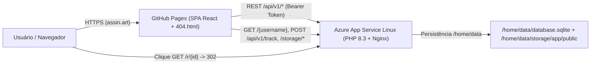

# Plano de Deploy — Assin.art v1 (Backend Laravel + Frontend React)

> **Objetivo:** Publicar a API Laravel (`assinart_v1-back`) no **Azure App Service (Linux / PHP 8.3)** usando a assinatura **Azure for Students** e conectá-la ao frontend React/Vite (`assinart_v1`) hospedado no **GitHub Pages** (`https://assin.art`).
> **Status:** Planejamento atualizado após merge de `origin/develop` em `main` (nenhum deploy executado).
> **Repositórios envolvidos:**
> - Backend: `/data/data/com.termux/files/home/assinart_v1-back` (`https://github.com/pinhogo/assinart_v1-back`, branch `main` @ `e2fc47d`)
> - Frontend: `/data/data/com.termux/files/home/assinart_v1` (`https://github.com/pinhogo/assinart_v1`, branch `main`)

---

## 1. Diagnóstico Técnico Real (Pós-Merge `develop` -> `main`)

### 1.1 Backend (`assinart_v1-back`)
- **Stack (`composer.json`):** PHP `^8.2`, Laravel `^11.0`, Laravel Sanctum `^4.0`. Dependências `require-dev`: `fakerphp/faker`, `laravel/pint`, `mockery/mockery`, `nunomaduro/collision`, `phpunit/phpunit`.
- **Autenticação real (`bootstrap/app.php`, `app/Http/Controllers/Api/AuthController.php`):**
  - `bootstrap/app.php` desabilitou `$middleware->statefulApi()` e configurou `$middleware->validateCsrfTokens(except: ['api/*'])`.
  - `register` e `login` emitem **Bearer Token** via `$artist->createToken('auth_token')->plainTextToken` (tabela `personal_access_tokens`).
  - `AuthController` agora inclui `POST /api/v1/auth/account/delete` e `DELETE /api/v1/auth/account` (`deleteAccount`), além de `ManagesPasswordAndEmail` (onde `forgotPassword` e `resendVerification` ainda não disparam SMTP real — `MAIL_MAILER=log`).
- **CORS (`config/cors.php`):**
  - `'https://assin.art'`, `'http://localhost:5173'` e `'http://127.0.0.1:5173'` **já estão** em `allowed_origins`.
  - `'paths' => ['api/*', 'sanctum/csrf-cookie', '*']` já cobre as rotas raiz (`GET /{username}`, `GET /r/{id}`, `GET /up`), que o frontend acessa fora de `/api/v1`.
  - **Lacuna:** `https://www.assin.art` ainda **não** está listado e `allowed_origins` está fixo no arquivo (sem leitura de `env('CORS_ALLOWED_ORIGINS')`).
- **Proxy Reverso & HTTPS (`bootstrap/app.php`):**
  - Há polyfills condicionais (`!function_exists('mb_split')`, `!class_exists('finfo')`) para compatibilidade local no Termux; em PHP 8.3 no Azure com `mbstring` e `fileinfo` habilitados, são inócuos.
  - O healthcheck nativo do Laravel está ativo em `health: '/up'`, além de `GET /` em `routes/web.php`.
  - **Lacuna crítica:** Falta `$middleware->trustProxies(at: '*');` em `bootstrap/app.php`. Sem confiar nos headers `X-Forwarded-*` do load balancer do Azure:
    1. `$request->ip()` pode resolver o IP interno do proxy, colapsando o `RateLimiter` de `login` (`5/min` em `AuthController.php`) e `/r/{id}` (`throttle:60,1` em `routes/web_public.php`), além de distorcer `visitor_id` fallback em `POST /api/v1/track`.
    2. `url("/r/{$btn->id}")` em `FormatsPublicProfile.php` pode gerar links `http://` em vez de `https://`.
- **Storage de Mídia e Limites de Upload (`config/filesystems.php`, `ManagesProfileMedia.php`, `ManagesButtonReorderAndImage.php`):**
  - Uploads salvam no disco `'public'` em 4 pastas: `avatars/` (até `5120 KB`), `covers/` (até `10240 KB`), `wallpapers/` (até `10240 KB`, via `/api/v1/profile/background` e `/profile/wallpaper`) e `cards/` (até `5120 KB`). Todos usam `Storage::url($path)`.
  - Em `config/filesystems.php`, `'default' => env('FILESYSTEM_DISK', 'local')` e o disco `'public'` monta a URL com `env('APP_URL', 'http://localhost:8000').'/storage'`.
  - **Armadilha 1 (URLs quebradas):** Sem `FILESYSTEM_DISK=public` e `APP_URL=https://assinart-api.azurewebsites.net`, `Storage::url()` retorna caminho relativo (`/storage/...`), fazendo o frontend em `https://assin.art` requisitar `https://assin.art/storage/...` (404 no GitHub Pages).
  - **Armadilha 2 (Perda de arquivos em redeploy):** `/home/site/wwwroot` é sobrescrito a cada deploy ZIP. A pasta física precisa viver em `/home/data/storage/app/public` via symlink.
  - **Armadilha 3 (Erro `413` / limite de 2 MB):** Capas e backgrounds aceitam até `10 MB` (`10240 KB`), mas PHP e Nginx padrão limitam entre `1M` e `8M`. Ambos precisam ser elevados para `12M`–`16M`.
- **Banco de Dados SQLite, Novas Migrations e Telemetria (`database/migrations/`):**
  - Após o merge de `develop`, existem **10 migrations**, incluindo:
    - `2026_11_02_000001_add_typography_and_style_columns.php`
    - `2026_11_02_000002_create_page_views_and_button_clicks_tables.php` (`page_views` e `button_clicks`)
    - `2026_11_12_000001_add_text_align_and_update_buttons_defaults.php`
    - `2026_11_13_000001_add_is_published_to_artists_table.php`
    - `2026_11_14_000001_add_shadow_color_and_circular_shadow_to_artists.php`
    - `2026_11_14_000002_normalize_artist_usernames.php` (data migration que normaliza usernames e registra colisões em log)
  - **Não existe migration da tabela `jobs`**, portanto `QUEUE_CONNECTION` em produção deve ser `sync` (e não `database` como no `.env.example`).
  - `database/database.sqlite` (172 KB) está rastreado no Git e **deve ser excluído** do pacote de deploy.
  - **Impacto de escrita em SQLite:** As novas tabelas `page_views` e `button_clicks` recebem `INSERT` a cada acesso público (`POST /api/v1/track` e `GET /r/{id}`). No App Service Linux (com `/home` sobre SMB/CIFS), manter **instância única**, `SESSION_DRIVER=file` e `CACHE_STORE=file` reduz contenção de locks no SQLite até a migração pós-MVP para PostgreSQL/MySQL gerenciado.
- **Publicação de Perfil (`is_published` / `draft`):**
  - Novos artistas são criados com `'is_published' => false` (`AuthController::register`).
  - `PublicProfileController::show` retorna HTTP `404` (`status: 'draft'`) para perfis não publicados quando acessados anonimamente. Durante o teste E2E em aba anônima, o perfil de teste precisa ser publicado (`PUT/PATCH /api/v1/profile` com `is_published: true` ou `publication_status: 'published'`).
- **Bootstrap Cache & Pastas de Runtime:**
  - `bootstrap/cache/packages.php` e `bootstrap/cache/services.php` estão versionados no Git referenciando `nunomaduro/collision` e `nunomaduro/termwind` (`require-dev`). Devem ser removidos antes de `composer install --no-dev`.
  - Pastas `storage/app/public`, `storage/framework/cache/data` e `storage/framework/sessions` precisam ser criadas no startup.
  - `composer.phar` (3,6 MB) está na raiz e deve ser excluído do artefato de deploy.

### 1.2 Frontend (`assinart_v1`)
- **Stack:** React 19 + Vite 8 + TypeScript 6 + React Router (`BrowserRouter` em `src/routes/AppRoutes.tsx`).
- **Hospedagem:** GitHub Pages com `public/CNAME` = `assin.art` e fallback SPA (`cp dist/index.html dist/404.html` em `.github/workflows/deploy-pages.yml`).
- **Configuração de API (`src/config/env.config.ts`):**
  - Em `MODE=production`, exige `VITE_API_BASE_URL` HTTPS não-loopback e `VITE_USE_MOCK_API === 'false'`; caso contrário ativa `useMockApi = true`.
  - `envConfig.apiHost` é derivado de `VITE_API_BASE_URL` e usado por `publicProfile.service.ts` para chamar `GET ${apiHost}/{username}`.
- **Cliente HTTP (`src/services/api/apiClient.ts`):**
  - Envia `Authorization: Bearer <token>` com `credentials: 'same-origin'` (compatível com a remoção de `statefulApi()` no backend).
  - Timeout padrão de `10000 ms` (`10s`) -> recomenda-se **SKU `B1` com `Always On` habilitado** para evitar *cold start* > 10s.
- **Workflow (`.github/workflows/deploy-pages.yml`):**
  - Já lê `vars.VITE_API_BASE_URL` e `vars.VITE_USE_MOCK_API`. Basta configurar as Repository Variables no GitHub e disparar o workflow.

---

## 2. Arquitetura Alvo



- **Frontend:** `https://assin.art` (GitHub Pages)
- **Backend API (MVP):** `https://assinart-api.azurewebsites.net` (Azure App Service Linux, SKU `B1`, instância única)
- **Persistência (MVP):** `/home/data/database.sqlite` + `/home/data/storage/app/public/{avatars,covers,cards,wallpapers}`
- **Evolução recomendada pós-MVP:**
  - Domínio customizado `https://api.assin.art` (CNAME + Azure Managed Certificate).
  - Azure Database for PostgreSQL ou MySQL Flexible Server (especialmente pelo volume de inserts em `page_views` e `button_clicks`).
  - Azure Blob Storage (driver S3/Blob) para uploads.
  - Provedor SMTP real para `forgot-password` e verificação de e-mail.

---

## 3. Pré-requisitos e Verificações Iniciais (Fase 0)

1. **Autenticação e assinatura ativa no Azure CLI (`az`):**
   ```bash
   az login
   az account show --output table
   ```
   Confirmar assinatura **Azure for Students**.
2. **Disponibilidade de região e SKU Linux `B1`:**
   ```bash
   az appservice list-locations --sku B1 --linux-workers-enabled --output table
   ```
   Priorizar `brazilsouth`; fallback comum para contas Student: `eastus2`.
3. **Unicidade global do nome do Web App (`assinart-api`):**
   Confirmar disponibilidade; caso já esteja em uso, escolher alternativo (ex.: `assinart-api-prod`) e atualizar `APP_URL` e `VITE_API_BASE_URL`.
4. **Ferramentas:** `php` (>= 8.2), `composer`, `zip`, `openssl`, `curl`, `gh` (opcional).

---

## 4. Plano de Execução por Fases

### Fase 1 — Ajustes no Backend (`assinart_v1-back`)

1. **Confiar no proxy reverso do Azure (`bootstrap/app.php`):**
   - Adicionar em `->withMiddleware(function (Middleware $middleware) { ... })`:
     ```php
     $middleware->trustProxies(at: '*');
     ```
   - Preserva IP real do cliente (`RateLimiter` de login, `throttle:60,1` em `/r/{id}`, fallback de `visitor_id` em `/api/v1/track`) e esquema `https` em `url("/r/{$btn->id}")`.

2. **Completar CORS (`config/cors.php`):**
   - Incluir `https://www.assin.art` e suporte via `CORS_ALLOWED_ORIGINS`:
     ```php
     'allowed_origins' => array_values(array_filter(array_unique(array_merge([
         'http://localhost:5173',
         'https://assin.art',
         'https://www.assin.art',
         'http://127.0.0.1:5173',
     ], explode(',', (string) env('CORS_ALLOWED_ORIGINS', '')))))),
     ```

3. **Configurar Nginx (`azure/nginx.conf`):**
   - `root /home/site/wwwroot/public;`
   - `client_max_body_size 16M;` (suporta `10240 KB` de capa/wallpaper + overhead multipart)
   - `try_files $uri $uri/ /index.php?$query_string;`
   - Bloquear arquivos ocultos (`location ~ /\.(?!well-known).* { deny all; }`) e **bloquear execução PHP dentro de `/storage/`** (`location ~* ^/storage/.*\.php$ { deny all; }`).

4. **Configurar limites PHP (`azure/php-uploads.ini`):**
   - Via `PHP_INI_SCAN_DIR=/usr/local/etc/php/conf.d:/home/site/wwwroot/azure`:
     ```ini
     upload_max_filesize = 12M
     post_max_size = 16M
     memory_limit = 256M
     max_execution_time = 60
     expose_php = Off
     ```

5. **Criar script de startup idempotente (`azure/startup.sh`):**
   ```bash
   #!/usr/bin/env bash
   set -euo pipefail

   mkdir -p /home/data/storage/app/public/{avatars,covers,cards,wallpapers}
   mkdir -p /home/site/wwwroot/storage/app
   mkdir -p /home/site/wwwroot/storage/framework/{sessions,views,cache/data}
   mkdir -p /home/site/wwwroot/storage/logs

   if [ "${DB_CONNECTION:-sqlite}" = "sqlite" ] && [ -n "${DB_DATABASE:-}" ]; then
     mkdir -p "$(dirname "$DB_DATABASE")"
     touch "$DB_DATABASE"
   fi

   rm -rf /home/site/wwwroot/storage/app/public
   ln -sfn /home/data/storage/app/public /home/site/wwwroot/storage/app/public
   ln -sfn /home/data/storage/app/public /home/site/wwwroot/public/storage

   cd /home/site/wwwroot
   php artisan migrate --force
   php artisan optimize:clear
   php artisan config:cache
   php artisan route:cache
   php artisan view:cache

   cp /home/site/wwwroot/azure/nginx.conf /etc/nginx/sites-available/default
   nginx -t
   service nginx reload
   ```

6. **Aplicar correções de segurança pré-produção (ver [SECURITY_AUDIT.md](file:///data/data/com.termux/files/home/assinart_v1-back/SECURITY_AUDIT.md)) e validar suíte local:**
   - Executar `php artisan test` (incluindo os novos testes de métricas, publicação/draft, normalização de username, account deletion e background media) garantindo exit code `0`.

---

### Fase 2 — Provisionamento no Azure (`az` CLI)

```bash
RG="rg-assinart-prod"
LOCATION="brazilsouth" # fallback: eastus2
PLAN="plan-assinart-prod"
APP_NAME="assinart-api"

az group create --name "$RG" --location "$LOCATION"

az appservice plan create \
  --name "$PLAN" \
  --resource-group "$RG" \
  --location "$LOCATION" \
  --sku B1 \
  --is-linux

az webapp create \
  --resource-group "$RG" \
  --plan "$PLAN" \
  --name "$APP_NAME" \
  --runtime "PHP:8.3"

az webapp update --resource-group "$RG" --name "$APP_NAME" --https-only true

az webapp config set \
  --resource-group "$RG" \
  --name "$APP_NAME" \
  --always-on true \
  --ftps-state Disabled \
  --min-tls-version 1.2 \
  --http20-enabled true \
  --startup-file "/home/site/wwwroot/azure/startup.sh"

az webapp log config \
  --resource-group "$RG" \
  --name "$APP_NAME" \
  --application-logging filesystem \
  --level information \
  --web-server-logging filesystem
```

---

### Fase 3 — Configuração de App Settings (Variáveis de Ambiente)

```bash
APP_KEY="base64:$(openssl rand -base64 32)"

az webapp config appsettings set \
  --resource-group "$RG" \
  --name "$APP_NAME" \
  --settings \
    APP_NAME="Assinart" \
    APP_ENV="production" \
    APP_DEBUG="false" \
    APP_KEY="$APP_KEY" \
    APP_TIMEZONE="America/Sao_Paulo" \
    APP_LOCALE="pt_BR" \
    APP_URL="https://${APP_NAME}.azurewebsites.net" \
    FRONTEND_URL="https://assin.art" \
    CORS_ALLOWED_ORIGINS="https://assin.art,https://www.assin.art" \
    SANCTUM_STATEFUL_DOMAINS="assin.art,www.assin.art" \
    DB_CONNECTION="sqlite" \
    DB_DATABASE="/home/data/database.sqlite" \
    FILESYSTEM_DISK="public" \
    SESSION_DRIVER="file" \
    CACHE_STORE="file" \
    QUEUE_CONNECTION="sync" \
    LOG_CHANNEL="stderr" \
    LOG_LEVEL="warning" \
    MAIL_MAILER="log" \
    WEBSITES_ENABLE_APP_SERVICE_STORAGE="true" \
    PHP_INI_SCAN_DIR="/usr/local/etc/php/conf.d:/home/site/wwwroot/azure"
```

---

### Fase 4 — Build Limpo, Empacotamento e Deploy do Backend

1. **Exportar árvore limpa e preparar `vendor/` de produção:**
   ```bash
   rm -rf /tmp/assinart-build /tmp/assinart-back.zip
   mkdir -p /tmp/assinart-build
   git archive --format=tar HEAD | tar -x -C /tmp/assinart-build
   cd /tmp/assinart-build

   rm -f bootstrap/cache/*.php database/database.sqlite composer.phar \
         DEPLOY_PLAN.md deploy-prompt.json SECURITY_AUDIT.md README-local.md
   rm -rf tests storage/logs/*.log

   composer install --no-dev --optimize-autoloader --no-interaction --prefer-dist
   chmod +x azure/startup.sh
   zip -rq /tmp/assinart-back.zip . -x "*.git*" ".env*"
   ```
   *(Idealmente executar em ambiente PHP 8.3, como GitHub Actions `ubuntu-latest` + `shivammathur/setup-php@v2`.)*

2. **Publicar e acompanhar logs:**
   ```bash
   az webapp deploy \
     --resource-group "$RG" \
     --name "$APP_NAME" \
     --src-path /tmp/assinart-back.zip \
     --type zip

   az webapp log tail --resource-group "$RG" --name "$APP_NAME"
   ```

3. **Smoke tests do backend:**
   - `GET https://${APP_NAME}.azurewebsites.net/up` -> `200 OK`
   - `GET https://${APP_NAME}.azurewebsites.net/` -> `200 OK` (`status: "operational"`)
   - `GET https://${APP_NAME}.azurewebsites.net/api/v1/usernames/check?username=teste_deploy` -> `200 OK`
   - `OPTIONS` preflight com `Origin: https://assin.art` -> `204 No Content` com `Access-Control-Allow-Origin: https://assin.art`

---

### Fase 5 — Conexão do Frontend (`assinart_v1`) no GitHub Pages

```bash
gh variable set VITE_API_BASE_URL --repo pinhogo/assinart_v1 --body "https://assinart-api.azurewebsites.net/api/v1"
gh variable set VITE_USE_MOCK_API --repo pinhogo/assinart_v1 --body "false"
gh workflow run deploy-pages.yml --repo pinhogo/assinart_v1 --ref main
```

Confirmar no log do GitHub Actions que `npm run test && npm run build` concluiu sem erros e publicou `dist/404.html`.

---

## 5. Validação End-to-End (Fase 6)

Executar em **aba anônima**:

1. **Cadastro e Onboarding (`/cadastro`):**
   - Acessar `https://assin.art/cadastro` e verificar `GET /api/v1/usernames/check` no Network.
   - Registrar usuário (`POST /api/v1/auth/register` -> `201`) e concluir etapas de onboarding (`PUT /api/v1/onboarding/*` -> `200` com `Authorization: Bearer ...`).
2. **Uploads de mídia (> 2 MB):**
   - No `/editor`, enviar avatar (`<= 5 MB`), capa (`> 2 MB` e `<= 10 MB`) e background/wallpaper (`POST /api/v1/profile/background`).
   - Confirmar URLs retornadas em `https://assinart-api.azurewebsites.net/storage/...` carregando com `200 OK`.
3. **Publicação e Página Pública (`is_published`):**
   - Publicar perfil no editor (`PATCH /api/v1/profile` com `is_published: true` / `publication_status: "published"`), pois contas novas iniciam como `draft` (`404` público).
   - Abrir `https://assin.art/{username}` -> confirmar `GET https://assinart-api.azurewebsites.net/{username}` (`200 OK`) e disparo de `POST /api/v1/track` (`204`).
4. **Rastreador de cliques e Métricas:**
   - Clicar em botão (`GET /r/{id}` -> `302 Found`) e verificar atualização em `GET /api/v1/metrics/summary`.
5. **Persistência pós-restart:**
   - Rodar `az webapp restart --resource-group "$RG" --name "$APP_NAME"` e confirmar que banco `/home/data/database.sqlite` e uploads em `/home/data/storage/app/public` permanecem intactos.

---

## 6. Plano de Rollback

1. **Frontend:** Alterar `VITE_USE_MOCK_API` para `true` nas GitHub Variables e reexecutar `deploy-pages.yml` para restaurar o modo demo imediatamente.
2. **Backend:** Manter backup de `/home/data/database.sqlite` antes de deploys com novas migrations; em caso de falha, reimplantar o ZIP anterior estável via `az webapp deploy --type zip` e reiniciar o Web App.
