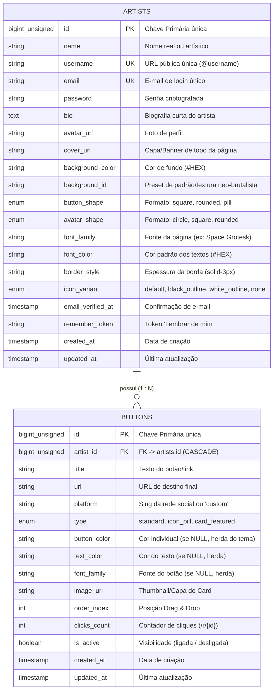

# Assin.art v1 — Backend API (Laravel 11)

> **Escopo:** API Oficial do Backend da **Assin.art v1 (Plataforma de Link na Bio para Artistas)**  
> **Stack:** PHP 8.2+ · Laravel 11 · SQLite (Desenvolvimento Local) · MySQL 8+ / PostgreSQL (Produção)  
> **Arquitetura:** MVC Padrão do Laravel (CRUD direto com Eloquent ORM, 2 tabelas integradas, sem sobrecarga de DDD)

---

## 1. Visão Geral do Projeto

A **Assin.art v1** é uma plataforma focada em artistas e criadores de conteúdo para centralizar seus links, redes sociais, portfólio e lançamentos em uma página com estética **Neo-Brutalista** de alto contraste (bordas grossas pretas, sombras sólidas projetadas e tipografia expressiva).

Este repositório isolado (`assinart_v1_backend`) contém a API RESTful e as rotas web para atender 100% dos fluxos do frontend:
- **Landing Page (`/`)**: Verificação e reserva em tempo real de `@username`.
- **Autenticação (`/cadastro`, `/entrar`, `/esqueci-senha`, `/confirmacao-email`)**: Criação de conta unificada, login seguro por sessão/Sanctum e recuperação de credenciais.
- **Onboarding em 3 Etapas (`/cadastro/personalizacao/links`, `/fundo`, `/botoes`)**: Seleção de até 5 redes iniciais, foto de perfil, bio, escolha de cor de fundo (paleta de 17 cores + custom) e formato dos botões (`square`, `rounded`, `pill`).
- **Editor de Perfil (`/editor`)**: Gestão de perfil, avatar, capa/banner do topo da página, CRUD de botões e reordenação interativa via Drag & Drop.
- **Página Pública (`/:username`)**: Carregamento público de alta performance (1 query otimizada com eager loading).
- **Rastreador de Cliques (`/r/{id}`)**: Redirecionamento instantâneo HTTP 302 com incremento atômico de contagem de cliques.

---

## 2. Estrutura do Repositório (MVC Padrão Laravel)

```text
assinart_v1_backend/
├── app/
│   ├── Http/
│   │   └── Controllers/
│   │       ├── Controller.php
│   │       ├── PublicProfileController.php  -> GET /{username} (carrega perfil público e botões ativos)
│   │       ├── RedirectController.php       -> GET /r/{id} (incrementa clique + redirect 302)
│   │       └── Api/
│   │           ├── ButtonController.php     -> CRUD de links e Drag & Drop (/api/v1/buttons/reorder)
│   │           └── ProfileController.php    -> Bio, aparência, upload de avatar e capa/banner
│   └── Models/
│       ├── Artist.php                       -> Auth, casts, relacionamentos e Route Model Binding
│       └── Button.php                       -> Casts, belongsTo e Accessors de herança visual
├── database/
│   ├── database.sqlite                      -> Banco de dados SQLite local (zero-config)
│   ├── factories/
│   │   ├── ArtistFactory.php
│   │   └── ButtonFactory.php
│   ├── migrations/
│   │   ├── 0001_01_01_000000_create_artists_table.php
│   │   ├── 0001_01_01_000001_create_buttons_table.php
│   │   └── 0001_01_01_000002_create_cache_table.php
│   └── seeders/
│       └── DatabaseSeeder.php               -> Perfil de teste Neo-Brutalista com 5 links reais
├── docs/
│   └── DATA_DICTIONARY.md                   -> Dicionário de dados consolidado
├── routes/
│   ├── web.php                              -> Rotas públicas (/ e /{username} e /r/{id})
│   └── api.php                              -> Endpoints autenticados (/api/v1/...)
├── composer.json                            -> Dependências do Laravel 11
├── README.md                                -> Guia oficial do projeto
└── .env / .env.example                      -> Configurado para SQLite nativo
```

---

## 3. Modelagem do Banco de Dados (2 Tabelas Integradas)

Para garantir máxima simplicidade no MVP da v1 e eliminar joins lentos ou registros órfãos, o schema relacional foi consolidado em **2 tabelas**:
1. **`artists`**: Armazena dados cadastrais, autenticação, capa do perfil e todo o tema visual da página.
2. **`buttons`**: Armazena links, redes sociais, formatos (`standard`, `icon_pill`, `card_featured`), capa do card e métricas de cliques.

### 3.1 Diagrama Entidade-Relacionamento



---

### 3.2 Tabela `artists` (`App\Models\Artist`)

| Coluna | Tipo SQL | Restrições | Descrição Funcional |
|---|---|---|---|
| `id` | `BIGINT UNSIGNED` | `PK`, `AUTO_INCREMENT` | Identificador único e imutável do artista |
| `name` | `VARCHAR(100)` | `NOT NULL` | Nome real ou artístico exibido no perfil |
| `username` | `VARCHAR(50)` | `UNIQUE`, `NOT NULL`, `INDEX` | `@` na URL `assin.art/{username}` (alterável no painel) |
| `email` | `VARCHAR(255)` | `UNIQUE`, `NOT NULL` | E-mail para login e recuperação de senha |
| `password` | `VARCHAR(255)` | `NOT NULL` | Hash da senha (Bcrypt / Argon2id) |
| `bio` | `VARCHAR(500)` | `NULLABLE` | Biografia curta (até 160 caracteres) |
| `avatar_url` | `VARCHAR(2048)` | `NULLABLE` | URL da foto de perfil |
| `cover_url` | `VARCHAR(2048)` | `NULLABLE` | **Banner / Capa no topo da página** |
| `background_color` | `VARCHAR(20)` | `DEFAULT '#FFFFFF'` | Cor de fundo da página em hexadecimal |
| `background_id` | `VARCHAR(50)` | `NULLABLE` | Preset de padrão ou textura neo-brutalista (`dots-grid`, etc.) |
| `button_shape` | `ENUM` | `DEFAULT 'square'` | Formato global dos botões: `'square'`, `'rounded'`, `'pill'` |
| `avatar_shape` | `ENUM` | `DEFAULT 'circle'` | Formato do avatar: `'circle'`, `'square'`, `'rounded'` |
| `font_family` | `VARCHAR(50)` | `DEFAULT 'Space Grotesk'` | Tipografia global dos títulos e página |
| `font_color` | `VARCHAR(20)` | `DEFAULT '#000000'` | Cor padrão dos textos |
| `border_style` | `VARCHAR(30)` | `DEFAULT 'solid-3px'` | Espessura da borda neo-brutalista |
| `icon_variant` | `ENUM` | `DEFAULT 'default'` | Estilo dos ícones: `'default'`, `'black_outline'`, `'white_outline'`, `'none'` |
| `email_verified_at`| `TIMESTAMP` | `NULLABLE` | Data e hora de confirmação do e-mail |
| `remember_token` | `VARCHAR(100)` | `NULLABLE` | Token de persistência de sessão |
| `created_at` / `updated_at` | `TIMESTAMP` | `NULLABLE` | Timestamps padrão do Eloquent |

---

### 3.3 Tabela `buttons` (`App\Models\Button`)

| Coluna | Tipo SQL | Restrições | Descrição Funcional |
|---|---|---|---|
| `id` | `BIGINT UNSIGNED` | `PK`, `AUTO_INCREMENT` | Identificador único do botão |
| `artist_id` | `BIGINT UNSIGNED` | `FK -> artists.id`, `CASCADE` | Artista proprietário do botão |
| `title` | `VARCHAR(100)` | `NOT NULL` | Rótulo/texto exibido no botão |
| `url` | `VARCHAR(2048)` | `NOT NULL` | Link de destino final |
| `platform` | `VARCHAR(50)` | `DEFAULT 'custom'` | Rede social (`spotify`, `instagram`, `youtube`, `custom`, etc.) |
| `type` | `ENUM` | `DEFAULT 'standard'` | Formato: `'standard'`, `'icon_pill'`, `'card_featured'` |
| `button_color` | `VARCHAR(20)` | `NULLABLE` | Cor individual (se `NULL`, herda a cor do tema da página) |
| `text_color` | `VARCHAR(20)` | `NULLABLE` | Cor do texto (se `NULL`, herda `artists.font_color`) |
| `font_family` | `VARCHAR(50)` | `NULLABLE` | **Fonte individual** (se `NULL`, herda `artists.font_family`) |
| `image_url` | `VARCHAR(2048)` | `NULLABLE` | Imagem de capa/thumbnail para o tipo `card_featured` |
| `order_index` | `INT UNSIGNED` | `DEFAULT 0`, `INDEX` | Posição de ordenação para **Drag & Drop** |
| `clicks_count` | `INT UNSIGNED` | `DEFAULT 0` | Cliques contabilizados via `/r/{id}` |
| `is_active` | `BOOLEAN` | `DEFAULT TRUE`, `INDEX` | Define se o botão está ativo ou oculto |
| `created_at` / `updated_at` | `TIMESTAMP` | `NULLABLE` | Timestamps padrão do Eloquent |

Para a especificação completa de cada coluna e índices, consulte o [Dicionário de Dados](docs/DATA_DICTIONARY.md).

---

## 4. Matriz de Herança Visual (Fallback Cascade)

O sistema adota o padrão de **Herança Inteligente com Fallback**. O frontend e o backend resolvem os estilos da seguinte forma:

```text
Botão Renderizado:
├── Fonte:       buttons.font_family ?? artists.font_family ?? 'Space Grotesk'
├── Cor Texto:   buttons.text_color  ?? artists.font_color  ?? '#000000'
├── Cor Fundo:   buttons.button_color ?? (tema da página / '#FFE600')
├── Formato:     artists.button_shape (uniforme em toda a página: square | rounded | pill)
├── Borda:       artists.border_style (uniforme em toda a página: solid-3px)
└── Ícone:       SVG da plataforma (renderizado segundo artists.icon_variant)
```

### 4.1 Tipos de Botão Suportados
- **`standard`**: O botão retangular padrão em largura total do Assin.art.
- **`icon_pill`**: Botões compactos/circulares de redes sociais logo abaixo da bio.
- **`card_featured`**: Card com thumbnail/imagem de capa (`image_url`), título em negrito e link de destaque (ex.: *"Novo Álbum no Spotify"*, *"Vídeo no YouTube"*).

---

## 5. Rota de Redirecionamento e Contador de Cliques (`/r/{id}`)

O rastreador de cliques opera de forma atômica e sem overhead de latência:
1. No perfil público `assin.art/{username}`, os botões apontam para `/r/{button_id}`.
2. O Laravel incrementa atomicamente `clicks_count`.
3. Executa imediatamente um redirecionamento HTTP `302` (Found) para a URL de destino final.

```php
// App\Http\Controllers\RedirectController.php
public function redirect(int $id): RedirectResponse
{
    $button = Button::where('id', $id)
        ->where('is_active', true)
        ->firstOrFail();

    $button->increment('clicks_count');

    return redirect()->away($button->url, 302);
}
```

---

## 6. Reordenação Drag & Drop de Botões

Ao arrastar e soltar os links no painel, o frontend envia uma requisição única:

```http
POST /api/v1/buttons/reorder
Content-Type: application/json

{
  "ordered_ids": [14, 10, 12, 11]
}
```

O backend aplica a nova ordenação em transação de banco com performance instantânea:

```php
// App\Http\Controllers\Api\ButtonController.php
public function reorder(Request $request): JsonResponse
{
    $artist = $request->user();
    $validated = $request->validate([
        'ordered_ids' => 'required|array',
        'ordered_ids.*' => 'integer|exists:buttons,id',
    ]);

    DB::transaction(function () use ($artist, $validated) {
        foreach ($validated['ordered_ids'] as $index => $id) {
            $artist->buttons()
                ->where('id', $id)
                ->update(['order_index' => $index]);
        }
    });

    return response()->json([
        'status' => 'success',
        'message' => 'Ordem dos botões atualizada com sucesso.',
    ]);
}
```

---

## 7. Mapa Completo de Endpoints

### 7.1 Rotas Web Públicas

| Método | Rota | Descrição |
|---|---|---|
| `GET` | `/{username}` | Retorna o perfil completo do artista com tema visual e botões ativos |
| `GET` | `/r/{id}` | Computa clique e redireciona (302) para a URL de destino |

### 7.2 Rotas da API (`/api/v1`)

| Método | Endpoint | Auth | Descrição |
|---|---|---|---|
| `GET` | `/api/v1/usernames/check` | Pública | Verifica se `@username` está disponível |
| `POST` | `/api/v1/auth/register` | Pública | Cadastro de novo artista |
| `POST` | `/api/v1/auth/login` | Pública | Autenticação por e-mail e senha |
| `POST` | `/api/v1/auth/logout` | Autenticado | Encerramento de sessão |
| `GET` | `/api/v1/profile` | Autenticado | Retorna dados completos do perfil para o editor |
| `PUT` | `/api/v1/profile` | Autenticado | Atualiza bio, username, paleta de cores e preferências |
| `POST` | `/api/v1/profile/avatar` | Autenticado | Upload de foto de perfil (JPG, PNG, WebP até 5MB) |
| `POST` | `/api/v1/profile/cover` | Autenticado | Upload de banner de capa no topo da página (até 10MB) |
| `GET` | `/api/v1/buttons` | Autenticado | Lista todos os botões do artista ordenados por `order_index` |
| `POST` | `/api/v1/buttons` | Autenticado | Cadastra novo botão/link |
| `PUT` | `/api/v1/buttons/{id}` | Autenticado | Atualiza botão existente |
| `DELETE` | `/api/v1/buttons/{id}` | Autenticado | Remove botão |
| `POST` | `/api/v1/buttons/reorder` | Autenticado | Atualiza a ordem dos botões via Drag & Drop |

---

## 8. Guia de Instalação e Execução Local

### Pré-requisitos
- **PHP** >= 8.2 (extensões recomendadas: `pdo_sqlite`, `mbstring`, `openssl`, `curl`)
- **Composer** >= 2.6

### Passo a Passo

```bash
# 1. Clonar ou navegar até a pasta do backend
cd assinart_v1_backend

# 2. Instalar as dependências do Composer
composer install

# 3. Configurar variáveis de ambiente e banco SQLite
cp .env.example .env
php artisan key:generate

# 4. Executar as Migrations e popular com dados de demonstração
php artisan migrate --seed

# 5. Criar link simbólico para uploads de avatares e capas
php artisan storage:link

# 6. Iniciar o servidor local de desenvolvimento
php artisan serve
```

A API estará respondendo em: `http://localhost:8000`

---

## 9. Integração com o Frontend (`assinart_v1`)

No repositório do frontend (`assinart_v1`), configure a URL base da API no arquivo `.env`:

```env
VITE_API_BASE_URL=http://localhost:8000
```

Todas as requisições de páginas públicas e chamadas de API se comunicarão com o backend de forma transparente.

---

## 📄 Licença e Propriedade
Propriedade de **Assin.art**. Todos os direitos reservados.
