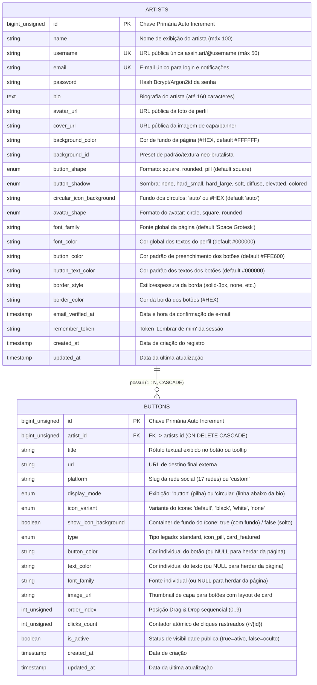

# Especificação de Backend — Assin.art v1 (`backend.md`)

> **Escopo:** Exclusivo da **Assin.art v1 (Plataforma de Link na Bio para Artistas)**  
> **Repositório do Backend:** `assinart_v1_backend` (`../assinart_v1_backend`)  
> **Stack:** PHP 8.2+ · Laravel 11 · SQLite (Desenvolvimento) · MySQL 8+ / PostgreSQL (Produção)  
> **Arquitetura:** MVC Padrão do Laravel 11 (CRUD direto com Eloquent ORM, 2 tabelas integradas, sem sobrecarga de microsserviços ou DDD excessivo)  
> **Última Atualização:** 2026-10-22 — Especificação Completa com Estilização Avançada de Links, Ícones P&B, Modo Circular, Sombras Neo-Brutalistas e Teto de 10 Links.

---

## 1. Visão Geral e Arquitetura do Sistema

O backend da **Assin.art v1** é uma aplicação monolítica elegante e de altíssimo desempenho desenvolvida em **Laravel 11** no repositório isolado `assinart_v1_backend`. A API foi modelada para atender com zero atrito, resposta sub-20ms e total fidelidade estética todas as interfaces e fluxos do frontend React (`assinart_v1`):

1. **Landing Page (`/`)**: Verificação em tempo real de disponibilidade de `@username` com sanitização do `@` inicial e bloqueio de rotas reservadas.
2. **Autenticação (`/cadastro`, `/entrar`, `/esqueci-senha`, `/confirmacao-email`)**: Registro unificado de artista, login com proteção anti-força bruta via RateLimiter, tokens Sanctum / sessão web HttpOnly e confirmação de e-mail.
3. **Onboarding em 3 Etapas (`/cadastro/personalizacao/*`)**:
   - **Etapa 1 — Links (`/cadastro/links`)**: Carrossel horizontal de redes sociais (sem Website), botão para link personalizado avulso, lista unificada com padrão do editor (título, URL, visibilidade, reordenação e exclusão) e limite global de **até 10 itens agregados**.
   - **Etapa 2 — Fundo e Capa (`/fundo`)**: Paleta de 17 cores + seletor hexadecimal personalizado, texturas neo-brutalistas e upload/recorte de banner panorâmico de capa.
   - **Etapa 3 — Botões e Estilo (`/botoes`)**: Formato dos botões (`square`, `rounded`, `pill`), seletor de 7 estilos de sombra (`button_shadow`), seletor de fundo dos ícones circulares (`circular_icon_background`), cores e bordas.
4. **Editor de Perfil (`/editor`)**: Gestão de perfil, edição de bio, upload de avatar com exclusão atômica de arquivos antigos, CRUD de botões com controle individual de estilo (`icon_variant`, `show_icon_background`, `display_mode`) e reordenação atômica Drag & Drop em transação de banco.
5. **Página Pública (`/:username`)**: Visualização pública servida em uma única consulta otimizada (1 query SQL com eager loading), separando logicamente os links em linha circular abaixo da bio (`circular_links`) e botões principais empilhados (`button_links`), com resolução de herança visual cascade.
6. **Rastreador de Cliques (`/r/{id}`)**: Redirecionamento instantâneo HTTP 302 direto para a URL de destino com incremento atômico de `clicks_count` e mitigação de bots por rate limit leve.

---

## 2. Modelagem Consolidada do Banco de Dados (2 Tabelas)

Para preservar a máxima simplicidade operacional, facilidade de migração e velocidade no Eloquent ORM, o banco de dados adota **2 tabelas integradas**:
1. **`artists`**: consolida credenciais de autenticação, dados cadastrais, preferências visuais globais (fundo, capa, tipografia, sombras e fundo dos ícones circulares).
2. **`buttons`**: consolida botões de redes sociais e links personalizados, formato de exibição (`button` ou `circular`), estilo de ícone (`default`, `black`, `white`, `none`), fundo de ícone (`show_icon_background`), ordenação e métricas de clique.

### 2.1 Diagrama Entidade-Relacionamento (Mermaid ERD)



---

### 2.2 Dicionário de Dados: Tabela `artists` (`App\Models\Artist`)

| Coluna | Tipo SQL | Restrições / Index | Valor Default | Descrição Detalhada |
|---|---|---|---|---|
| `id` | `BIGINT UNSIGNED` | `PK`, `AUTO_INCREMENT` | — | Identificador numérico primário do artista |
| `name` | `VARCHAR(100)` | `NOT NULL` | — | Nome artístico ou de exibição |
| `username` | `VARCHAR(50)` | `UNIQUE`, `NOT NULL`, `INDEX` | — | `@username` limpo na URL pública (letras minúsculas, números, `_`, `-`, `.`) |
| `email` | `VARCHAR(255)` | `UNIQUE`, `NOT NULL`, `INDEX` | — | E-mail corporativo/pessoal do artista para autenticação |
| `password` | `VARCHAR(255)` | `NOT NULL` | — | Senha criptografada via Bcrypt / Argon2id |
| `bio` | `VARCHAR(500)` | `NULLABLE` | `NULL` | Biografia do artista (recomendado até 160 caracteres) |
| `avatar_url` | `VARCHAR(2048)` | `NULLABLE` | `NULL` | URL pública da foto de perfil recortada no storage |
| `cover_url` | `VARCHAR(2048)` | `NULLABLE` | `NULL` | URL pública do banner panorâmico de topo |
| `background_color` | `VARCHAR(20)` | `NOT NULL` | `'#FFFFFF'` | Cor de fundo em formato hexadecimal (`#HEX`) |
| `background_id` | `VARCHAR(50)` | `NULLABLE` | `NULL` | ID de padrão/textura neo-brutalista (ex: `dots-grid`, `cross`, `solid`) |
| `button_shape` | `ENUM` | `NOT NULL` | `'square'` | Formato global dos botões: `'square'`, `'rounded'`, `'pill'` |
| `button_shadow` | `ENUM` | `NOT NULL` | `'hard_small'` | Estilo de sombra: `'none'`, `'hard_small'`, `'hard_large'`, `'soft'`, `'diffuse'`, `'elevated'`, `'colored'` *(substitui o antigo booleano has_shadow)* |
| `circular_icon_background` | `VARCHAR(20)` | `NOT NULL` | `'auto'` | Fundo dos botões circulares: `'auto'` ou hexadecimal `#HEX` |
| `avatar_shape` | `ENUM` | `NOT NULL` | `'circle'` | Formato de exibição do avatar: `'circle'`, `'square'`, `'rounded'` |
| `font_family` | `VARCHAR(50)` | `NOT NULL` | `'Space Grotesk'` | Fonte tipográfica global da página |
| `font_color` | `VARCHAR(20)` | `NOT NULL` | `'#000000'` | Cor dos textos do perfil (nome, `@username`, bio) |
| `button_color` | `VARCHAR(20)` | `NOT NULL` | `'#FFE600'` | Cor global de preenchimento dos botões |
| `button_text_color` | `VARCHAR(20)` | `NOT NULL` | `'#000000'` | Cor global dos rótulos dos botões |
| `border_style` | `VARCHAR(30)` | `NOT NULL` | `'solid-3px'` | Espessura/estilo da borda (`solid-2px`, `solid-3px`, `none`) |
| `border_color` | `VARCHAR(20)` | `NOT NULL` | `'#000000'` | Cor da borda dos botões |
| `email_verified_at`| `TIMESTAMP` | `NULLABLE` | `NULL` | Timestamp de validação de propriedade do e-mail |
| `remember_token` | `VARCHAR(100)` | `NULLABLE` | `NULL` | Token de persistência de sessão "Lembrar de mim" |
| `created_at` | `TIMESTAMP` | `NULLABLE` | `CURRENT_TIMESTAMP` | Data/hora de registro no sistema |
| `updated_at` | `TIMESTAMP` | `NULLABLE` | `CURRENT_TIMESTAMP` | Data/hora da última alteração de perfil |

---

### 2.3 Dicionário de Dados: Tabela `buttons` (`App\Models\Button`)

| Coluna | Tipo SQL | Restrições / Index | Valor Default | Descrição Detalhada |
|---|---|---|---|---|
| `id` | `BIGINT UNSIGNED` | `PK`, `AUTO_INCREMENT` | — | Identificador primário do botão/link |
| `artist_id` | `BIGINT UNSIGNED` | `FK -> artists.id`, `CASCADE`, `INDEX` | — | ID do artista proprietário do link |
| `title` | `VARCHAR(100)` | `NOT NULL` | — | Rótulo textual do botão (ex: "Ouça no Spotify", "Portfólio") |
| `url` | `VARCHAR(2048)` | `NOT NULL` | — | URL externa de redirecionamento final |
| `platform` | `VARCHAR(50)` | `NOT NULL`, `INDEX` | `'custom'` | Identificador da plataforma social (`instagram`, `youtube`, etc.) ou `'custom'` |
| `display_mode` | `ENUM` | `NOT NULL`, `INDEX` | `'button'` | Modo de renderização: `'button'` (botão largo na pilha) ou `'circular'` (ícone circular abaixo da bio) |
| `icon_variant` | `ENUM` | `NOT NULL` | `'default'` | Variante visual do ícone: `'default'` (colorido oficial), `'black'` (P&B preto), `'white'` (P&B branco), `'none'` (sem ícone) |
| `show_icon_background` | `BOOLEAN` | `NOT NULL` | `TRUE` | `true`: container quadrado/circular com fundo e borda; `false`: ícone solto sem caixa. *(Travado em `true` se `display_mode='circular'`; desabilitado se `icon_variant='none'`)* |
| `type` | `ENUM` | `NOT NULL` | `'standard'` | Formato legado: `'standard'`, `'icon_pill'`, `'card_featured'` |
| `button_color` | `VARCHAR(20)` | `NULLABLE` | `NULL` | Cor individual do botão (se `NULL`, herda `artists.button_color`) |
| `text_color` | `VARCHAR(20)` | `NULLABLE` | `NULL` | Cor individual do texto (se `NULL`, herda `artists.button_text_color`) |
| `font_family` | `VARCHAR(50)` | `NULLABLE` | `NULL` | Fonte individual (se `NULL`, herda `artists.font_family`) |
| `image_url` | `VARCHAR(2048)` | `NULLABLE` | `NULL` | Thumbnail para botões com destaque de card |
| `order_index` | `INT UNSIGNED` | `NOT NULL`, `INDEX` | `0` | Posição sequencial na listagem (0 a 9) para ordenação manual e Drag & Drop |
| `clicks_count` | `INT UNSIGNED` | `NOT NULL`, `INDEX` | `0` | Métrica de engajamento acumulada pela rota `/r/{id}` |
| `is_active` | `BOOLEAN` | `NOT NULL`, `INDEX` | `TRUE` | Visibilidade pública (`true` = visível, `false` = oculto) |
| `created_at` | `TIMESTAMP` | `NULLABLE` | `CURRENT_TIMESTAMP` | Data/hora de criação do botão |
| `updated_at` | `TIMESTAMP` | `NULLABLE` | `CURRENT_TIMESTAMP` | Data/hora da última alteração de dados |

---

## 3. Migrations Oficiais do Laravel 11

### 3.1 Migration `0001_01_01_000000_create_artists_table.php`

```php
<?php

use Illuminate\Database\Migrations\Migration;
use Illuminate\Database\Schema\Blueprint;
use Illuminate\Support\Facades\Schema;

return new class extends Migration
{
    public function up(): void
    {
        Schema::create('artists', function (Blueprint $table) {
            $table->id();
            $table->string('name', 100);
            $table->string('username', 50)->unique();
            $table->string('email', 255)->unique();
            $table->string('password', 255);
            $table->string('bio', 500)->nullable();
            $table->string('avatar_url', 2048)->nullable();
            $table->string('cover_url', 2048)->nullable();
            $table->string('background_color', 20)->default('#FFFFFF');
            $table->string('background_id', 50)->nullable();
            $table->enum('button_shape', ['square', 'rounded', 'pill'])->default('square');
            $table->enum('button_shadow', [
                'none',
                'hard_small',
                'hard_large',
                'soft',
                'diffuse',
                'elevated',
                'colored'
            ])->default('hard_small');
            $table->string('circular_icon_background', 20)->default('auto');
            $table->enum('avatar_shape', ['circle', 'square', 'rounded'])->default('circle');
            $table->string('font_family', 50)->default('Space Grotesk');
            $table->string('font_color', 20)->default('#000000');
            $table->string('button_color', 20)->default('#FFE600');
            $table->string('button_text_color', 20)->default('#000000');
            $table->string('border_style', 30)->default('solid-3px');
            $table->string('border_color', 20)->default('#000000');
            $table->timestamp('email_verified_at')->nullable();
            $table->rememberToken();
            $table->timestamps();

            $table->index('username');
            $table->index('email');
        });
    }

    public function down(): void
    {
        Schema::dropIfExists('artists');
    }
};
```

---

### 3.2 Migration `0001_01_01_000001_create_buttons_table.php`

```php
<?php

use Illuminate\Database\Migrations\Migration;
use Illuminate\Database\Schema\Blueprint;
use Illuminate\Support\Facades\Schema;

return new class extends Migration
{
    public function up(): void
    {
        Schema::create('buttons', function (Blueprint $table) {
            $table->id();
            $table->foreignId('artist_id')->constrained('artists')->onDelete('cascade');
            $table->string('title', 100);
            $table->string('url', 2048);
            $table->string('platform', 50)->default('custom');
            $table->enum('display_mode', ['button', 'circular'])->default('button');
            $table->enum('icon_variant', ['default', 'black', 'white', 'none'])->default('default');
            $table->boolean('show_icon_background')->default(true);
            $table->enum('type', ['standard', 'icon_pill', 'card_featured'])->default('standard');
            $table->string('button_color', 20)->nullable();
            $table->string('text_color', 20)->nullable();
            $table->string('font_family', 50)->nullable();
            $table->string('image_url', 2048)->nullable();
            $table->unsignedInteger('order_index')->default(0);
            $table->unsignedInteger('clicks_count')->default(0);
            $table->boolean('is_active')->default(true);
            $table->timestamps();

            $table->index(['artist_id', 'order_index']);
            $table->index(['artist_id', 'is_active']);
            $table->index(['artist_id', 'display_mode']);
        });
    }

    public function down(): void
    {
        Schema::dropIfExists('buttons');
    }
};
```

---

### 3.3 Migration Incremental (Atualização de Bancos Existentes)

Caso o banco de dados já tenha executado as migrations da versão anterior, a seguinte migration incremental adiciona as novas colunas e migra a antiga coluna `has_shadow` de forma segura:

```php
<?php

use Illuminate\Database\Migrations\Migration;
use Illuminate\Database\Schema\Blueprint;
use Illuminate\Support\Facades\Schema;
use Illuminate\Support\Facades\DB;

return new class extends Migration
{
    public function up(): void
    {
        // 1. Atualizar tabela artists
        Schema::table('artists', function (Blueprint $table) {
            if (!Schema::hasColumn('artists', 'button_shadow')) {
                $table->enum('button_shadow', [
                    'none', 'hard_small', 'hard_large', 'soft', 'diffuse', 'elevated', 'colored'
                ])->default('hard_small')->after('button_shape');
            }
            if (!Schema::hasColumn('artists', 'circular_icon_background')) {
                $table->string('circular_icon_background', 20)->default('auto')->after('button_shadow');
            }
            if (!Schema::hasColumn('artists', 'button_color')) {
                $table->string('button_color', 20)->default('#FFE600')->after('font_color');
            }
            if (!Schema::hasColumn('artists', 'button_text_color')) {
                $table->string('button_text_color', 20)->default('#000000')->after('button_color');
            }
            if (!Schema::hasColumn('artists', 'border_color')) {
                $table->string('border_color', 20)->default('#000000')->after('border_style');
            }
        });

        // 2. Atualizar tabela buttons
        Schema::table('buttons', function (Blueprint $table) {
            if (!Schema::hasColumn('buttons', 'display_mode')) {
                $table->enum('display_mode', ['button', 'circular'])->default('button')->after('platform');
            }
            if (!Schema::hasColumn('buttons', 'icon_variant')) {
                $table->enum('icon_variant', ['default', 'black', 'white', 'none'])->default('default')->after('display_mode');
            }
            if (!Schema::hasColumn('buttons', 'show_icon_background')) {
                $table->boolean('show_icon_background')->default(true)->after('icon_variant');
            }
        });

        // 3. Migrar dados de tipo legado 'icon_pill' para display_mode 'circular'
        DB::table('buttons')
            ->where('type', 'icon_pill')
            ->update([
                'display_mode' => 'circular',
                'show_icon_background' => true
            ]);
    }

    public function down(): void
    {
        Schema::table('buttons', function (Blueprint $table) {
            $table->dropColumn(['display_mode', 'icon_variant', 'show_icon_background']);
        });

        Schema::table('artists', function (Blueprint $table) {
            $table->dropColumn([
                'button_shadow', 'circular_icon_background', 'button_color',
                'button_text_color', 'border_color'
            ]);
        });
    }
};
```

---

## 4. Models Eloquent e Acessors de Herança Visual

### 4.1 Modelo `App\Models\Artist`

```php
namespace App\Models;

use Illuminate\Database\Eloquent\Factories\HasFactory;
use Illuminate\Database\Eloquent\Relations\HasMany;
use Illuminate\Foundation\Auth\User as Authenticatable;
use Illuminate\Notifications\Notifiable;

class Artist extends Authenticatable
{
    use HasFactory, Notifiable;

    protected $table = 'artists';

    protected $fillable = [
        'name',
        'username',
        'email',
        'password',
        'bio',
        'avatar_url',
        'cover_url',
        'background_color',
        'background_id',
        'button_shape',
        'button_shadow',
        'circular_icon_background',
        'avatar_shape',
        'font_family',
        'font_color',
        'button_color',
        'button_text_color',
        'border_style',
        'border_color',
        'email_verified_at',
    ];

    protected $hidden = [
        'password',
        'remember_token',
    ];

    protected function casts(): array
    {
        return [
            'email_verified_at' => 'datetime',
            'password' => 'hashed',
        ];
    }

    public function getRouteKeyName(): string
    {
        return 'username';
    }

    /**
     * Todos os botões ordenados por order_index.
     */
    public function buttons(): HasMany
    {
        return $this->hasMany(Button::class, 'artist_id')->orderBy('order_index', 'asc');
    }

    /**
     * Botões ativos no perfil público.
     */
    public function activeButtons(): HasMany
    {
        return $this->hasMany(Button::class, 'artist_id')
            ->where('is_active', true)
            ->orderBy('order_index', 'asc');
    }

    /**
     * Coleção de botões em modo circular (abaixo da bio).
     */
    public function circularButtons(): HasMany
    {
        return $this->hasMany(Button::class, 'artist_id')
            ->where('is_active', true)
            ->where('display_mode', 'circular')
            ->orderBy('order_index', 'asc');
    }

    /**
     * Coleção de botões em modo regular (pilha de botões).
     */
    public function stackButtons(): HasMany
    {
        return $this->hasMany(Button::class, 'artist_id')
            ->where('is_active', true)
            ->where('display_mode', 'button')
            ->orderBy('order_index', 'asc');
    }
}
```

---

### 4.2 Modelo `App\Models\Button`

```php
namespace App\Models;

use Illuminate\Database\Eloquent\Factories\HasFactory;
use Illuminate\Database\Eloquent\Model;
use Illuminate\Database\Eloquent\Relations\BelongsTo;

class Button extends Model
{
    use HasFactory;

    protected $table = 'buttons';

    protected $fillable = [
        'artist_id',
        'title',
        'url',
        'platform',
        'display_mode',
        'icon_variant',
        'show_icon_background',
        'type',
        'button_color',
        'text_color',
        'font_family',
        'image_url',
        'order_index',
        'clicks_count',
        'is_active',
    ];

    protected function casts(): array
    {
        return [
            'order_index' => 'integer',
            'clicks_count' => 'integer',
            'is_active' => 'boolean',
            'show_icon_background' => 'boolean',
        ];
    }

    public function artist(): BelongsTo
    {
        return $this->belongsTo(Artist::class, 'artist_id');
    }

    // Accessor para herança de fonte: individual -> página -> 'Space Grotesk'
    public function getResolvedFontFamilyAttribute(): string
    {
        return $this->font_family ?? $this->artist?->font_family ?? 'Space Grotesk';
    }

    // Accessor para herança de cor de texto: individual -> botão global -> '#000000'
    public function getResolvedTextColorAttribute(): string
    {
        return $this->text_color ?? $this->artist?->button_text_color ?? '#000000';
    }

    // Accessor para herança de cor de fundo: individual -> botão global -> '#FFE600'
    public function getResolvedButtonColorAttribute(): string
    {
        return $this->button_color ?? $this->artist?->button_color ?? '#FFE600';
    }

    // Accessor para resolução do fundo dos ícones circulares ('auto' vs custom hex)
    public function getResolvedCircularBgAttribute(): string
    {
        $artistSetting = $this->artist?->circular_icon_background ?? 'auto';

        if ($artistSetting !== 'auto' && preg_match('/^#[a-fA-F0-9]{6}$/', $artistSetting)) {
            return $artistSetting;
        }

        // Lógica 'auto' de alto contraste
        return match ($this->icon_variant) {
            'white' => '#000000',
            'black' => '#FFFFFF',
            default => '#FFFFFF',
        };
    }
}
```

---

## 5. Regras de Negócio e Casos de Borda

### 5.1 Catálogo de 17 Redes Sociais e Mapeamento Monocromático (R1 / Ajuste 2.2)

1. **Catálogo Oficial das 17 Plataformas Suportadas:**  
   `behance`, `discord`, `email`, `facebook`, `instagram`, `linkedin`, `pinterest`, `soundcloud`, `spotify`, `telegram`, `threads`, `tiktok`, `twitch`, `website`, `whatsapp`, `x`, `youtube`.
2. **14 Redes com SVG Monocromático Nativo (`src/assets/social-black-icons/` e `social-white-icons/`):**  
   `behance`, `discord`, `email`, `facebook`, `instagram`, `linkedin`, `pinterest`, `soundcloud`, `spotify`, `telegram`, `tiktok`, `twitch`, `whatsapp`, `youtube`.
3. **3 Redes Faltantes P&B com Fallback e Aviso Discreto:**  
   - `threads`: utiliza degradê oficial; fallback aplica filtro CSS com aviso no frontend.
   - `website`: utiliza SVG nativo com `stroke="currentColor"`; adapta-se automaticamente à cor preta ou branca.
   - `x`: SVG oficial preto; para versão branca recebe filtro de inversão ou substituição por `#FFFFFF`.
4. **Contrato de Fallback no Payload da API:**  
   Quando o frontend ou API serializa o ícone, o campo `is_monochrome_fallback` (`boolean`) pode ser retornado para que o cliente exiba uma nota informativa contextual sem travar a interface.

### 5.2 Regras do Fundo do Ícone (`show_icon_background`)

- **Ligado (`true` - Padrão):** O ícone é renderizado dentro de um container com fundo contrastante automático:
  * Ícone branco (`icon_variant = 'white'`): fundo do quadrado é `#000000`.
  * Ícone preto (`icon_variant = 'black'`): fundo do quadrado é `#FFFFFF`.
  * Ícone padrão colorido (`icon_variant = 'default'`): fundo é o padrão do botão com borda sutil.
- **Desligado (`false`):** Remove o quadrado, borda e background (`bg-transparent border-0`), exibindo o ícone solto diretamente sobre o corpo do botão.
- **Quando `icon_variant = 'none'` ("Sem ícone"):** O toggle "Fundo do ícone" fica desabilitado (`disabled`). O botão renderiza o texto centralizado sem espaço residual de ícone.
- **No Modo Circular (`display_mode = 'circular'`):** O toggle "Fundo do ícone" é **estritamente travado em `true`**, pois círculos exigem preenchimento visual.

### 5.3 Regras de Transição e Auto-Switch do Modo Circular (`display_mode = 'circular'`)

- **Proibição de "Sem Ícone" em Modo Circular:** Um botão circular não possui texto; logo, não pode existir sem ícone.
- **Regra de Auto-Switch:** Se o link estiver com `icon_variant = 'none'` e o usuário alterar `display_mode` para `'circular'`:
  1. O backend/frontend converte automaticamente `icon_variant` para `'default'`.
  2. O valor anterior (`'none'`) é temporariamente preservado no cliente.
  3. É retornado/exibido o aviso amigável: *"Ícone alterado para padrão (modo circular requer ícone)"*.
- **Restauração:** Se o usuário alternar de volta de `'circular'` para `'button'`, o valor anterior de `icon_variant` (`'none'`) é restaurado automaticamente.
- **Linha de Ícones Circulares na Página Pública / Mockup:**
  * Renderizada logo abaixo da bio (`profileBioContainer`) e antes da pilha de botões regulares (`profileLinksStack`).
  * Se `circular_links` tiver **0 itens**, o container circular **não é renderizado** (0px de espaço ocioso ou gap).
  * Links do tipo `website` ou personalizados sem rede associada (`platform = 'custom'`) utilizam o ícone de globo do website no círculo.

### 5.4 Seletor de Sombras dos Botões (`button_shadow`) (R5 / Ajuste 6)

Substitui o antigo switch binário por um enum com 7 estilos representativos:
1. `'none'`: sem sombra (`box-shadow: none`).
2. `'hard_small'`: dura pequena neo-brutalista padrão do Assin.art (`3px 3px 0px #000000`). *(Padrão para novas contas)*.
3. `'hard_large'`: dura grande neo-brutalista destacada (`5px 5px 0px #000000`).
4. `'soft'`: sombra suave com desfoque moderado (`0 4px 6px -1px rgba(0,0,0,0.1)`).
5. `'diffuse'`: sombra difusa elegante (`0 10px 15px -3px rgba(0,0,0,0.1)`).
6. `'elevated'`: sombra flutuante elevada (`0 20px 25px -5px rgba(0,0,0,0.15)`).
7. `'colored'`: sombra neo-brutalista ou difusa colorida no tom do botão.

**Retrocompatibilidade:** Se uma requisição ou perfil legado enviar `has_shadow: boolean`, o backend mapeia:
- `has_shadow = false` $\rightarrow$ `button_shadow = 'none'`
- `has_shadow = true` $\rightarrow$ `button_shadow = 'hard_small'`

### 5.5 Limite Global de 10 Itens Agregados (R3 / Ajuste 10)

- O total de links ativos de um artista é calculado pela soma:
  $$\text{Total} = \text{Redes Sociais Selecionadas} + \text{Links Personalizados Avulsos} \le 10$$
- Ao atingir 10 links:
  * A API rejeita adições extras (`POST /api/v1/buttons` e `PUT /api/v1/onboarding/links`) retornando HTTP `422 Unprocessable Entity` com a mensagem `"Limite de 10 links atingido."`.
  * Redes não selecionadas no carrossel de onboarding são bloqueadas na UI.
  * O botão "Adicionar novo link personalizado" fica desabilitado.

---

## 6. Catálogo Detalhado de Endpoints e Contratos de Dados (API v1)

Todas as rotas da API respondem e recebem `application/json` e adotam o prefixo `/api/v1`.

### 6.1 `PUT /api/v1/onboarding/links` — Sincronização da Etapa 1 do Onboarding

Salva a biografia do artista e sincroniza a lista inicial de até 10 links agregados (redes sociais e links personalizados). O card "Website" foi removido do carrossel de redes e passa a ser adicionado como link personalizado avulso.

- **Autenticação:** Obrigatória (Sanctum / Cookie de Sessão).
- **Validação de Entrada:**
  * `bio`: string opcional, máximo de 160 caracteres.
  * `links`: array de 0 a 10 itens.
  * `links.*.platform`: slug válido dentre as 17 redes ou `'custom'`.
  * `links.*.title`: string obrigatória (1 a 100 caracteres).
  * `links.*.url`: string obrigatória com formato de URL válida (adiciona `https://` automaticamente se omitido).
  * `links.*.display_mode`: `'button'` ou `'circular'` (default `'button'`).
  * `links.*.icon_variant`: `'default'`, `'black'`, `'white'`, `'none'` (default `'default'`).
  * `links.*.show_icon_background`: booleano (default `true`).

**Exemplo de Requisição:**
```http
PUT /api/v1/onboarding/links
Content-Type: application/json
Authorization: Bearer 1|qwertysanctumtoken

{
  "bio": "Artista visual e gravurista contemporâneo baseado em Curitiba.",
  "links": [
    {
      "platform": "instagram",
      "title": "Instagram",
      "url": "https://instagram.com/joaoartista",
      "display_mode": "circular",
      "icon_variant": "black",
      "show_icon_background": true
    },
    {
      "platform": "spotify",
      "title": "Ouça minhas faixas no Spotify",
      "url": "https://open.spotify.com/artist/3jost8... ",
      "display_mode": "button",
      "icon_variant": "default",
      "show_icon_background": true
    },
    {
      "platform": "custom",
      "title": "Portfólio e Loja Virtual",
      "url": "https://joaoartista.com.br",
      "display_mode": "button",
      "icon_variant": "white",
      "show_icon_background": false
    }
  ]
}
```

**Exemplo de Resposta de Sucesso (HTTP 200 OK):**
```json
{
  "status": "success",
  "message": "Links do onboarding salvos com sucesso.",
  "data": {
    "bio": "Artista visual e gravurista contemporâneo baseado em Curitiba.",
    "total_links": 3,
    "remaining_slots": 7,
    "links": [
      {
        "id": 101,
        "title": "Instagram",
        "url": "https://instagram.com/joaoartista",
        "platform": "instagram",
        "display_mode": "circular",
        "icon_variant": "black",
        "show_icon_background": true,
        "order_index": 0
      },
      {
        "id": 102,
        "title": "Ouça minhas faixas no Spotify",
        "url": "https://open.spotify.com/artist/3jost8... ",
        "platform": "spotify",
        "display_mode": "button",
        "icon_variant": "default",
        "show_icon_background": true,
        "order_index": 1
      },
      {
        "id": 103,
        "title": "Portfólio e Loja Virtual",
        "url": "https://joaoartista.com.br",
        "platform": "custom",
        "display_mode": "button",
        "icon_variant": "white",
        "show_icon_background": false,
        "order_index": 2
      }
    ]
  }
}
```

**Exemplo de Resposta de Erro (HTTP 422 Unprocessable Entity - Limite Excedido):**
```json
{
  "message": "O limite máximo de links no onboarding é de 10 itens.",
  "errors": {
    "links": [
      "Você pode cadastrar no máximo 10 links combinados entre redes sociais e personalizados."
    ]
  }
}
```

---

### 6.2 `PUT /api/v1/onboarding/buttons` — Estilização Global dos Botões (Etapa 3)

Persiste as opções visuais de botões definidas na aba Botões do onboarding, abrangendo formato, sombra neo-brutalista, fundo dos ícones circulares e cores.

- **Autenticação:** Obrigatória.
- **Validação de Entrada:**
  * `button_shape`: obrigatório, `'square'`, `'rounded'` ou `'pill'`.
  * `button_shadow`: opcional, enum `'none'`, `'hard_small'`, `'hard_large'`, `'soft'`, `'diffuse'`, `'elevated'`, `'colored'` (default `'hard_small'`).
  * `circular_icon_background`: opcional, string `'auto'` ou formato hexadecimal `#RRGGBB` válido (default `'auto'`).
  * `button_color`: opcional, hex `#HEX` válido.
  * `button_text_color`: opcional, hex `#HEX` válido.
  * `border_style`: opcional, string (`solid-2px`, `solid-3px`, `none`).
  * `border_color`: opcional, hex `#HEX`.

**Exemplo de Requisição:**
```http
PUT /api/v1/onboarding/buttons
Content-Type: application/json
Authorization: Bearer 1|qwertysanctumtoken

{
  "button_shape": "rounded",
  "button_shadow": "hard_large",
  "circular_icon_background": "auto",
  "button_color": "#FFE600",
  "button_text_color": "#18191D",
  "border_style": "solid-3px",
  "border_color": "#18191D"
}
```

**Exemplo de Resposta de Sucesso (HTTP 200 OK):**
```json
{
  "status": "success",
  "message": "Preferências de estilo dos botões atualizadas com sucesso.",
  "data": {
    "button_shape": "rounded",
    "button_shadow": "hard_large",
    "circular_icon_background": "auto",
    "button_color": "#FFE600",
    "button_text_color": "#18191D",
    "border_style": "solid-3px",
    "border_color": "#18191D"
  }
}
```

---

### 6.3 `POST /api/v1/buttons` — Adição de Novo Link / Botão

Adiciona um novo link à lista do artista no editor ou onboarding.

- **Autenticação:** Obrigatória.
- **Regra de Negócio:** Rejeita se o artista já possuir 10 botões cadastrados.

**Exemplo de Requisição:**
```http
POST /api/v1/buttons
Content-Type: application/json
Authorization: Bearer 1|qwertysanctumtoken

{
  "title": "Behance Portfolio",
  "url": "https://behance.net/joaoartista",
  "platform": "behance",
  "display_mode": "circular",
  "icon_variant": "white",
  "show_icon_background": true
}
```

**Exemplo de Resposta (HTTP 201 Created):**
```json
{
  "status": "success",
  "message": "Botão criado com sucesso.",
  "data": {
    "id": 104,
    "title": "Behance Portfolio",
    "url": "https://behance.net/joaoartista",
    "platform": "behance",
    "display_mode": "circular",
    "icon_variant": "white",
    "show_icon_background": true,
    "order_index": 3,
    "clicks_count": 0,
    "is_active": true
  }
}
```

---

### 6.4 `PUT /api/v1/buttons/{id}` — Atualização Individual do Botão

Atualiza propriedades de conteúdo, visibilidade ou estilo do link (incluindo as ações do `LinkActionMenu` ⋮).

- **Autenticação:** Obrigatória (com verificação de posse do recurso via Policy/FormRequest).
- **Comportamento Condicional:**
  * Se `display_mode` for atualizado para `'circular'`: `show_icon_background` é forçado para `true`. Se `icon_variant` era `'none'`, a API converte automaticamente para `'default'`.

**Exemplo de Requisição:**
```http
PUT /api/v1/buttons/104
Content-Type: application/json
Authorization: Bearer 1|qwertysanctumtoken

{
  "title": "Meus Projetos Recentes no Behance",
  "url": "https://behance.net/joaoartista",
  "icon_variant": "black",
  "show_icon_background": false,
  "display_mode": "button",
  "is_active": true
}
```

**Exemplo de Resposta (HTTP 200 OK):**
```json
{
  "status": "success",
  "message": "Botão atualizado com sucesso.",
  "data": {
    "id": 104,
    "title": "Meus Projetos Recentes no Behance",
    "url": "https://behance.net/joaoartista",
    "platform": "behance",
    "display_mode": "button",
    "icon_variant": "black",
    "show_icon_background": false,
    "is_active": true
  }
}
```

---

### 6.5 `POST /api/v1/buttons/reorder` — Reordenação Atômica de Links

Atualiza a ordenação completa dos botões do artista via Drag & Drop ou botões ▲/▼. Executado dentro de uma transação do banco (`DB::transaction`) com proteção anti-IDOR.

- **Autenticação:** Obrigatória.
- **Validação de Entrada:**
  * `ordered_ids`: array contendo de 1 a 10 IDs numéricos pertencentes exclusivamente ao artista logado.

**Exemplo de Requisição:**
```http
POST /api/v1/buttons/reorder
Content-Type: application/json
Authorization: Bearer 1|qwertysanctumtoken

{
  "ordered_ids": [104, 101, 103, 102]
}
```

**Exemplo de Resposta (HTTP 200 OK):**
```json
{
  "status": "success",
  "message": "Ordem dos botões atualizada com sucesso.",
  "data": {
    "updated_count": 4
  }
}
```

---

### 6.6 `GET /{username}` — Página Pública do Perfil (Alta Performance)

Endpoint público ultra-rápido consumido pelo `PublicProfileView.tsx`. Retorna em **1 query SQL única com eager loading** o tema visual do perfil e particiona estruturadamente os links ativos em:
- `circular_links`: exibidos na linha de ícones circulares centralizada abaixo da bio.
- `button_links`: exibidos na pilha de botões verticais tradicionais.

**Exemplo de Resposta de Sucesso (HTTP 200 OK):**
```json
{
  "status": "found",
  "artist": {
    "name": "João Gravuras",
    "username": "joaogravuras",
    "bio": "Artista visual e gravurista contemporâneo baseado em Curitiba.",
    "avatar_url": "https://assin.art/storage/avatars/1.webp",
    "avatar_shape": "circle",
    "cover_url": "https://assin.art/storage/covers/1.webp",
    "background_color": "#F7F6F2",
    "background_id": "dots-grid",
    "button_shape": "rounded",
    "button_shadow": "hard_small",
    "circular_icon_background": "auto",
    "font_family": "Space Grotesk",
    "font_color": "#18191D",
    "button_color": "#FFE600",
    "button_text_color": "#18191D",
    "border_style": "solid-3px",
    "border_color": "#18191D"
  },
  "circular_links": [
    {
      "id": 101,
      "title": "Instagram",
      "redirect_url": "https://assin.art/r/101",
      "platform": "instagram",
      "display_mode": "circular",
      "icon_variant": "black",
      "show_icon_background": true,
      "resolved_circular_bg": "#FFFFFF",
      "order_index": 0
    }
  ],
  "button_links": [
    {
      "id": 102,
      "title": "Ouça minhas faixas no Spotify",
      "redirect_url": "https://assin.art/r/102",
      "platform": "spotify",
      "display_mode": "button",
      "icon_variant": "default",
      "show_icon_background": true,
      "resolved_button_color": "#FFE600",
      "resolved_text_color": "#18191D",
      "resolved_font_family": "Space Grotesk",
      "resolved_shadow": "hard_small",
      "order_index": 1
    },
    {
      "id": 103,
      "title": "Portfólio e Loja Virtual",
      "redirect_url": "https://assin.art/r/103",
      "platform": "custom",
      "display_mode": "button",
      "icon_variant": "white",
      "show_icon_background": false,
      "resolved_button_color": "#FFE600",
      "resolved_text_color": "#18191D",
      "resolved_font_family": "Space Grotesk",
      "resolved_shadow": "hard_small",
      "order_index": 2
    }
  ]
}
```

**Tratamento de Status da Página Pública:**
- `200 found`: Artista localizado com botões ativos.
- `200 no_links`: Artista localizado, mas sem nenhum botão visível publicado (`circular_links: []`, `button_links: []`).
- `404 not_found`: `@username` não existe no banco de dados.

---

### 6.7 `GET /r/{id}` — Rastreador de Cliques e Redirecionamento HTTP 302

Executa o incremento atômico de métricas e envia o visitante diretamente para a URL final:

```http
GET /r/102
Host: assin.art
```

**Resposta HTTP:**
```http
HTTP/1.1 302 Found
Location: https://open.spotify.com/artist/3jost8...
Cache-Control: no-cache, no-store, must-revalidate
```

---

## 7. Controllers de Referência (Laravel 11)

### 7.1 `App\Http\Controllers\Api\OnboardingController.php`

```php
namespace App\Http\Controllers\Api;

use App\Http\Controllers\Controller;
use Illuminate\Http\JsonResponse;
use Illuminate\Http\Request;
use Illuminate\Support\Facades\DB;

class OnboardingController extends Controller
{
    /**
     * Etapa 1: Links e Bio (máximo de 10 links combinados)
     */
    public function syncLinks(Request $request): JsonResponse
    {
        $artist = $request->user();

        $validated = $request->validate([
            'bio' => 'nullable|string|max:160',
            'links' => 'present|array|max:10',
            'links.*.platform' => 'required|string|max:50',
            'links.*.title' => 'required|string|max:100',
            'links.*.url' => 'required|string|max:2048',
            'links.*.display_mode' => 'nullable|in:button,circular',
            'links.*.icon_variant' => 'nullable|in:default,black,white,none',
            'links.*.show_icon_background' => 'nullable|boolean',
        ], [
            'links.max' => 'Você pode cadastrar no máximo 10 links combinados entre redes sociais e personalizados.',
        ]);

        DB::transaction(function () use ($artist, $validated) {
            if (isset($validated['bio'])) {
                $artist->update(['bio' => $validated['bio']]);
            }

            // Excluir links anteriores do onboarding e recriar com ordem sequencial
            $artist->buttons()->delete();

            foreach ($validated['links'] as $index => $item) {
                $displayMode = $item['display_mode'] ?? 'button';
                $iconVariant = $item['icon_variant'] ?? 'default';
                $showBackground = $item['show_icon_background'] ?? true;

                // Regra: modo circular exige ícone e fundo travado
                if ($displayMode === 'circular') {
                    $showBackground = true;
                    if ($iconVariant === 'none') {
                        $iconVariant = 'default';
                    }
                }

                $artist->buttons()->create([
                    'title' => $item['title'],
                    'url' => $this->sanitizeUrl($item['url']),
                    'platform' => $item['platform'],
                    'display_mode' => $displayMode,
                    'icon_variant' => $iconVariant,
                    'show_icon_background' => $showBackground,
                    'order_index' => $index,
                    'is_active' => true,
                ]);
            }
        });

        return response()->json([
            'status' => 'success',
            'message' => 'Links do onboarding salvos com sucesso.',
            'data' => [
                'bio' => $artist->fresh()->bio,
                'total_links' => $artist->buttons()->count(),
                'links' => $artist->buttons()->get(),
            ],
        ]);
    }

    /**
     * Etapa 3: Estilização dos Botões (Sombra, Formato e Círculos)
     */
    public function updateButtons(Request $request): JsonResponse
    {
        $artist = $request->user();

        $validated = $request->validate([
            'button_shape' => 'required|in:square,rounded,pill',
            'button_shadow' => 'nullable|in:none,hard_small,hard_large,soft,diffuse,elevated,colored',
            'circular_icon_background' => 'nullable|string|max:20',
            'button_color' => ['nullable', 'regex:/^#[a-fA-F0-9]{6}$/'],
            'button_text_color' => ['nullable', 'regex:/^#[a-fA-F0-9]{6}$/'],
            'border_style' => 'nullable|string|max:30',
            'border_color' => ['nullable', 'regex:/^#[a-fA-F0-9]{6}$/'],
        ]);

        $artist->update($validated);

        return response()->json([
            'status' => 'success',
            'message' => 'Preferências de estilo dos botões atualizadas com sucesso.',
            'data' => $artist->only([
                'button_shape', 'button_shadow', 'circular_icon_background',
                'button_color', 'button_text_color', 'border_style', 'border_color'
            ]),
        ]);
    }

    private function sanitizeUrl(string $url): string
    {
        $trimmed = trim($url);
        if (!preg_match('/^https?:\/\//i', $trimmed)) {
            return 'https://' . $trimmed;
        }
        return $trimmed;
    }
}
```

---

### 7.2 `App\Http\Controllers\PublicProfileController.php`

```php
namespace App\Http\Controllers;

use App\Models\Artist;
use Illuminate\Http\JsonResponse;

class PublicProfileController extends Controller
{
    public function show(string $username): JsonResponse
    {
        $cleanUsername = strtolower(ltrim(trim($username), '@'));

        $artist = Artist::where('username', $cleanUsername)
            ->with(['activeButtons'])
            ->first();

        if (!$artist) {
            return response()->json([
                'status' => 'not_found',
                'message' => 'Artista não encontrado.',
            ], 404);
        }

        $allButtons = $artist->activeButtons;

        // Particionamento lógico de alta performance
        $circularLinks = $allButtons->where('display_mode', 'circular')->values()->map(function ($btn) {
            return [
                'id' => $btn->id,
                'title' => $btn->title,
                'redirect_url' => url("/r/{$btn->id}"),
                'platform' => $btn->platform,
                'display_mode' => 'circular',
                'icon_variant' => $btn->icon_variant,
                'show_icon_background' => true,
                'resolved_circular_bg' => $btn->resolved_circular_bg,
                'order_index' => $btn->order_index,
            ];
        });

        $buttonLinks = $allButtons->where('display_mode', 'button')->values()->map(function ($btn) {
            return [
                'id' => $btn->id,
                'title' => $btn->title,
                'redirect_url' => url("/r/{$btn->id}"),
                'platform' => $btn->platform,
                'display_mode' => 'button',
                'icon_variant' => $btn->icon_variant,
                'show_icon_background' => $btn->show_icon_background,
                'resolved_button_color' => $btn->resolved_button_color,
                'resolved_text_color' => $btn->resolved_text_color,
                'resolved_font_family' => $btn->resolved_font_family,
                'order_index' => $btn->order_index,
            ];
        });

        return response()->json([
            'status' => $allButtons->isEmpty() ? 'no_links' : 'found',
            'artist' => [
                'name' => $artist->name,
                'username' => $artist->username,
                'bio' => $artist->bio,
                'avatar_url' => $artist->avatar_url,
                'avatar_shape' => $artist->avatar_shape,
                'cover_url' => $artist->cover_url,
                'background_color' => $artist->background_color,
                'background_id' => $artist->background_id,
                'button_shape' => $artist->button_shape,
                'button_shadow' => $artist->button_shadow,
                'circular_icon_background' => $artist->circular_icon_background,
                'font_family' => $artist->font_family,
                'font_color' => $artist->font_color,
                'button_color' => $artist->button_color,
                'button_text_color' => $artist->button_text_color,
                'border_style' => $artist->border_style,
                'border_color' => $artist->border_color,
            ],
            'circular_links' => $circularLinks,
            'button_links' => $buttonLinks,
        ], 200);
    }
}
```

---

## 8. Guia de Validação e Testes Automatizados (PHPUnit / Pest)

A suíte de testes de backend em `assinart_v1_backend` valida 100% dos novos contratos e regras de integridade:

```bash
# Executar suíte completa de testes no repositório backend
cd ../assinart_v1_backend
php artisan test
```

### Casos de Teste Essenciais Implementados:
1. `test_onboarding_links_enforces_maximum_of_10_items`:
   - Envia payload com 11 itens para `PUT /api/v1/onboarding/links`.
   - Assevera retorno `422 Unprocessable Entity` com erro específico em `links`.
2. `test_circular_mode_forces_icon_and_background`:
   - Cria botão com `display_mode = 'circular'`, `icon_variant = 'none'` e `show_icon_background = false`.
   - Assevera que o banco persistiu `icon_variant = 'default'` e `show_icon_background = true`.
3. `test_button_shadow_accepts_all_seven_variants`:
   - Atualiza `artists.button_shadow` para `'none'`, `'hard_small'`, `'hard_large'`, `'soft'`, `'diffuse'`, `'elevated'`, `'colored'`.
   - Assevera persistência e validação estrita de enums inválidos.
4. `test_public_profile_partitions_circular_and_button_links`:
   - Cria 2 botões circulares e 3 botões em pilha.
   - Consulta `GET /{username}` e assevera `count($response['circular_links']) === 2` e `count($response['button_links']) === 3`.
5. `test_atomic_reorder_within_transaction`:
   - Executa `POST /api/v1/buttons/reorder` com reordenação de 5 itens.
   - Assevera nova sequência de `order_index` e bloqueio de IDs de outros usuários.
6. `test_redirect_tracker_increments_clicks_and_redirects_302`:
   - Envia requisição `GET /r/{id}`.
   - Assevera incremento de `clicks_count` em `+1` e header `Location` com status `302`.
