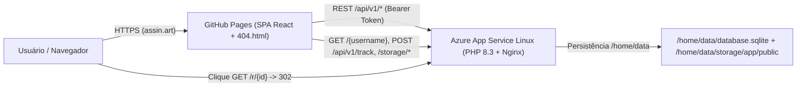

# Plano de Deploy — Assin.art v1 (Backend Laravel + Frontend React)

> **Objetivo:** Publicar a API Laravel (`assinart_v1-back`) no **Azure App Service (Linux / PHP 8.3)** usando a assinatura **Azure for Students** e conectá-la ao frontend React/Vite (`assinart_v1`) hospedado no **GitHub Pages** (`https://assin.art`).
> **Status:** Planejamento revisado em 2026-11-15 (furos incorporados na seção 7). Nenhum deploy executado. **Deploy bloqueado** até concluir os itens P0 da seção 7.
> **Repositórios envolvidos:**
> - Backend: `/home/pinho/Projetos/assinart_v1_backend` (`https://github.com/pinhogo/assinart_v1-back`, branch `main` @ `e2fc47d`)
> - Frontend: `/home/pinho/Projetos/assinart_v1` (`https://github.com/pinhogo/assinart_v1`, branch `main`)

---

## 1. Diagnóstico Técnico Real (Pós-Merge `develop` -> `main`)

### 1.1 Backend (`assinart_v1-back`)
- **Stack (`composer.json`):** PHP `^8.2`, Laravel `^11.0`, Laravel Sanctum `^4.0`. Dependências `require-dev`: `fakerphp/faker`, `laravel/pint`, `mockery/mockery`, `nunomaduro/collision`, `phpunit/phpunit`.
- **Autenticação real (`bootstrap/app.php`, `app/Http/Controllers/Api/AuthController.php`):**
  - `bootstrap/app.php` desabilitou `$middleware->statefulApi()` e configurou `$middleware->validateCsrfTokens(except: ['api/*'])`.
  - `register` e `login` emitem **Bearer Token** via `$artist->createToken('auth_token')->plainTextToken` (tabela `personal_access_tokens`).
  - `AuthController` agora inclui `POST /api/v1/auth/account/delete` e `DELETE /api/v1/auth/account` (`deleteAccount`), além de `ManagesPasswordAndEmail` (onde `forgotPassword` e `resendVerification` ainda não disparam SMTP real — `MAIL_MAILER=log`).
- **CORS (`config/cors.php`):**
  - `'https://assin.art'`, `'http://localhost:5173'` e `'http://127.0.0.1:5173'` **já estão** em `allowed_origins`.
  - `'paths' => ['api/*', 'sanctum/csrf-cookie', '*']` já cobre as rotas raiz (`GET /{username}`, `GET /r/{id}`, `GET /up`), que o frontend acessa fora de `/api/v1`.
  - **Lacuna:** `https://www.assin.art` ainda **não** está listado e `allowed_origins` está fixo no arquivo (sem leitura de `env('CORS_ALLOWED_ORIGINS')`).
- **Proxy Reverso & HTTPS (`bootstrap/app.php`):**
  - Há polyfills condicionais (`!function_exists('mb_split')`, `!class_exists('finfo')`) para compatibilidade local no Termux; em PHP 8.3 no Azure com `mbstring` e `fileinfo` habilitados, são inócuos.
  - O healthcheck nativo do Laravel está ativo em `health: '/up'`, além de `GET /` em `routes/web.php`.
  - **Lacuna crítica:** Falta `$middleware->trustProxies(at: '*');` em `bootstrap/app.php`. Sem confiar nos headers `X-Forwarded-*` do load balancer do Azure:
    1. `$request->ip()` pode resolver o IP interno do proxy, colapsando o `RateLimiter` de `login` (`5/min` em `AuthController.php`) e `/r/{id}` (`throttle:60,1` em `routes/web_public.php`), além de distorcer `visitor_id` fallback em `POST /api/v1/track`.
    2. `url("/r/{$btn->id}")` em `FormatsPublicProfile.php` pode gerar links `http://` em vez de `https://`.
- **Storage de Mídia e Limites de Upload (`config/filesystems.php`, `ManagesProfileMedia.php`, `ManagesButtonReorderAndImage.php`):**
  - Uploads salvam no disco `'public'` em 4 pastas: `avatars/` (até `5120 KB`), `covers/` (até `10240 KB`), `wallpapers/` (até `10240 KB`, via `/api/v1/profile/background` e `/profile/wallpaper`) e `cards/` (até `5120 KB`). Todos usam `Storage::url($path)`.
  - Em `config/filesystems.php`, `'default' => env('FILESYSTEM_DISK', 'local')` e o disco `'public'` monta a URL com `env('APP_URL', 'http://localhost:8000').'/storage'`.
  - **Armadilha 1 (URLs quebradas):** Sem `FILESYSTEM_DISK=public` e `APP_URL=https://assinart-api.azurewebsites.net`, `Storage::url()` retorna caminho relativo (`/storage/...`), fazendo o frontend em `https://assin.art` requisitar `https://assin.art/storage/...` (404 no GitHub Pages).
  - **Armadilha 2 (Perda de arquivos em redeploy):** `/home/site/wwwroot` é sobrescrito a cada deploy ZIP. A pasta física precisa viver em `/home/data/storage/app/public` via symlink.
  - **Armadilha 3 (Erro `413` / limite de 2 MB):** Capas e backgrounds aceitam até `10 MB` (`10240 KB`), mas PHP e Nginx padrão limitam entre `1M` e `8M`. Ambos precisam ser elevados para `12M`–`16M`.
- **Banco de Dados SQLite, Novas Migrations e Telemetria (`database/migrations/`):**
  - Após o merge de `develop`, existem **10 migrations**, incluindo:
    - `2026_11_02_000001_add_typography_and_style_columns.php`
    - `2026_11_02_000002_create_page_views_and_button_clicks_tables.php` (`page_views` e `button_clicks`)
    - `2026_11_12_000001_add_text_align_and_update_buttons_defaults.php`
    - `2026_11_13_000001_add_is_published_to_artists_table.php`
    - `2026_11_14_000001_add_shadow_color_and_circular_shadow_to_artists.php`
    - `2026_11_14_000002_normalize_artist_usernames.php` (data migration que normaliza usernames e registra colisões em log)
  - **Não existe migration da tabela `jobs`**, portanto `QUEUE_CONNECTION` em produção deve ser `sync` (e não `database` como no `.env.example`).
  - `database/database.sqlite` (172 KB) está rastreado no Git e **deve ser excluído** do pacote de deploy.
  - **Impacto de escrita em SQLite:** As novas tabelas `page_views` e `button_clicks` recebem `INSERT` a cada acesso público (`POST /api/v1/track` e `GET /r/{id}`). No App Service Linux (com `/home` sobre SMB/CIFS), manter **instância única**, `SESSION_DRIVER=file` e `CACHE_STORE=file` reduz contenção de locks no SQLite até a migração pós-MVP para PostgreSQL/MySQL gerenciado.
- **Publicação de Perfil (`is_published` / `draft`):**
  - Novos artistas são criados com `'is_published' => false` (`AuthController::register`).
  - `PublicProfileController::show` retorna HTTP `404` (`status: 'draft'`) para perfis não publicados quando acessados anonimamente. Durante o teste E2E em aba anônima, o perfil de teste precisa ser publicado (`PUT/PATCH /api/v1/profile` com `is_published: true` ou `publication_status: 'published'`).
- **Bootstrap Cache & Pastas de Runtime:**
  - `bootstrap/cache/packages.php` e `bootstrap/cache/services.php` estão versionados no Git referenciando `nunomaduro/collision` e `nunomaduro/termwind` (`require-dev`). Devem ser removidos antes de `composer install --no-dev`.
  - Pastas `storage/app/public`, `storage/framework/cache/data` e `storage/framework/sessions` precisam ser criadas no startup.
  - `composer.phar` (3,6 MB) está na raiz e deve ser excluído do artefato de deploy.

### 1.2 Frontend (`assinart_v1`)
- **Stack:** React 19 + Vite 8 + TypeScript 6 + React Router (`BrowserRouter` em `src/routes/AppRoutes.tsx`).
- **Hospedagem:** GitHub Pages com `public/CNAME` = `assin.art` e fallback SPA (`cp dist/index.html dist/404.html` em `.github/workflows/deploy-pages.yml`).
- **Configuração de API (`src/config/env.config.ts`):**
  - Em `MODE=production`, exige `VITE_API_BASE_URL` HTTPS não-loopback e `VITE_USE_MOCK_API === 'false'`; caso contrário ativa `useMockApi = true`.
  - `envConfig.apiHost` é derivado de `VITE_API_BASE_URL` e usado por `publicProfile.service.ts` para chamar `GET ${apiHost}/{username}`.
- **Cliente HTTP (`src/services/api/apiClient.ts`):**
  - Envia `Authorization: Bearer <token>` com `credentials: 'same-origin'` (compatível com a remoção de `statefulApi()` no backend).
  - Timeout padrão de `10000 ms` (`10s`) -> recomenda-se **SKU `B1` com `Always On` habilitado** para evitar *cold start* > 10s.
- **Workflow (`.github/workflows/deploy-pages.yml`):**
  - Já lê `vars.VITE_API_BASE_URL` e `vars.VITE_USE_MOCK_API`. Basta configurar as Repository Variables no GitHub e disparar o workflow.

---

## 2. Arquitetura Alvo



- **Frontend:** `https://assin.art` (GitHub Pages)
- **Backend API (MVP):** `https://assinart-api.azurewebsites.net` (Azure App Service Linux, SKU `B1`, instância única)
- **Persistência (MVP):** `/home/data/database.sqlite` + `/home/data/storage/app/public/{avatars,covers,cards,wallpapers}`
- **Evolução recomendada pós-MVP:**
  - Domínio customizado `https://api.assin.art` (CNAME + Azure Managed Certificate).
  - Azure Database for PostgreSQL ou MySQL Flexible Server (especialmente pelo volume de inserts em `page_views` e `button_clicks`).
  - Azure Blob Storage (driver S3/Blob) para uploads.
  - Provedor SMTP real para `forgot-password` e verificação de e-mail.

---

## 3. Pré-requisitos e Verificações Iniciais (Fase 0)

1. **Autenticação e assinatura ativa no Azure CLI (`az`):**
   ```bash
   az login
   az account show --output table
   ```
   Confirmar assinatura **Azure for Students**.
2. **Disponibilidade de região e SKU Linux `B1`:**
   ```bash
   az appservice list-locations --sku B1 --linux-workers-enabled --output table
   ```
   Priorizar `brazilsouth`; fallback comum para contas Student: `eastus2`.
3. **Unicidade global do nome do Web App (`assinart-api`):**
   Confirmar disponibilidade; caso já esteja em uso, escolher alternativo (ex.: `assinart-api-prod`) e atualizar `APP_URL` e `VITE_API_BASE_URL`.
4. **Ferramentas:** `php` (>= 8.2), `composer`, `zip`, `openssl`, `curl`, `gh` (opcional).

---

## 4. Plano de Execução por Fases

### Fase 1 — Ajustes no Backend (`assinart_v1-back`)

1. **Confiar no proxy reverso do Azure (`bootstrap/app.php`):**
   - Adicionar em `->withMiddleware(function (Middleware $middleware) { ... })`:
     ```php
     $middleware->trustProxies(at: '*');
     ```
   - Preserva IP real do cliente (`RateLimiter` de login, `throttle:60,1` em `/r/{id}`, fallback de `visitor_id` em `/api/v1/track`) e esquema `https` em `url("/r/{$btn->id}")`.

2. **Completar CORS e Security Headers (`config/cors.php`, `app/Http/Middleware/SecurityHeaders.php`, `bootstrap/app.php`):**
   - `paths` restrito a `['api/*', 'sanctum/csrf-cookie', 'up', 'r/*']` (sem `'*'`) e `supports_credentials => false` (autenticação via Bearer Token).
   - `allowed_origins` inclui `https://assin.art`, `https://www.assin.art` e origens extras via `CORS_ALLOWED_ORIGINS`:
     ```php
     'allowed_origins' => array_values(array_filter(array_unique(array_merge([
         'http://localhost:5173',
         'https://assin.art',
         'https://www.assin.art',
         'http://127.0.0.1:5173',
     ], array_map('trim', explode(',', (string) env('CORS_ALLOWED_ORIGINS', ''))))))),
     ```
   - `SecurityHeaders` aplica `X-Content-Type-Options: nosniff`, `X-Frame-Options: DENY`, `Referrer-Policy: strict-origin-when-cross-origin` e `Strict-Transport-Security: max-age=31536000; includeSubDomains` (em HTTPS/produção).

3. **Configurar Nginx (`azure/nginx.conf`):**
   - `root /home/site/wwwroot/public;`
   - `client_max_body_size 16M;` (suporta `10240 KB` de capa/wallpaper + overhead multipart)
   - `try_files $uri $uri/ /index.php?$query_string;`
   - Bloqueia arquivos ocultos (`location ~ /\.(?!well-known).* { deny all; }`) e **bloqueia execução PHP dentro de `/storage/`** (`location ~* ^/storage/.*\.php$ { deny all; }`).

4. **Configurar limites PHP (`public/.user.ini`):**
   - Arquivo versionado em `public/.user.ini` (independente de `PHP_INI_SCAN_DIR`):
     ```ini
     upload_max_filesize=12M
     post_max_size=16M
     memory_limit=256M
     max_execution_time=60
     expose_php=Off
     ```

5. **Script de startup idempotente e backup (`azure/startup.sh`, `azure/backup.sh`, `config/database.php`):**
   - Cria `/home/data/storage/app/public/{avatars,covers,cards,wallpapers}` e pastas `storage/framework/{sessions,views,cache/data}` e `storage/logs`.
   - Recria symlinks de `/home/site/wwwroot/storage/app/public` e `/home/site/wwwroot/public/storage` -> `/home/data/storage/app/public`.
   - Executa backup com timestamp em `/home/data/backups/database_<UTC>.sqlite` antes de `php artisan migrate --force`.
   - Conexão `sqlite` em `config/database.php` configurada com `busy_timeout=5000` (`DB_SQLITE_BUSY_TIMEOUT`) e `journal_mode=WAL` (`DB_SQLITE_JOURNAL_MODE`).
   - Copia `azure/nginx.conf` e recarrega com `nginx -s reload || service nginx reload || true` (validar comportamento no App Service real).

6. **Aplicar correções de segurança pré-produção (bloqueante: `SEC-14` e `SEC-04`..`SEC-13`; ver seção 7) (ver [SECURITY_AUDIT.md](file:///home/pinho/Projetos/assinart_v1_backend/context/SECURITY_AUDIT.md)) e validar suíte local:**
   - Executar `php artisan test` (incluindo os novos testes de métricas, publicação/draft, normalização de username, account deletion e background media) garantindo exit code `0`.

---

### Fase 2 e Fase 3 — Provisionamento Azure e App Settings (`azure/provision.sh`, `azure/appsettings.example.env`)

- Executar `./azure/provision.sh` (com `RG`, `LOCATION=brazilsouth`, fallback `eastus2`, `PLAN`, `APP_NAME`, `BUDGET_EMAIL`) para:
  1. Validar `az account show`, região/quota Linux `B1` e disponibilidade global do Web App.
  2. Criar Resource Group, App Service Plan `B1 --is-linux --number-of-workers 1` e Web App `PHP:8.3`.
  3. Habilitar `--https-only true`, `--always-on true`, `--ftps-state Disabled`, `--min-tls-version 1.2`, `--http20-enabled true` e `--startup-file /home/site/wwwroot/azure/startup.sh`.
  4. Configurar App Settings conforme `azure/appsettings.example.env` (incluindo `WEBSITES_CONTAINER_START_TIME_LIMIT=230`, `DB_SQLITE_BUSY_TIMEOUT=5000`, `DB_SQLITE_JOURNAL_MODE=WAL`, `SESSION_DRIVER=file`, `CACHE_STORE=file`, `QUEUE_CONNECTION=sync`, `LOG_CHANNEL=stderr`, `LOG_LEVEL=warning`, `MAIL_MAILER=log`, **sem** `SANCTUM_STATEFUL_DOMAINS`).
  5. Criar alerta de orçamento mensal via `az consumption budget create` para proteger os créditos **Azure for Students**.

---

### Fase 4 — Build Limpo, CI/CD e Empacotamento (`.github/workflows/deploy-backend.yml`, `.gitattributes`)

- O workflow `.github/workflows/deploy-backend.yml` executa automaticamente em PHP `8.3` (`fileinfo`, `mbstring`, `pdo_sqlite`, `pdo_pgsql`):
  1. Roda `php artisan test` antes de empacotar.
  2. Exporta árvore limpa com `git archive` (`.gitattributes` com `export-ignore` descarta `context/`, `docs/`, `documentacao/`, `tests/`, `*.md`, `run.sh`, `composer.phar`, `.phpunit*`, `.github/`).
  3. Remove `.env*`, caches locais e arquivos `.sqlite` e roda `composer install --no-dev --optimize-autoloader --no-interaction`.
  4. Pré-gera `route:cache` e `view:cache` (sem fixar `config:cache` com variáveis de build).
  5. Salva `assinart-back-rollback-zip` via `actions/upload-artifact` (retenção de 30 dias) e publica via `azure/webapps-deploy` (ou `az webapp deploy`).
- **Smoke tests pós-deploy:**
  - `GET https://${APP_NAME}.azurewebsites.net/up` -> `200 OK`
  - `GET https://${APP_NAME}.azurewebsites.net/` -> `200 OK` (`status: "operational"`)
  - `GET https://${APP_NAME}.azurewebsites.net/api/v1/usernames/check?username=teste_deploy` -> `200 OK`
  - `OPTIONS /api/v1/auth/login` com `Origin: https://assin.art` e `Access-Control-Request-Method: POST` -> `204 No Content` com `Access-Control-Allow-Origin: https://assin.art` e sem `Access-Control-Allow-Credentials: true`
  - `OPTIONS /api/v1/auth/login` com `Origin: https://www.assin.art` -> `204 No Content` com `Access-Control-Allow-Origin: https://www.assin.art`
  - Confirmar headers de segurança (`X-Content-Type-Options: nosniff`, `X-Frame-Options: DENY`, `Referrer-Policy: strict-origin-when-cross-origin`, `Strict-Transport-Security`).

---

### Fase 5 — Conexão do Frontend (`assinart_v1`), DNS e HTTPS

```bash
gh variable set VITE_API_BASE_URL --repo pinhogo/assinart_v1 --body "https://assinart-api.azurewebsites.net/api/v1"
gh variable set VITE_USE_MOCK_API --repo pinhogo/assinart_v1 --body "false"
gh workflow run deploy-pages.yml --repo pinhogo/assinart_v1 --ref main
```

- **DNS e HTTPS (`assin.art` e `www.assin.art`):**
  - Confirmar registros `A` do apex `assin.art` apontando para os 4 IPs oficiais do GitHub Pages (`185.199.108.153`, `185.199.109.153`, `185.199.110.153`, `185.199.111.153`) e `CNAME` de `www.assin.art` apontando para `pinhogo.github.io` (ou redirecionamento canônico `www.assin.art` -> `https://assin.art`).
  - Confirmar **Enforce HTTPS** ativo nas configurações de GitHub Pages e certificados TLS válidos para `https://assin.art` e `https://www.assin.art` (`curl -I https://assin.art` e `curl -I https://www.assin.art`).
  - Confirmar no log do GitHub Actions que `npm run test && npm run build` concluiu sem erros e publicou `dist/404.html`.

---

## 5. Validação End-to-End (Fase 6) e Limitações Conhecidas

Executar em **aba anônima** (sem cache ou sessão prévia):

1. **Cadastro e Onboarding (`/cadastro`):**
   - Acessar `https://assin.art/cadastro` e verificar `GET /api/v1/usernames/check` no Network.
   - Registrar usuário (`POST /api/v1/auth/register` -> `201`) e concluir etapas de onboarding (`PUT /api/v1/onboarding/*` -> `200` com `Authorization: Bearer ...`).
2. **Uploads de mídia (> 2 MB):**
   - No `/editor`, enviar avatar (`<= 5 MB`), capa (`> 2 MB` e `<= 10 MB`) e background/wallpaper (`POST /api/v1/profile/background`).
   - Confirmar URLs retornadas em `https://assinart-api.azurewebsites.net/storage/...` carregando com `200 OK`.
3. **Publicação e Página Pública (`is_published`):**
   - Publicar perfil no editor (`PATCH /api/v1/profile` com `is_published: true` / `publication_status: "published"`), pois contas novas iniciam como `draft` (`404` público).
   - Abrir `https://assin.art/{username}` -> confirmar `GET https://assinart-api.azurewebsites.net/{username}` (`200 OK`) e disparo de `POST /api/v1/track` (`204`).
4. **Rastreador de cliques e Métricas:**
   - Clicar em botão (`GET /r/{id}` -> `302 Found`) e verificar atualização em `GET /api/v1/metrics/summary`.
5. **Persistência pós-restart:**
   - Rodar `az webapp restart --resource-group "$RG" --name "$APP_NAME"` e confirmar que banco `/home/data/database.sqlite` e uploads em `/home/data/storage/app/public` permanecem intactos.
6. **Limitação conhecida de `forgot-password` (`MAIL_MAILER=log`):**
   - Em MVP (`MAIL_MAILER=log` e `LOG_LEVEL=warning`), `POST /api/v1/auth/forgot-password` e `resendVerification` **não enviam e-mail SMTP real**; os links/tokens só aparecem em logs se o nível incluir `info`/`debug` (evitar em produção para não expor tokens em `stderr`). A entrega real de e-mails será habilitada na fase pós-MVP (`API-20`).
7. **Gatilho de migração SQLite -> PostgreSQL/MySQL (`#327` / Task 8.1):**
   - Migrar imediatamente de SQLite (`/home/data/database.sqlite`) para **Azure Database for PostgreSQL** ou **MySQL Flexible Server** assim que ocorrer qualquer um destes gatilhos:
     1. Qualquer ocorrência de `database is locked` nos logs do Azure (`stderr`).
     2. Latência `p95 > 500 ms` em `POST /api/v1/track` ou `GET /r/{id}` sob tráfego real.
     3. Arquivo `database.sqlite` ultrapassar `100 MB` ou necessidade de escalar o App Service além de `1` instância (`workers > 1`).

---

## 6. Plano de Rollback (< 15 minutos)

1. **Frontend (< 3 min):** Alterar `VITE_USE_MOCK_API` para `true` nas GitHub Variables (`gh variable set VITE_USE_MOCK_API --repo pinhogo/assinart_v1 --body "true"`) e reexecutar `deploy-pages.yml` para restaurar o modo demo imediatamente.
2. **Backend (< 12 min — pacote + banco + schema):**
   1. **Baixar o ZIP estável anterior:** No GitHub Actions do `assinart_v1-back`, baixar o artefato `assinart-back-rollback-zip` da última execução saudável (`gh run download <RUN_ID> -n assinart-back-rollback-zip`).
   2. **Reverter schema antes do código (se houve nova migration incompatível):** Via Kudu/SSH do App Service (`az webapp ssh`), executar:
      ```bash
      cd /home/site/wwwroot
      php artisan migrate:rollback --step=1 --force
      ```
   3. **Restaurar backup do SQLite (se houve corrupção ou data migration irreversível):** Via Kudu/SSH, restaurar o snapshot pré-deploy gerado automaticamente pelo `azure/startup.sh` ou `azure/backup.sh` em `/home/data/backups/`:
      ```bash
      ls -lh /home/data/backups/database_*.sqlite
      cp -p /home/data/database.sqlite /home/data/database.sqlite.broken
      rm -f /home/data/database.sqlite-wal /home/data/database.sqlite-shm
      sqlite3 /home/data/database.sqlite ".restore '/home/data/backups/database_<TIMESTAMP>.sqlite'"
      # Fallback sem sqlite3 CLI: cp -p /home/data/backups/database_<TIMESTAMP>.sqlite /home/data/database.sqlite
      ```
   4. **Reimplantar o ZIP anterior e reiniciar:**
      ```bash
      az webapp deploy --resource-group "$RG" --name "$APP_NAME" --src-path ./assinart-back.zip --type zip
      az webapp restart --resource-group "$RG" --name "$APP_NAME"
      ```
   5. **Confirmar recuperação:** Validar `GET /up` (`200 OK`), `GET /` (`200 OK`) e fluxo de login antes de liberar tráfego.


---

## 7. Furos Identificados na Revisão (2026-11-15)

> Rastreio: cards `BACKLOG - FLUXO B` no GitHub Project nº 2, blocos em [`BACKLOG_MELHORIAS.md`](BACKLOG_MELHORIAS.md) e Fase 9 em [`tasks_backend.md`](tasks_backend.md). Auditoria em [`SECURITY_AUDIT.md`](SECURITY_AUDIT.md).

### P0 — Bloqueiam o deploy

| # | Furo | Ação | ID |
| :--- | :--- | :--- | :--- |
| P0-1 | O backlog marca `SEC-01`..`SEC-03` como `DONE`, mas o código ainda tem as falhas (verify de e-mail público, IDOR no storage, URL sem whitelist). | Reverifique e reabra. | `SEC-14` |
| P0-2 | `POST /api/v1/track` sem validação, throttle ou filtro de `draft`. Piora o SQLite em `/home`. | Valide e limite. | `SEC-04` |
| P0-3 | `trustProxies(at: '*')` já foi adicionado em `API-12` (`5635c9c`); chave composta de `login` e `email/resend` segue pendente. | Validar IP real e ajustar chaves. | `SEC-06`, `API-14` |
| P0-4 | Sem throttle em `register`, `forgot-password` e `reset-password`. O reset aceita token em texto puro. | Aplique throttle e remova o fallback. | `SEC-05` |
| P0-5 | O Git rastreia `database.sqlite`, `bootstrap/cache`, `composer.phar` e `laravel.log`. `.env.example` tem `APP_DEBUG=true`. | Limpe o índice. | `SEC-13` |
| P0-6 | A pasta `azure/` não existe no repositório. O `git archive HEAD` descarta qualquer arquivo não commitado. | Crie e commite `azure/`. | `API-15` |

### P1 — Risco alto de falha em produção

| # | Furo | Ação | ID |
| :--- | :--- | :--- | :--- |
| P1-1 | `service nginx reload` pode falhar no startup (Nginx ainda parado). O config padrão é recriado a cada boot. | Teste `nginx -s reload` no App Service real. | `API-15` |
| P1-2 | `PHP_INI_SCAN_DIR=/usr/local/etc/php/conf.d` assume a imagem Docker oficial. | Use `public/.user.ini` ou confirme o caminho. | `API-15` |
| P1-3 | SQLite em `/home` (CIFS): risco de `database is locked` e corrupção. Não existe backup. | Faça teste de carga, WAL e backup. | `API-18` |
| P1-4 | `migrate --force` roda em todo boot. A data migration de usernames pode derrubar o app. | Faça backup antes e fixe instância única. | `API-15`, `API-17` |
| P1-5 | `config:cache`, `route:cache` e `view:cache` no startup atrasam o boot (limite de 230 s). | Gere os caches no build. | `API-15`, `API-16` |
| P1-6 | Os testes locais rodam no PHP do Termux com `finfo` falso: o MIME de upload não é validado. | Rode `php artisan test` em PHP 8.3 real (CI). | `SEC-10`, `API-16` |
| P1-7 | Quota de B1 e restrição de região em Azure for Students não verificadas. | Valide antes de provisionar. | `API-17` |
| P1-8 | `.env` local sobrepõe os App Settings se entrar no ZIP. | Exclua `.env*` do ZIP e valide. | `API-16` |

### P2 — Endurecimento e operação

| # | Furo | Ação | ID |
| :--- | :--- | :--- | :--- |
| P2-1 | `supports_credentials=true` e `'*'` em `paths` de CORS. O auth usa Bearer. | Restrinja o CORS. | `SEC-09` |
| P2-2 | `SANCTUM_STATEFUL_DOMAINS` é inútil: `statefulApi()` está desativado. | Remova do App Settings. | `SEC-09` |
| P2-3 | Tokens Sanctum sem expiração. Senha `min:6`. | Defina expiração e `min:8`. | `SEC-08` |
| P2-4 | `/r/{id}` redireciona perfis `draft`. `forgot-password` permite enumerar contas. | Corrija os dois casos. | `SEC-07` |
| P2-5 | `MAIL_MAILER=log` com `LOG_CHANNEL=stderr` grava tokens de reset nos logs do Azure. | Use `LOG_LEVEL=warning` e SMTP real no pós-MVP. | `API-19` |
| P2-6 | DNS de `assin.art` e `www.assin.art` e HTTPS forçado no GitHub Pages não constam no plano. | Valide na Fase 5. | `API-19` |
| P2-7 | O rollback não restaura o schema nem o banco. | Restaure o ZIP anterior e o backup. | `API-19` |
| P2-8 | `GET /{username}` pode colidir com `/storage/*`. | Teste com `ReservedUsernames`. | `API-14` |
| P2-9 | Cache e sessão em `file` sobre CIFS deixam o `RateLimiter` lento. | Meça no teste de carga. | `API-18` |
| P2-10 | Crédito Azure for Students sem alerta de custo. | Crie alerta de orçamento. | `API-17` |

### Ordem de execução

1. `SEC-14` ➔ `SEC-13` ➔ `SEC-04`, `SEC-05`, `SEC-06` (P0).
2. `API-15` ➔ `API-16` ➔ `API-17` (P1).
3. `API-18` ➔ `API-19` (teste de carga, E2E e rollback).
4. `SEC-07`..`SEC-12` e `API-14` antes do uso público, ou como pós-MVP imediato.
5. `API-20`..`API-22`, `CAD-11` e `FIX-GLB-22` para envio real de confirmação de e-mail, guarda de `/editor`, redirecionamento pós-login e encaminhamento de `sac@assin.art` ao Gmail pessoal.

> **Nota pós-merge (`API-12` / `API-13` em `develop`):** `5635c9c` e `b8c092f` já incluíram `trustProxies(at: '*')`, `config/database.php`, migration `jobs`, healthcheck com DB em `/up` e disco `azure` (`MEDIA_DISK`). Quando configurar `DB_CONNECTION` gerenciado e `MEDIA_DISK=azure` no App Service, `API-18` (risco de SQLite em `/home`) torna-se dispensável.

---

## 8. Simulação Local Azure `B1` e Benchmark SQLite `WAL` vs PostgreSQL (`API-23`)

> **Status de execução (`2026-11-16` — Concluída):** Container `assinart-azure-sim:latest` (`php:8.3-fpm` + `nginx`, limites `1.0 vCPU` / `1792 MB` RAM) compilado e executado ao vivo com `./scripts/load-test-azure-sim.sh` (`20 VUs x 20s`, executor `php`) para **SQLite `WAL`** e **PostgreSQL 16**. A simulação em PHP 8.3 também revelou e corrigiu o lock do `composer.lock` gerado no PHP 8.5 (`symfony/* v8.1` incompatível com PHP 8.3 no Azure/CI), fixando `config.platform.php = "8.3.0"` em `composer.json`.

### 8.1 Resultados Medidos no Container Limitado (`1.0 vCPU / 1792 MB` — `20 VUs x 20s`)

| Modo de Banco | Total Req | Sucessos (`2xx/3xx`) | Erros `5xx` / Timeout | `database is locked` | `p50` Global | `p95` Global | Memória Container `app` |
| :--- | :---: | :---: | :---: | :---: | :---: | :---: | :---: |
| **SQLite `WAL`** (`busy_timeout=5000`) | `1829` | `1829` (`100%`) | `0` (`0.00%`) | `0` | `200.84 ms` | `387.27 ms` | `54.6 MiB` (`3.05%`) |
| **PostgreSQL 16** (`postgres:16-alpine`) | `1316` | `1316` (`100%`) | `0` (`0.00%`) | `0` | `303.91 ms` | `397.67 ms` | `56.45 MiB` (`3.15%`) |

- **Detalhe por endpoint (`p50` / `p95`):**
  - **SQLite `WAL`:** `POST /api/v1/track` (`209.09 / 391.36 ms`), `GET /r/{id}` (`215.79 / 398.87 ms`), `GET /{username}` (`196.54 / 382.97 ms`), `GET /up` (`191.37 / 303.14 ms`).
  - **PostgreSQL 16:** `POST /api/v1/track` (`312.09 / 398.88 ms`), `GET /r/{id}` (`320.88 / 401.82 ms`), `GET /{username}` (`311.46 / 398.38 ms`), `GET /up` (`275.34 / 306.18 ms`).
- **Ressalva de produção Azure:** em disco Linux local do container, SQLite `WAL` suportou `~91 req/s` com `0` locks e `p95 < 400 ms`; em produção no App Service Linux, `/home/data` roda sobre montagem **SMB/CIFS**, que possui latência de I/O maior que disco local — mantenha o gatilho da seção `8.4` para virar para `DB_CONNECTION=pgsql` (`API-12`) imediatamente caso surja `database is locked` ou `p95 > 500 ms` em produção.

### 8.2 Artefatos do ambiente de simulação
- [`docker/azure-sim/Dockerfile`](../docker/azure-sim/Dockerfile): imagem `php:8.3-fpm` + `nginx` com `mbstring`, `fileinfo`, `pdo_sqlite`, `pdo_pgsql`, `gd`, `zip` e `opcache`, copiando `azure/nginx.conf` (porta `8080`, `fastcgi_pass 127.0.0.1:9000`) e `public/.user.ini` (`PHP_INI_SCAN_DIR=/usr/local/etc/php/conf.d`).
- [`docker/azure-sim/entrypoint.sh`](../docker/azure-sim/entrypoint.sh): prepara `/home/data/storage/app/public/{avatars,covers,cards,wallpapers}` e `/home/data/backups`, aguarda PostgreSQL quando `DB_CONNECTION=pgsql`, executa `azure/startup.sh`, ajusta permissões `www-data` e inicia `php-fpm` + `nginx`.
- [`docker/azure-sim/compose.yml`](../docker/azure-sim/compose.yml): define os limites do SKU `B1` (`cpus: 1.0`, `mem_limit: 1792m` / `deploy.resources.limits`), volume persistente `/home/data`, flags SQLite (`DB_SQLITE_JOURNAL_MODE=WAL`, `DB_SQLITE_BUSY_TIMEOUT=5000`, `SESSION_DRIVER=file`, `CACHE_STORE=file`, `QUEUE_CONNECTION=sync`) e profile opcional `postgres` (`postgres:16-alpine` com healthcheck).
- [`scripts/load-test-azure-sim.sh`](../scripts/load-test-azure-sim.sh): prepara um artista publicado + botão ativo e dispara carga concorrente contra `POST /api/v1/track`, `GET /r/{id}`, `GET /{username}` e `GET /up` (via `k6` / `grafana/k6`, com fallback nativo em `php` `curl_multi` ou `curl` + `xargs`), reportando total de requisições, taxa de erro `5xx`/timeout, `p50`/`p95` e ocorrências de `database is locked` nos logs.

### 8.2 Comandos exatos após iniciar o daemon Docker

1. **Iniciar o daemon Docker** (Linux com systemd ou Docker Desktop):
   ```bash
   sudo systemctl start docker
   docker info
   ```
2. **Subir o container de simulação (`SQLite WAL`, padrão Azure B1):**
   ```bash
   docker compose -f docker/azure-sim/compose.yml up -d --build
   # Alternativa sem Compose v2 (docker-compose legado ou docker run direto):
   # docker-compose -f docker/azure-sim/compose.yml up -d --build
   # docker build -f docker/azure-sim/Dockerfile -t assinart-azure-sim .
   # docker run -d --name assinart-azure-sim-app --cpus=1.0 --memory=1792m -p 8080:8080 -v azure_sim_data:/home/data assinart-azure-sim
   ```
3. **Executar a bateria de carga comparativa (`SQLite WAL` vs `PostgreSQL`):**
   ```bash
   # 1) Benchmark SQLite WAL (API-18) sob 1.0 vCPU / 1792 MB
   ./scripts/load-test-azure-sim.sh --db sqlite --vus 20 --duration 30

   # 2) Benchmark PostgreSQL 16 (API-12) sob os mesmos limites do app container
   ./scripts/load-test-azure-sim.sh --db pgsql --vus 20 --duration 30

   # Opcional: forcar executor grafana/k6
   ./scripts/load-test-azure-sim.sh --db sqlite --vus 20 --duration 30 --runner k6
   ```
4. **Encerrar e limpar containers/volumes após coleta:**
   ```bash
   docker compose -f docker/azure-sim/compose.yml --profile postgres down -v
   ```

### 8.3 Critério empírico de corte SQLite (`API-18`) -> PostgreSQL (`API-12`)

Adote **PostgreSQL gerenciado (`API-12`)** imediatamente antes da abertura pública se o benchmark local ou a observabilidade em produção atingir **qualquer** um dos limites abaixo:

| Indicador | Limite seguro (SQLite `WAL`) | Gatilho de corte para PostgreSQL (`API-12`) |
| :--- | :--- | :--- |
| Ocorrências de `database is locked` nos logs | `0` ocorrências | `>= 1` ocorrência em `docker logs` ou `storage/logs/laravel.log` |
| Taxa de erro (`5xx` + timeout + lock) | `0.00%` | `> 0%` sob `20` VUs concorrentes |
| Latência `p95` (`POST /api/v1/track` ou `GET /r/{id}`) | `<= 500 ms` | `> 500 ms` sustentado |
| Tamanho do arquivo `database.sqlite` | `<= 100 MB` | `> 100 MB` |
| Escala de instâncias / workers no App Service | `1` instância | Necessidade de `workers > 1` ou scale-out horizontal |

---

## 9. E-mail Gratuito do Domínio `assin.art` na Hostinger — Recebimento e Envio (`API-22`)

> **Premissa:** O domínio `assin.art` está registrado e hospedado na **Hostinger** sem plano de e-mail incluso.
> **Regra de fechamento:** A task `API-22` **NÃO avança para `DONE`** enquanto o proprietário não concluir a configuração no painel DNS da Hostinger (`API-22.1..22.4`) e o teste real de recebimento (`API-22.7`).
> **Segurança:** Nunca grave o endereço Gmail pessoal de destino em arquivos do repositório, commits ou logs.

### 9.1 Endereços oficiais configurados no backend (`API-22.5`)

- **Remetente (`MAIL_FROM_ADDRESS`):** `contato@assin.art` (`MAIL_FROM_NAME="${APP_NAME}"`).
- **Resposta (`MAIL_REPLY_TO_ADDRESS`):** `sac@assin.art` (`MAIL_REPLY_TO_NAME="${APP_NAME}"`).
- **Configuração versionada:** `.env.example`, `azure/appsettings.example.env` e `config/mail.php` (lê `MAIL_REPLY_TO_ADDRESS` e `MAIL_REPLY_TO_NAME` do ambiente quando definidos).

### 9.2 Preservação obrigatória do GitHub Pages no DNS da Hostinger

Antes de alterar qualquer registro de e-mail no **hPanel da Hostinger** (**Domínios > assin.art > DNS / Nameservers**), confirme e **NÃO apague** os registros que mantêm o site no ar no GitHub Pages:

- Registros `A` do apex `@` (`assin.art`): `185.199.108.153`, `185.199.109.153`, `185.199.110.153`, `185.199.111.153`.
- Registros `AAAA` do apex `@` (se configurados para GitHub Pages): `2606:50c0:8000::153`, `2606:50c0:8001::153`, `2606:50c0:8002::153`, `2606:50c0:8003::153`.
- Registro `CNAME` de `www`: `pinhogo.github.io`.

### 9.3 Recebimento gratuito (`sac@assin.art` e `contato@assin.art` -> Gmail pessoal)

#### Opção A — Direto no DNS da Hostinger via ImprovMX gratuito (sem trocar nameservers)

1. Crie a conta gratuita no painel do **ImprovMX** para o domínio `assin.art`.
2. Informe o endereço Gmail pessoal de destino apenas no painel do ImprovMX.
3. Abra o e-mail de confirmação recebido no Gmail pessoal e clique no link de verificação.
4. No painel do ImprovMX, crie os aliases `sac@assin.art` e `contato@assin.art` apontando para o Gmail pessoal verificado.
5. Abra o **hPanel da Hostinger** (**Domínios > assin.art > DNS / Nameservers > Gerenciar registros DNS**).
6. Mantenha intactos todos os registros `A`, `AAAA` e `CNAME` (`www` -> `pinhogo.github.io`) do GitHub Pages.
7. Remova apenas registros `MX` antigos da Hostinger, se existirem, e adicione os dois registros `MX` no host `@`:
   - `MX` | Nome: `@` | Aponta para: `mx1.improvmx.com` | Prioridade: `10`
   - `MX` | Nome: `@` | Aponta para: `mx2.improvmx.com` | Prioridade: `20`
8. Publique o registro `SPF` combinado único no host `@` conforme a Seção 9.4.

#### Opção B — Migrar nameservers da Hostinger para Cloudflare gratuito + Cloudflare Email Routing

1. Crie uma conta gratuita na **Cloudflare** e adicione o site `assin.art` no plano **Free**.
2. Revise a importação automática de DNS na Cloudflare e confirme que **todos os registros `A`, `AAAA` e `CNAME` (`www` -> `pinhogo.github.io`) do GitHub Pages** constam na zona.
3. Mantenha os registros `A`, `AAAA` e `CNAME` do GitHub Pages em modo **DNS only (nuvem cinza)** para preservar a renovação automática de TLS do GitHub Pages.
4. No **hPanel da Hostinger** (**Domínios > assin.art > DNS / Nameservers > Alterar nameservers**), substitua os nameservers da Hostinger pelos dois nameservers informados pela Cloudflare.
5. Aguarde a ativação da zona na Cloudflare e abra **Email > Email Routing > Destination addresses**.
6. Cadastre o endereço Gmail pessoal apenas no painel da Cloudflare e clique no link de verificação recebido no Gmail.
7. Crie duas **Routing rules** em **Email Routing**: `sac@assin.art` -> Gmail pessoal verificado e `contato@assin.art` -> Gmail pessoal verificado.
8. Ative o roteamento para a Cloudflare publicar os registros `MX` (`route1.mx.cloudflare.net`, `route2.mx.cloudflare.net` e `route3.mx.cloudflare.net` com as prioridades exibidas no painel).

#### Verificação dos registros `MX` após propagação

```bash
dig +short MX assin.art
```

### 9.4 Envio transacional gratuito (`API-20` no Azure) + DKIM / SPF combinado / DMARC

| Provedor | Cota gratuita | Configuração SMTP no Azure | Registros DNS exigidos |
| :--- | :--- | :--- | :--- |
| **Resend** | `3.000` e-mails/mês (`100`/dia) | `MAIL_MAILER=smtp`, `MAIL_HOST=smtp.resend.com`, `MAIL_PORT=587`, `MAIL_USERNAME=resend`, `MAIL_PASSWORD=<API_KEY>`, `MAIL_ENCRYPTION=tls` | `DKIM` (`TXT`), `SPF` (`TXT` no subdomínio de envio ou raiz) e `DMARC` (`TXT`) |
| **Brevo** | `300` e-mails/dia (`~9.000`/mês) | `MAIL_MAILER=smtp`, `MAIL_HOST=smtp-relay.brevo.com`, `MAIL_PORT=587`, `MAIL_USERNAME=<SMTP_LOGIN>`, `MAIL_PASSWORD=<SMTP_KEY>`, `MAIL_ENCRYPTION=tls` | `DKIM` (`TXT`), `SPF` (`TXT`) e `DMARC` (`TXT`) |

Publique os registros abaixo no painel DNS ativo (**Hostinger** na Opção A ou **Cloudflare** na Opção B):

1. Cadastre `assin.art` no provedor escolhido (**Resend** ou **Brevo**) e publique os registros `DKIM` gerados pelo provedor.
2. Publique **exatamente um único registro `TXT` `SPF` no apex (`@` / `assin.art`)** (RFC 7208 proíbe múltiplos registros `v=spf1` e gera `PermError`). Combine todos os `include:` na mesma linha:
   - **Opção A (Hostinger + ImprovMX) + Brevo:**
     ```text
     v=spf1 include:spf.improvmx.com include:spf.brevo.com ~all
     ```
   - **Opção A (Hostinger + ImprovMX) + Resend (quando usar SPF no apex):**
     ```text
     v=spf1 include:spf.improvmx.com include:amazonses.com ~all
     ```
     *(Se o painel do Resend usar o subdomínio dedicado `send.assin.art` para SPF, mantenha `v=spf1 include:spf.improvmx.com ~all` no apex `@` e publique o `TXT` do Resend no host `send`.)*
   - **Opção B (Cloudflare Email Routing) + Brevo:**
     ```text
     v=spf1 include:_spf.mx.cloudflare.net include:spf.brevo.com ~all
     ```
   - **Opção B (Cloudflare Email Routing) + Resend (quando usar SPF no apex):**
     ```text
     v=spf1 include:_spf.mx.cloudflare.net include:amazonses.com ~all
     ```
     *(Se o Resend usar o subdomínio dedicado `send`, mantenha `v=spf1 include:_spf.mx.cloudflare.net ~all` no apex `@` e publique o `TXT` do Resend no host `send`.)*
3. Publique o registro `DMARC` no host `_dmarc` (`TXT`):
   ```text
   v=DMARC1; p=none; rua=mailto:sac@assin.art; fo=1
   ```
   *(Após confirmar entrega estável em produção, evolua `p=none` para `p=quarantine` ou `p=reject`.)*
4. Grave as credenciais SMTP reais apenas no Azure Portal ou via CLI (nunca no repositório):
   ```bash
   az webapp config appsettings set --resource-group "$RG" --name "$APP_NAME" --settings \
     MAIL_MAILER=smtp \
     MAIL_HOST=smtp.resend.com \
     MAIL_PORT=587 \
     MAIL_USERNAME=resend \
     MAIL_PASSWORD="<RESEND_API_KEY>" \
     MAIL_ENCRYPTION=tls \
     MAIL_FROM_ADDRESS="contato@assin.art" \
     MAIL_FROM_NAME="Assinart" \
     MAIL_REPLY_TO_ADDRESS="sac@assin.art" \
     MAIL_REPLY_TO_NAME="Assinart"
   ```
   *(No Azure App Settings, informe `Assinart` literalmente em `MAIL_FROM_NAME` e `MAIL_REPLY_TO_NAME`, pois variáveis de ambiente do sistema não expandem `${APP_NAME}` como o parser `.env`.)*

### 9.5 Checklist manual pós-DNS (`API-22.1..22.4` e `API-22.7` — Proprietário)

> **Importante:** Conclua todos os itens abaixo antes de mover `API-22` para `DONE`.

- [ ] **API-22.1:** Escolher Opção A (ImprovMX direto no DNS da Hostinger) ou Opção B (migrar nameservers para Cloudflare + Email Routing), preservando `A`/`AAAA`/`CNAME` do GitHub Pages, e verificar o Gmail pessoal apenas no painel.
- [ ] **API-22.2:** Criar aliases/regras `sac@assin.art` e `contato@assin.art` apontando para o Gmail pessoal verificado.
- [ ] **API-22.3:** Validar domínio no provedor transacional (**Resend** ou **Brevo**) com `DKIM`, `SPF` único combinado e `DMARC`.
- [ ] **API-22.4:** Configurar `MAIL_MAILER=smtp` e credenciais reais apenas via Azure Portal / `az webapp config appsettings set`.
- [ ] **API-22.7:** Executar validação externa pós-propagação DNS e confirmar recebimento real:
  ```bash
  dig +short MX assin.art
  dig +short TXT assin.art
  dig +short TXT _dmarc.assin.art
  dig +short A assin.art
  dig +short CNAME www.assin.art
  ```
  - Confirmar que os registros `A` e `CNAME` (`www` -> `pinhogo.github.io`) do GitHub Pages continuam intactos.
  - Confirmar apenas um registro `TXT` começando com `v=spf1` em `assin.art`.
  - Enviar e-mail externo para `sac@assin.art` e confirmar entrega no Gmail pessoal.
  - Enviar e-mail externo para `contato@assin.art` e confirmar entrega no Gmail pessoal.
