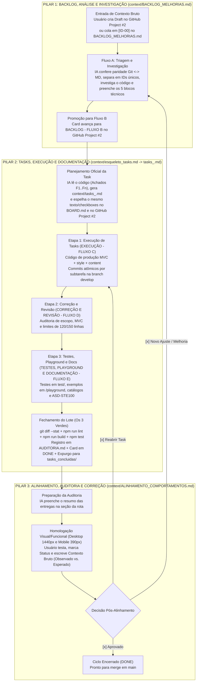
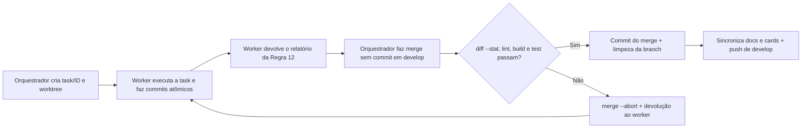

# Rotina Operacional e Mapa de Organização do Repositório (`Assin.art`)

> **Documento Central de Governança, Ciclo de Vida de Desenvolvimento e Higiene de Diretórios**  
> **Status:** Oficial e Ativo (Branch `develop`)  
> **Alinhamento:** [`context/rules.md`](rules.md) (Regras 0 a 15), [`context/AUDITORIA.md`](AUDITORIA.md), [`context/BACKLOG_MELHORIAS.md`](BACKLOG_MELHORIAS.md), [`context/esqueleto_tasks.md`](esqueleto_tasks.md), [`context/ALINHAMENTO_COMPORTAMENTOS.md`](ALINHAMENTO_COMPORTAMENTOS.md) e **GitHub Project nº 2** (`https://github.com/users/pinhogo/projects/2`)

Este documento define o ciclo completo de engenharia para agentes de IA e desenvolvedores no repositório `assinart_v1`, desde a entrada de contexto bruto até a homologação pós-entrega e realimentação do backlog.

---

## 1. Panorama Geral do Projeto (Arquitetura e Domínios)

O **Assin.art v1** é a plataforma neo-brutalista de link na bio para artistas e criadores visuais:

- **Landing Page (`/`):** Implementada em `src/views/landing/**`, `src/components/mockups/HomeMockup.tsx` e `src/components/mockups/style/HomeMockup.style.ts`.
- **Autenticação e Acesso (`auth`):** Cadastro (`/cadastro`), Login (`/entrar`), Recuperação de Senha (`/esqueci-senha`) e Confirmação de E-mail (`/confirmacao-email`).
- **Onboarding Interativo (`onboarding`):** Identidade e Mídias (`/cadastro/perfil`), Redes e Links (`/cadastro/links`), Estilo de Botões (`/cadastro/botoes`), Paletas e Contraste (`/cadastro/cores`) e Tipografia (`/cadastro/fontes`), compartilhando `OnboardingLayout`, `ResponsiveWorkspaceLayout` e `ProfileMockup`.
- **Editor (`editor`) e Perfil Público (`profile`):** Painel administrativo (`/editor`), página pública do artista (`/:username`) e catálogo interativo de componentes (`/playground`).
- **Backend v1 (`backend.md`):** API RESTful em PHP 8.3 + Laravel 11 em MVC padrão.

---

## 2. Ciclo Completo de Desenvolvimento (Os 3 Pilares com Workflows e Esqueletos Integrados)

O desenvolvimento no repositório opera em um ciclo fechado de 3 pilares. Cada pilar possui seu próprio arquivo mestre contendo **Workflow de IA integrado no topo (`> [!CAUTION]`) + Esqueleto Estrutural**:



### Detalhamento Operacional dos 3 Pilares

#### Pilar 1: Backlog, Análise, Organização e Investigação (`context/BACKLOG_MELHORIAS.md`)
1. **Entrada Bidirecional de Contexto Bruto:** O usuário insere ideias ou relatos brutos em `context/BACKLOG_MELHORIAS.md` ou cria um card *draft* na coluna `BACKLOG - FLUXO A` do GitHub Project nº 2.
2. **Conferência e Triagem (Fluxo A):** A IA consulta o GitHub Project nº 2 via CLI (`gh project item-list 2 --owner pinhogo`) e o `BACKLOG_MELHORIAS.md`. Se o item bruto existir em apenas um local, a IA cria no outro. Em seguida, desmembra problemas independentes em IDs únicos (`CAD-XX`, `PRF-XX`, `LNK-XX`, `BOT-XX`, `COR-XX`, `FON-XX`, `EDT-XX`, `PUB-XX`, `GLB-XX`, `FIX-<DOM>-XX`), investiga os arquivos reais do projeto e preenche os 5 blocos do esqueleto.
3. **Transição para o Fluxo B:** O texto estruturado é atualizado tanto no `BACKLOG_MELHORIAS.md` quanto no card do GitHub Project nº 2, que avança para a coluna `BACKLOG - FLUXO B`.

#### Pilar 2: Tasks, Execução, Implementação e Documentação (`context/esqueleto_tasks.md`)
1. **Geração do Plano Oficial (`context/tasks_<dominio>.md`):** Ao iniciar a tratativa de itens do Fluxo B, a IA usa o `context/esqueleto_tasks.md` para documentar os Achados da Leitura do Código (`F1..Fn`), Decisões (`D1..Dn`) e tarefas detalhadas.
2. **Paridade Tripla Obrigatória:** O item recebe `- **Estado no Backlog:** Em Tratativa` em `BACKLOG_MELHORIAS.md`. O texto das tasks e seus checkboxes (`[ ]` / `[x]`) são sincronizados com redação idêntica entre `context/tasks_<dominio>.md`, `coordination/BOARD.md` e o card do GitHub Project nº 2.
3. **Execução nas 3 Etapas (Regra 8):**
   - **Etapa 1 (`EXECUÇÃO - FLUXO C`):** Código de produção na branch `develop`, respeitando Regra 1 (Zero Tailwind no JSX), Regra 2 (MVC estrito), Regra 3 (Zero strings fixas) e Regra 9 (Commits atômicos com o ID único sem rodar lint/build intermediário).
   - **Etapa 2 (`CORREÇÃO E REVISÃO - FLUXO D`):** Auditoria de escopo (`git diff --stat`), reversão de arquivos não autorizados e imposição do limite de 120 linhas (Views/Components) e 150 linhas (Hooks/Models).
   - **Etapa 3 (`TESTES, PLAYGROUND E DOCUMENTAÇÃO - FLUXO E`):** Criação de testes em `test/` (blocos `auth`, `onboarding`, `editor`, `profile`, `services`, `global`), suíte E2E em `e2e/` quando aplicável, exemplos em `/playground`, atualização de `inventory.md`, `context_components.md`, `api_contracts.md` e registro cumulativo em `context/AUDITORIA.md`.
4. **Encerramento e Expurgo:** Após aprovação única nos 3 Verdes compactos (`npm run lint`, `npm run build` com `--logLevel error`, `npm test` em `--reporter=agent --silent=passed-only`; usando `npm run test:changed` ou `npm run test:<bloco>` apenas em validação focada e `npm run test:e2e` pré-`main`), o card vai para `DONE` no GitHub Project nº 2, o bloco é expurgado de `BACKLOG_MELHORIAS.md` e `BOARD.md`, e o plano `tasks_<dominio>.md` é movido para `context/tasks_concluidas/` (e indexado em `INDEX.md`).

#### Pilar 3: Alinhamento, Auditoria e Correção (`context/ALINHAMENTO_COMPORTAMENTOS.md`)
1. **Registro de Entrega para Homologação:** A IA atualiza a seção da rota correspondente em `context/ALINHAMENTO_COMPORTAMENTOS.md` listando o que foi entregue.
2. **Auditoria pelo Usuário (Contexto Bruto):** O usuário testa em Desktop (1440px) e Mobile (390px), marca o checkbox de status da seção e descreve em texto bruto o **Comportamento Atual Observado** e o **Comportamento Esperado**.
3. **Realimentação do Ciclo (Fechamento de Loop):** A IA processa o documento de alinhamento e executa uma das 3 ações:
   - **`[x] Aprovado sem ressalvas`:** Mantém o lote encerrado em `DONE`.
   - **`[x] Reabrir Task Existente`:** Restaura a task correspondente de `context/tasks_concluidas/` para `context/`, reabre os checkboxes pendentes em `tasks_<dominio>.md` e `coordination/BOARD.md`, e move o card no GitHub Project nº 2 de volta para `EXECUÇÃO - FLUXO C` ou `CORREÇÃO E REVISÃO - FLUXO D`.
   - **`[x] Gerar Novo Ajuste / Melhoria (`FIX-*`)`:** Converte o contexto bruto observado/esperado em novos itens `FIX-<DOM>-XX` na tabela síntese do alinhamento, injeta os blocos correspondentes em `context/BACKLOG_MELHORIAS.md` e cria os cards no GitHub Project nº 2 (`BACKLOG - FLUXO B`).

#### Raias Auxiliares Fora da Esteira Linear (`DOCUMENTAÇÃO` e `FIGMA`)
1. **`DOCUMENTAÇÃO`:** Armazena **Draft Issues estacionárias `[DOC-REF-XX]`** (índice vivo de governança, contratos, catálogos, homologação, auditoria e guias em `context/`, `coordination/`, `README.md`, `test/README.md`, `chat/README.md`) e **Issues `[DOC-XX]`** 100% documentais sem alterações em `src/`.
   - **Regra de separação:** Features/fixes atualizam catálogos dentro de `TESTES, PLAYGROUND E DOCUMENTAÇÃO - FLUXO E` e fecham direto em `DONE`, nunca migrando para `DOCUMENTAÇÃO`.
   - **Categorização:** Use `Domínio: GLB (Global)` (ou domínio específico), `Etapa: Etapa 3 (Testes/Docs)` para `[DOC-REF-XX]` e `Labels` `docs:*` (`docs:governanca`, `docs:contratos`, `docs:catalogos`, `docs:auditoria`, `docs:onboarding`) para `[DOC-XX]`.
   - **Saída / Arquivamento:** `[DOC-REF-XX]` sai apenas quando o documento é arquivado em `context/OFF/`; `[DOC-XX]` fecha em `DONE` após commit e registro em `context/AUDITORIA.md`.
2. **`FIGMA`:** Armazena referências canônicas do Design System (`context/design_and_skills/DESIGN.md`, nós do Figma e `scripts/figma-plugin/`) e auditorias visuais v1 fora da esteira linear.

---

## 3. Mapa Oficial de Pastas e Nomenclatura Padronizada

```text
assinart_v1/
├── .github/
│   ├── copilot-instructions.md          # Aponta para context/rules.md
│   └── workflows/
│       ├── deploy-pages.yml             # Pipeline CI/CD de publicação em main
│       └── ci-pre-main.yml              # Gate obrigatório PR -> main (lint, test, build, E2E)
│
├── context/                             # GOVERNANÇA, CICLO OPERACIONAL E CATÁLOGOS
│   ├── rules.md                         # [Governança] Regras oficiais (Regras 0 a 15)
│   ├── ROTINA_E_ORGANIZACAO.md          # [Governança] Este documento: fluxo macro dos 3 pilares e mapa
│   ├── AUDITORIA.md                     # [Governança] Registro cumulativo oficial da branch develop
│   ├── BACKLOG_MELHORIAS.md             # [Pilar 1] Workflow + Esqueleto + Fila de Pré-Tasks (Fluxos A e B)
│   ├── esqueleto_tasks.md               # [Pilar 2] Workflow + Esqueleto padrão para criar tasks_<dominio>.md
│   ├── ALINHAMENTO_COMPORTAMENTOS.md    # [Pilar 3] Workflow + Esqueleto de homologação pós-entrega
│   ├── tasks_<dominio>.md               # [Ativos] Planos de tasks em execução no ciclo atual
│   ├── inventory.md                     # [Catálogo] Models, hooks, services, content e assets
│   ├── context_components.md            # [Catálogo] Componentes visuais e props
│   ├── api_contracts.md                 # [Catálogo] Endpoints REST, DTOs, schemas e mocks
│   ├── data_dictionary.md               # [Catálogo] Dicionário de entidades e tipos
│   ├── tasks_concluidas/                # [Arquivo DONE] Planos concluídos (tasks_*.md) + INDEX.md
│   ├── design_and_skills/               # [Design] Diretrizes visuais e tokens
│   └── OFF/                             # [Histórico Inativo] Logs e pastas de experimentos encerrados
│
├── coordination/                        # COORDENAÇÃO OPERACIONAL E HANDOFFS
│   ├── BOARD.md                         # Quadro ativo espelhado com o GitHub Project nº 2
│   ├── briefings/                       # Especificações recebidas
│   └── handoffs/                        # Relatórios consolidados de passagem de turno
│
├── src/                                 # CÓDIGO-FONTE MVC (models, views, controllers, components, services, content)
├── test/                                # SUÍTE CENTRALIZADA DE TESTES (6 blocos em vitest.config.ts)
├── e2e/                                 # TESTES E2E PLAYWRIGHT (playwright.config.ts em modo mock)
├── vitest.config.ts                     # Configuração Vitest + test.projects por domínio
└── playwright.config.ts                 # Configuração Playwright (--reporter=line) e preview mock
```

### Convenção Estrita de Nomes em `context/`

| Categoria | Padrão de Nome | Exemplos Oficiais |
| :--- | :--- | :--- |
| **Governança e Pilares Operacionais** | `UPPERCASE_SNAKE_CASE.md` *(exceto `rules.md`)* | `ROTINA_E_ORGANIZACAO.md`, `AUDITORIA.md`, `BACKLOG_MELHORIAS.md`, `ALINHAMENTO_COMPORTAMENTOS.md` |
| **Esqueleto e Planos de Tasks** | `lower_snake_case.md` *(sempre no plural `tasks_`)* | `esqueleto_tasks.md`, `tasks_link_publico.md`, `tasks_editor.md`, `tasks_ajustes.md` |
| **Catálogos Técnicos Vivos** | `lower_snake_case.md` | `inventory.md`, `context_components.md`, `api_contracts.md`, `data_dictionary.md` |

---

## 4. Rotina de Orquestração Multi-Agente (Regra 15)

Use esta rotina somente no modo `Modo: orquestração`. Trabalhando sozinho, siga as seções 1 a 3. As normas desta rotina estão na Regra 15 de [`context/rules.md`](rules.md).



### 4.1 Despacho (por task)

1. Crie a branch e o worktree: `git worktree add ../assinart_wt/<ID> -b task/<ID> develop`.
2. Despache o worker com o ID, a etapa, a lista de arquivos (Regra 7) e os critérios de aceite.
3. Inclua no despacho os caminhos de `context/rules.md` e `context/ROTINA_E_ORGANIZACAO.md`.
4. Aguarde o relatório da Regra 12 do worker.

### 4.2 Merge e validação (por task concluída, na ordem de conclusão)

1. Execute em `develop`: `git merge --no-ff --no-commit task/<ID>`.
2. Execute `git diff --cached --stat` e compare com a lista de arquivos da task.
3. Execute `npm run lint`, `npm run build` e `npm test` em `develop`. Os worktrees não têm `node_modules`.
4. Conclua o merge com um commit que contenha o ID da task quando todas as verificações passarem.
5. Execute `git merge --abort` quando alguma verificação falhar. Devolva a task ao worker com a saída do erro.
6. Repita os passos 1 a 3 após a correção do worker.
7. Remova o worktree e a branch após o commit do merge: `git worktree remove ../assinart_wt/<ID>` e `git branch -d task/<ID>`.

### 4.3 Conflitos de merge

1. Leia os dois lados do conflito e resolva preservando a intenção das duas tasks.
2. Valide o resultado conforme o passo 2 da seção 4.2.
3. Execute `git merge --abort` quando você não conseguir resolver o conflito.
4. Marque o card como bloqueado e avise o usuário imediatamente.
5. Registre o conflito e a forma de tratamento para o relatório final.

### 4.4 Encerramento do lote

1. Registre os arquivos de todas as tasks em `context/AUDITORIA.md`.
2. Sincronize `coordination/BOARD.md` e o GitHub Project nº 2 com os mesmos textos e checkboxes (Regra 14).
3. Execute `git push origin develop` uma vez, após o último merge.
4. Emita o relatório da Regra 12, com a lista de conflitos.
