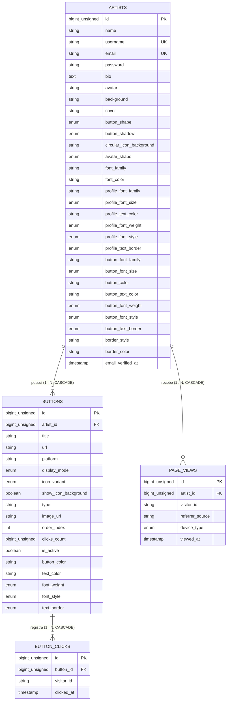

# Contratos de API, DTOs e Esquema de Dados (`context/api_contracts.md`)

> **Catálogo Oficial de Contratos de API, DTOs, Mocks e Esquema do Banco**  
> **Status:** Oficial e Ativo  
> **Alinhamento:** [`context/rules.md`](rules.md), [`backend.md`](../backend.md), [`context/tasks_integration_backend_frontend.md`](tasks_integration_backend_frontend.md)  
> **Padrão de Redação:** ASD-STE100

Este documento reúne todos os contratos de endpoints REST, estruturas de DTO, comportamentos de mock e modelagem de banco de dados do **Assin.art v1**. Consulte este documento antes de criar ou modificar chamadas em `src/services/api/`.

---

## 1. Padrões Gerais da API

- **Base URL:** `/api/v1` (produção e desenvolvimento).
- **Formato de Dados:** JSON no corpo de requisições e respostas (`application/json`).
- **Autenticação:** Header HTTP `Authorization: Bearer <token>`.
- **Formato Padrão de Resposta com Sucesso:**
  ```json
  {
    "status": "success",
    "data": {}
  }
  ```
- **Formato Padrão de Resposta de Erro de Validação (422):**
  ```json
  {
    "message": "Os dados fornecidos são inválidos.",
    "errors": {
      "campo": ["Descrição da falha de validação."]
    }
  }
  ```

---

## 2. Autenticação e Conta (`/api/v1/auth`)

### 2.1 Registro de Artista (`POST /api/v1/auth/register`)
- **Acesso:** Público.
- **Corpo da Requisição:**
  ```json
  {
    "name": "Maria Silva",
    "username": "nomedeusuario",
    "email": "artista@exemplo.com",
    "password": "senhaSegura123",
    "agreeTerms": true
  }
  ```
- **Resposta de Sucesso (201 Created):**
  ```json
  {
    "status": "success",
    "data": {
      "user": {
        "id": 1,
        "name": "Maria Silva",
        "username": "nomedeusuario",
        "email": "artista@exemplo.com"
      },
      "token": "sanctum_token_string"
    }
  }
  ```
- **Campo `name`:** Nome artístico ou de exibição do artista. Obrigatório no formulário e persistido na tabela `ARTISTS`.
- **Respostas de Erro:** 422 Unprocessable Entity (username em uso, e-mail duplicado, senha curta ou nome vazio).

### 2.2 Login de Artista (`POST /api/v1/auth/login`)
- **Acesso:** Público.
- **Corpo da Requisição:**
  ```json
  {
    "email": "artista@exemplo.com",
    "password": "senhaSegura123"
  }
  ```
- **Resposta de Sucesso (200 OK):**
  ```json
  {
    "status": "success",
    "data": {
      "user": {
        "id": 1,
        "name": "Nome do Artista",
        "username": "nomedeusuario",
        "email": "artista@exemplo.com"
      },
      "token": "sanctum_token_string"
    }
  }
  ```
- **Respostas de Erro:** 401 Unauthorized (credenciais inválidas), 429 Too Many Requests (proteção contra força bruta).

### 2.3 Perfil Autenticado (`GET /api/v1/auth/me`)
- **Acesso:** Bearer Token.
- **Resposta de Sucesso (200 OK):** Retorna o objeto `user` do artista logado.
- **Respostas de Erro:** 401 Unauthorized (token ausente ou expirado).

### 2.4 Logout (`POST /api/v1/auth/logout`)
- **Acesso:** Bearer Token.
- **Resposta de Sucesso (200 OK):** `{ "status": "success", "message": "Logout realizado com sucesso." }`.

### 2.5 Exclusão de Conta (`POST /api/v1/auth/account/delete`)
- **Acesso:** Bearer Token.
- **Corpo da Requisição:**
  ```json
  {
    "password": "senhaAtualDoArtista"
  }
  ```
- **Resposta de Sucesso (200 OK):** `{ "status": "success", "message": "Conta excluída permanentemente." }`.
- **Respostas de Erro:** 422 Unprocessable Entity (senha incorreta), 401 Unauthorized.
- **Nota Arquitetural:** O endpoint opera via método `POST` para evitar que proxies e CDNs descartem o payload com a senha.

---

## 3. Verificação de Username (`/api/v1/usernames`)

### 3.1 Checagem de Disponibilidade (`GET /api/v1/usernames/check?username={user}`)
- **Acesso:** Público.
- **Parâmetros de URL:** `username` (texto sem `@`).
- **Resposta de Sucesso (200 OK):**
  ```json
  {
    "available": true,
    "username": "nomedeusuario"
  }
  ```
- **Resposta Quando Ocupado ou Reservado (200 OK):**
  ```json
  {
    "available": false,
    "username": "admin",
    "reason": "Nome de usuário reservado ou já utilizado."
  }
  ```

---

## 4. Perfil do Artista e Tema Visual (`/api/v1/profile`)

### 4.1 Obter Perfil Completo (`GET /api/v1/profile`)
- **Acesso:** Bearer Token.
- **Resposta de Sucesso (200 OK):**
  ```json
  {
    "id": 1,
    "name": "Nome de Exibição",
    "username": "nomedeusuario",
    "email": "artista@exemplo.com",
    "bio": "Biografia curta do artista visual.",
    "avatar_url": "https://cdn.assin.art/avatars/1.webp",
    "cover_url": "https://cdn.assin.art/covers/1.webp",
    "background_color": "#FFFFFF",
    "background_id": "clean_grid",
    "button_shape": "square",
    "button_shadow": "hard_small",
    "circular_icon_background": "auto",
    "avatar_shape": "circle",
    "font_family": "Space Grotesk",
    "font_color": "#000000",
    "profile_font_family": "Space Grotesk",
    "profile_font_size": "md",
    "profile_text_color": "#000000",
    "profile_font_weight": "normal",
    "profile_font_style": "normal",
    "profile_text_border": "none",
    "button_font_family": "Space Grotesk",
    "button_font_size": "md",
    "button_color": "#FFE600",
    "button_text_color": "#000000",
    "button_font_weight": "normal",
    "button_font_style": "normal",
    "button_text_border": "none",
    "border_style": "solid-3px",
    "border_color": "#000000"
  }
  ```

### 4.2 Atualizar Perfil e Tema (`PATCH /api/v1/profile`)
- **Acesso:** Bearer Token.
- **Corpo da Requisição:** Campos opcionais correspondentes aos atributos de perfil, referências polimórficas de mídia (`avatar`, `background`, `cover`) e estilo visual / tipografia.
- **Resposta de Sucesso (200 OK):** Retorna envelope `{ status: "success", data: ArtistUser }` com o perfil atualizado.
- **Respostas de Erro:** 422 Unprocessable Entity (username em uso, enum inválido ou palavras reservadas).

---

## 5. Mídia e Uploads (`/api/v1/profile/avatar`, `/cover` e `/background`)

Endpoints simétricos para upload (`multipart/form-data`) e exclusão de mídia (`DELETE`), garantindo o expurgo de arquivos antigos no disco e atualização das referências polimórficas.

### 5.1 Upload de Avatar (`POST /api/v1/profile/avatar`)
- **Acesso:** Bearer Token.
- **Formato:** `multipart/form-data` contendo campo `avatar` (arquivo de imagem).
- **Resposta de Sucesso (200 OK):**
  ```json
  {
    "status": "success",
    "message": "Avatar atualizado com sucesso.",
    "avatar_url": "https://cdn.assin.art/avatars/1.webp",
    "media": {
      "type": "upload",
      "value": "https://cdn.assin.art/avatars/1.webp",
      "url": "https://cdn.assin.art/avatars/1.webp"
    }
  }
  ```

### 5.2 Excluir Avatar (`DELETE /api/v1/profile/avatar`)
- **Acesso:** Bearer Token.
- **Resposta de Sucesso (200 OK):** Reverte o avatar para `preset:avatar_01`.

### 5.3 Upload de Capa (`POST /api/v1/profile/cover`)
- **Acesso:** Bearer Token.
- **Formato:** `multipart/form-data` contendo campo `cover`.
- **Resposta de Sucesso (200 OK):**
  ```json
  {
    "status": "success",
    "message": "Capa atualizada com sucesso.",
    "cover_url": "https://cdn.assin.art/covers/1.webp",
    "media": {
      "type": "upload",
      "value": "https://cdn.assin.art/covers/1.webp",
      "url": "https://cdn.assin.art/covers/1.webp"
    }
  }
  ```

### 5.4 Excluir Imagem de Capa (`DELETE /api/v1/profile/cover`)
- **Acesso:** Bearer Token.
- **Resposta de Sucesso (200 OK):** Redefine a capa para `null`.

### 5.5 Upload de Plano de Fundo (`POST /api/v1/profile/background`)
- **Acesso:** Bearer Token.
- **Formato:** `multipart/form-data` contendo campo `background`.
- **Resposta de Sucesso (200 OK):** Retorna `ResolvedMediaDto` do novo fundo.

### 5.6 Excluir Imagem de Fundo (`DELETE /api/v1/profile/background`)
- **Acesso:** Bearer Token.
- **Resposta de Sucesso (200 OK):** Reverte o fundo para cor sólida padrão `#FFFFFF`.

---

## 6. Gestão de Botões e Links (`/api/v1/buttons`)

### 6.1 Listar Botões do Artista (`GET /api/v1/buttons`)
- **Acesso:** Bearer Token.
- **Resposta de Sucesso (200 OK):**
  ```json
  [
    {
      "id": 10,
      "artist_id": 1,
      "title": "Instagram",
      "url": "https://instagram.com/usuario",
      "platform": "instagram",
      "display_mode": "button",
      "icon_variant": "default",
      "show_icon_background": true,
      "type": "standard",
      "order_index": 0,
      "clicks_count": 45,
      "is_active": true,
      "button_color": "#FFE600",
      "text_color": "#000000",
      "font_weight": "normal",
      "font_style": "normal",
      "text_border": "none"
    }
  ]
  ```

> **Catálogo de Plataformas Suportadas (`platform`):**
> Suporta `instagram`, `behance`, `youtube`, `canva`, `readymag`, `tiktok`, `whatsapp`, `spotify`, `github`, `pinterest`, `linkedin`, `twitter`, `vimeo`, `artstation`, `dribbble`, `twitch` e `custom`.
> O título segue as regras automáticas `LNK-01` a `LNK-05`. Caso o artista informe um título customizado explicitamente, este tem soberania permanente (`LNK-05`) e o backend/mock não deve sobrescrever.

### 6.2 Criar Novo Botão (`POST /api/v1/buttons`)
- **Acesso:** Bearer Token.
- **Corpo da Requisição:**
  ```json
  {
    "title": "Portfólio Behance",
    "url": "https://behance.net/usuario",
    "platform": "behance",
    "display_mode": "button",
    "icon_variant": "default",
    "show_icon_background": true,
    "type": "standard",
    "is_active": true,
    "button_color": "#FFE600",
    "text_color": "#000000",
    "font_weight": "normal",
    "font_style": "normal",
    "text_border": "none"
  }
  ```
- **Resposta de Sucesso (201 Created):** Retorna o objeto do botão criado.
- **Respostas de Erro:** 422 Unprocessable Entity (máximo de 10 botões atingido ou URL inválida).

### 6.3 Atualizar Botão Existente (`PUT /api/v1/buttons/{id}`)
- **Acesso:** Bearer Token.
- **Corpo da Requisição:** Campos opcionais (`title`, `url`, `is_active`, `display_mode`, `icon_variant`, `show_icon_background`, `button_color`, `text_color`, `font_weight`, `font_style`, `text_border`).
- **Resposta de Sucesso (200 OK):** Retorna o botão atualizado.

### 6.4 Excluir Botão (`DELETE /api/v1/buttons/{id}`)
- **Acesso:** Bearer Token.
- **Resposta de Sucesso (204 No Content).**

### 6.5 Reordenar Botões (`POST /api/v1/buttons/reorder`)
- **Acesso:** Bearer Token.
- **Corpo da Requisição:**
  ```json
  {
    "ordered_ids": [12, 10, 15]
  }
  ```
- **Resposta de Sucesso (200 OK):** `{ "status": "success", "message": "Ordem atualizada com sucesso." }`.

### 6.6 Limpar Todos os Botões (`DELETE /api/v1/buttons`)
- **Acesso:** Bearer Token.
- **Resposta de Sucesso (204 No Content):** Remove todos os links do artista logado.

---

## 7. Página Pública e Redirecionador (`/{username}` e `/r/{id}`)

### 7.1 Obter Perfil Público (`GET /{username}`)
- **Acesso:** Público.
- **Resposta de Sucesso (200 OK):**
  ```json
  {
    "name": "Nome do Artista",
    "username": "nomedeusuario",
    "bio": "Texto da biografia.",
    "avatar_url": "https://cdn.assin.art/avatars/1.webp",
    "cover_url": "https://cdn.assin.art/covers/1.webp",
    "background_color": "#FFFFFF",
    "background_id": "clean_grid",
    "button_shape": "square",
    "button_shadow": "hard_small",
    "font_family": "Space Grotesk",
    "font_color": "#000000",
    "profile_font_family": "Space Grotesk",
    "profile_font_size": "md",
    "profile_text_color": "#000000",
    "profile_font_weight": "normal",
    "profile_font_style": "normal",
    "profile_text_border": "none",
    "button_font_family": "Space Grotesk",
    "button_font_size": "md",
    "button_color": "#FFE600",
    "button_text_color": "#000000",
    "button_font_weight": "normal",
    "button_font_style": "normal",
    "button_text_border": "none",
    "circular_links": [],
    "button_links": []
  }
  ```
- **Respostas de Erro:** 404 Not Found (artista não cadastrado).

### 7.2 Redirecionamento e Contagem de Clique (`GET /r/{id}`)
- **Acesso:** Público.
- **Comportamento:** Incrementa atomicamente o contador `clicks_count` do botão e retorna resposta HTTP `302 Found` com cabeçalho `Location: {url_original}`.

---

## 8. Métricas e Telemetria (`/api/v1/metrics` e `/api/v1/track`)

### 8.1 Sumário Consolidado de Métricas (`GET /api/v1/metrics/summary?period={period}`)
- **Acesso:** Bearer Token.
- **Parâmetros de Query:** `period` (`7d` | `30d` | `90d` | `all`, padrão `30d`).
- **Resposta de Sucesso (200 OK):**
  ```json
  {
    "period": "30d",
    "range": { "from": "2026-10-01", "to": "2026-10-30" },
    "totals": {
      "views": 1200,
      "unique_visitors": 830,
      "clicks": 310
    },
    "series": [
      { "date": "2026-10-01", "views": 40, "unique_visitors": 31, "clicks": 12 }
    ],
    "links": [
      {
        "link_id": "10",
        "title": "Instagram",
        "platform": "instagram",
        "display_mode": "button",
        "clicks": 120
      }
    ],
    "referrers": [
      { "source": "instagram", "views": 600 }
    ],
    "devices": [
      { "device": "mobile", "views": 1100 }
    ],
    "peak": {
      "by_hour": [0, 0, 5, 20, 80],
      "by_weekday": [50, 60, 70, 80, 120, 150, 90]
    }
  }
  ```

### 8.2 Telemetria Pública de Navegação (`POST /api/v1/track`)
- **Acesso:** Público (`skipAuth: true`).
- **Corpo da Requisição (Dados Brutos):**
  - **Variante `pageview`:**
    ```json
    {
      "type": "pageview",
      "username": "nomedeusuario",
      "visitor_id": "uuid-v4-anonimo",
      "referrer": "https://instagram.com",
      "utm_source": "bio",
      "user_agent": "Mozilla/5.0..."
    }
    ```
  - **Variante `click`:**
    ```json
    {
      "type": "click",
      "username": "nomedeusuario",
      "visitor_id": "uuid-v4-anonimo",
      "link_id": "10"
    }
    ```
- **Resposta de Sucesso (204 No Content).**
- **Persistência e Atribuição:**
  - Eventos `pageview` registram ocorrência na tabela `PAGE_VIEWS`.
  - Eventos `click` registram ocorrência na tabela `BUTTON_CLICKS` e incrementam atomicamente `BUTTONS.clicks_count`.
  - O redirecionador `/r/{id}` também persiste em `BUTTON_CLICKS` e incrementa o contador. O frontend não deve emitir `POST /track` duplicado ao navegar via `/r/{id}`.
- **Observação Crítica:** O frontend envia apenas dados brutos sem classificar. O backend classifica dispositivo e origem do tráfego.

---

## 9. Esquema Consolidado do Banco de Dados (4 Tabelas)



---

## 10. Notas e Regras das Tabelas Analíticas

1. **Tabela `PAGE_VIEWS`:**
   - `referrer_source`: Enum (`ReferrerSource`: `instagram`, `tiktok`, `whatsapp`, `google`, `youtube`, `facebook`, `x`, `direct`, `other`).
   - `device_type`: Enum (`DeviceType`: `mobile`, `desktop`, `tablet`).
   - O backend extrai `referrer_source` e `device_type` a partir dos cabeçalhos e payload bruto (`referrer`, `user_agent`), garantindo isolamento de responsabilidade (Regra 2).
   - **Índices recomendados:** `(artist_id, viewed_at)` para filtro por período (`7d`, `30d`, `90d`) e `(artist_id, visitor_id)` para agregação de visitantes únicos.

2. **Tabela `BUTTON_CLICKS`:**
   - Registra cliques individuais com carimbo de data/hora (`timestamp clicked_at`).
   - **Índices recomendados:** `(button_id, clicked_at)`.
   - Permite relacionar o clique ao modo de exibição (`BUTTONS.display_mode`) para gerar a análise comparativa (`DisplayModeComparison`: botão tradicional vs circular/ícone).

3. **Mapeamento para o DTO de Métricas (`MetricsSummaryDto`):**
   - `totals.views` = `COUNT(PAGE_VIEWS.id)`.
   - `totals.unique_visitors` = `COUNT(DISTINCT PAGE_VIEWS.visitor_id)`.
   - `totals.clicks` = `COUNT(BUTTON_CLICKS.id)` (ou soma de `BUTTONS.clicks_count`).
   - `series[]` = agrupamento por `DATE(viewed_at)` e `DATE(clicked_at)`.
   - `peak.by_hour` = histograma agrupado por `PAGE_VIEWS.hour_of_day` (0 a 23).
   - `peak.by_weekday` = histograma agrupado por `PAGE_VIEWS.day_of_week` (0 a 6).
   - `referrers[]` = agrupamento por `PAGE_VIEWS.referrer_source`.
   - `devices[]` = agrupamento por `PAGE_VIEWS.device_type`.

---

## 11. Regras e Validações de Tipografia e Formatação (Passo 6 — Fontes)

1. **Campos Tipográficos do Perfil (`ARTISTS`):**
   - `profile_font_family`: Família tipográfica do perfil (padrão `'Space Grotesk'`).
   - `profile_font_size`: Enum (`'sm'`, `'md'`, `'lg'`, padrão `'md'`).
   - `profile_text_color`: Cor hexadecimal dos textos do perfil (padrão `'#121316'`).
   - `profile_font_weight`: Enum (`'normal'`, `'bold'`, padrão `'normal'`).
   - `profile_font_style`: Enum (`'normal'`, `'italic'`, padrão `'normal'`).
   - `profile_text_border`: Enum (`'none'`, `'black'`, `'white'`, `'yellow'`, padrão `'none'`).

2. **Campos Tipográficos dos Botões em Nível de Perfil (`ARTISTS`):**
   - `button_font_family`: Família tipográfica global dos botões (padrão `'Space Grotesk'`).
   - `button_font_size`: Enum (`'sm'`, `'md'`, `'lg'`, padrão `'md'`).
   - `button_font_weight`: Enum (`'normal'`, `'bold'`, padrão `'normal'`).
   - `button_font_style`: Enum (`'normal'`, `'italic'`, padrão `'normal'`).
   - `button_text_border`: Enum (`'none'`, `'black'`, `'white'`, `'yellow'`, padrão `'none'`).

3. **Sobrescrita Individual por Botão (`BUTTONS`):**
   - Os campos `font_weight`, `font_style` e `text_border` na tabela `BUTTONS` são anuláveis (`nullable`).
   - Quando `null`, o botão herda automaticamente a configuração global correspondente de `ARTISTS`.
   - Quando definidos (`'bold'`, `'italic'`, `'black'`, etc.), o valor do botão tem soberania sobre o tema global.
