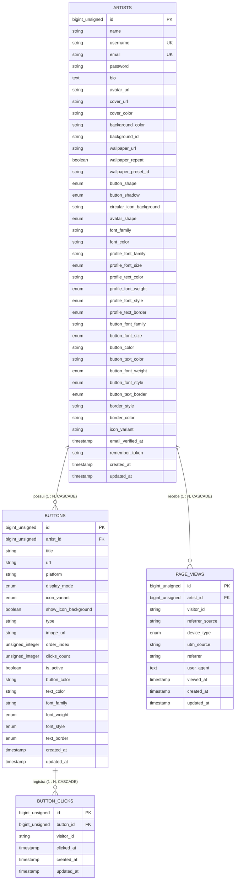

# Dicionário de Dados — Assin.art v1 (Backend Laravel 11)

> **Documento:** Especificação Técnica de Banco de Dados  
> **Versão:** 2.0 (Consolidada com Contratos de API)  
> **SGBD de Desenvolvimento:** SQLite (`database/database.sqlite`)  
> **SGBD de Produção:** MySQL 8+ / PostgreSQL (Agnóstico via Eloquent ORM)  
> **Arquitetura:** 4 Tabelas Relacionais (`artists`, `buttons`, `page_views`, `button_clicks`) com Herança Visual Neo-Brutalista.

---

## 1. Visão Geral Relacional (4 Tabelas)

---

## 2. Tabela `artists`

Armazena as credenciais de acesso, dados de perfil e configurações visuais globais da página neo-brutalista.

- **Nome no Banco:** `artists`
- **Model Eloquent:** `App\Models\Artist`
- **Chave Primária:** `id` (`BIGINT UNSIGNED AUTO_INCREMENT`)
- **Rota Pública Associada:** `GET /{username}`

| Coluna | Tipo SQL | Nulo? | Padrão | Descrição Funcional |
|---|---|:---:|---|---|
| `id` | `BIGINT UNSIGNED` | Não | *Auto Increment* | Identificador único do artista. |
| `name` | `VARCHAR(100)` | Não | — | Nome real ou artístico exibido no perfil. |
| `username` | `VARCHAR(50)` | Não | — | Identificador público único na URL. |
| `email` | `VARCHAR(255)` | Não | — | E-mail para login e recuperação de senha. |
| `password` | `VARCHAR(255)` | Não | — | Hash da senha de acesso (Bcrypt / Argon2id). |
| `bio` | `VARCHAR(500)` | Sim | `NULL` | Biografia do artista abaixo do avatar. |
| `avatar_url` | `VARCHAR(2048)` | Sim | `NULL` | URL do arquivo de avatar no storage. |
| `cover_url` | `VARCHAR(2048)` | Sim | `NULL` | URL do banner de capa no topo. |
| `cover_color` | `VARCHAR(20)` | Sim | `NULL` | Cor sólida de destaque para capa sem imagem. |
| `background_color` | `VARCHAR(20)` | Não | `'#FFFFFF'` | Cor hexadecimal de fundo da página. |
| `background_id` | `VARCHAR(50)` | Sim | `NULL` | ID do preset de textura ou padrão geométrico. |
| `wallpaper_url` | `VARCHAR(2048)` | Sim | `NULL` | URL de imagem de papel de parede em mosaico. |
| `wallpaper_repeat` | `BOOLEAN` | Não | `false` | Se verdadeiro, repete em mosaico (tiling). |
| `wallpaper_preset_id` | `VARCHAR(50)` | Sim | `NULL` | ID de preset de wallpaper selecionado. |
| `button_shape` | `ENUM` | Não | `'square'` | Formato dos botões (`square`, `rounded`, `pill`). |
| `button_shadow` | `ENUM` | Não | `'hard_small'` | Estilo de sombra neo-brutalista. |
| `circular_icon_background` | `VARCHAR(20)` | Não | `'auto'` | Fundo de ícones circulares (`auto` ou `#hex`). |
| `avatar_shape` | `ENUM` | Não | `'circle'` | Formato da moldura do avatar. |
| `font_family` | `VARCHAR(50)` | Não | `'Space Grotesk'` | Fonte global herdada. |
| `font_color` | `VARCHAR(20)` | Não | `'#000000'` | Cor textual padrão. |
| `profile_font_family` | `VARCHAR(50)` | Não | `'Space Grotesk'` | Família tipográfica do perfil. |
| `profile_font_size` | `ENUM` | Não | `'md'` | Tamanho da fonte do perfil (`sm`, `md`, `lg`). |
| `profile_text_color` | `VARCHAR(20)` | Não | `'#000000'` | Cor do texto do perfil em hexadecimal. |
| `profile_font_weight` | `ENUM` | Não | `'normal'` | Peso da fonte do perfil (`normal`, `bold`). |
| `profile_font_style` | `ENUM` | Não | `'normal'` | Estilo da fonte do perfil (`normal`, `italic`). |
| `profile_text_border` | `ENUM` | Não | `'none'` | Contorno do texto do perfil (`none`, `black`, `white`, `yellow`). |
| `button_font_family` | `VARCHAR(50)` | Não | `'Space Grotesk'` | Família tipográfica global dos botões. |
| `button_font_size` | `ENUM` | Não | `'md'` | Tamanho global dos botões (`sm`, `md`, `lg`). |
| `button_color` | `VARCHAR(20)` | Não | `'#FFE600'` | Cor de fundo padrão dos botões. |
| `button_text_color` | `VARCHAR(20)` | Não | `'#000000'` | Cor de texto padrão dos botões. |
| `button_font_weight` | `ENUM` | Não | `'normal'` | Peso padrão dos botões (`normal`, `bold`). |
| `button_font_style` | `ENUM` | Não | `'normal'` | Estilo padrão dos botões (`normal`, `italic`). |
| `button_text_border` | `ENUM` | Não | `'none'` | Contorno de texto padrão dos botões. |
| `border_style` | `VARCHAR(30)` | Não | `'solid-3px'` | Espessura de borda neo-brutalista. |
| `border_color` | `VARCHAR(20)` | Não | `'#000000'` | Cor das bordas neo-brutalistas. |
| `icon_variant` | `VARCHAR(30)` | Não | `'default'` | Variante de ícones sociais. |
| `email_verified_at` | `TIMESTAMP` | Sim | `NULL` | Carimbo de verificação de e-mail. |
| `remember_token` | `VARCHAR(100)` | Sim | `NULL` | Token de persistência de sessão. |
| `created_at` / `updated_at` | `TIMESTAMP` | Sim | `CURRENT_TIMESTAMP` | Carimbos de criação e atualização. |

---

## 3. Tabela `buttons`

Armazena os links, redes sociais, contadores de cliques e personalizações individuais de cada botão.

- **Nome no Banco:** `buttons`
- **Model Eloquent:** `App\Models\Button`
- **Chave Primária:** `id` (`BIGINT UNSIGNED AUTO_INCREMENT`)
- **Chave Estrangeira:** `artist_id` references `artists(id)` ON DELETE CASCADE

| Coluna | Tipo SQL | Nulo? | Padrão | Descrição Funcional |
|---|---|:---:|---|---|
| `id` | `BIGINT UNSIGNED` | Não | *Auto Increment* | Identificador único do botão (cast para inteiro). |
| `artist_id` | `BIGINT UNSIGNED` | Não | — | Chave estrangeira do artista proprietário. |
| `title` | `VARCHAR(100)` | Não | — | Rótulo do botão ou nome da rede. |
| `url` | `VARCHAR(2048)` | Não | — | URL de destino do link. |
| `platform` | `VARCHAR(50)` | Não | `'custom'` | Identificador da plataforma ou `'custom'`. |
| `display_mode` | `ENUM` | Não | `'button'` | Modo de exibição: `'button'` (card) ou `'circular'` (ícone). |
| `icon_variant` | `ENUM` | Não | `'default'` | Variante do ícone (`default`, `black`, `white`, `none`). |
| `show_icon_background` | `BOOLEAN` | Não | `true` | Exibição de fundo do ícone em modo circular. |
| `type` | `VARCHAR(50)` | Não | `'standard'` | Tipo: `'standard'`, `'featured'`, `'icon_pill'`, `'card_featured'`. |
| `image_url` | `VARCHAR(2048)` | Sim | `NULL` | Thumbnail para cards featured. |
| `order_index` | `UNSIGNED INT` | Não | `0` | Posição ordinal para reordenação drag & drop. |
| `clicks_count` | `UNSIGNED INT` | Não | `0` | Total acumulado de cliques no redirecionador. |
| `is_active` | `BOOLEAN` | Não | `true` | Visibilidade do link na página pública. |
| `button_color` | `VARCHAR(20)` | Sim | `NULL` | Sobrescrita individual da cor do botão. |
| `text_color` | `VARCHAR(20)` | Sim | `NULL` | Sobrescrita individual da cor do texto. |
| `font_family` | `VARCHAR(50)` | Sim | `NULL` | Sobrescrita individual da fonte. |
| `font_weight` | `ENUM` | Sim | `NULL` | Sobrescrita de peso (`normal`, `bold`). |
| `font_style` | `ENUM` | Sim | `NULL` | Sobrescrita de estilo (`normal`, `italic`). |
| `text_border` | `ENUM` | Sim | `NULL` | Sobrescrita de contorno de texto. |
| `created_at` / `updated_at` | `TIMESTAMP` | Sim | `CURRENT_TIMESTAMP` | Carimbos de auditoria. |

---

## 4. Tabela `page_views`

Registra acessos e pageviews do perfil público com dados para agregação de telemetria analítica.

- **Nome no Banco:** `page_views`
- **Model Eloquent:** `App\Models\PageView`
- **Chave Primária:** `id` (`BIGINT UNSIGNED AUTO_INCREMENT`)
- **Chave Estrangeira:** `artist_id` references `artists(id)` ON DELETE CASCADE

| Coluna | Tipo SQL | Nulo? | Padrão | Descrição Funcional |
|---|---|:---:|---|---|
| `id` | `BIGINT UNSIGNED` | Não | *Auto Increment* | Identificador único do evento. |
| `artist_id` | `BIGINT UNSIGNED` | Não | — | Chave estrangeira do perfil visitado. |
| `visitor_id` | `VARCHAR(64)` | Não | — | UUID anônimo do visitante gerado no client. |
| `referrer_source` | `VARCHAR(50)` | Não | `'direct'` | Origem do tráfego (`instagram`, `tiktok`, `google`, etc.). |
| `device_type` | `VARCHAR(20)` | Não | `'desktop'` | Tipo de dispositivo (`mobile`, `desktop`, `tablet`). |
| `utm_source` | `VARCHAR(100)` | Sim | `NULL` | Parâmetro UTM de campanha quando informado. |
| `referrer` | `VARCHAR(2048)` | Sim | `NULL` | URL completa do cabeçalho referer. |
| `user_agent` | `TEXT` | Sim | `NULL` | User Agent do navegador do visitante. |
| `viewed_at` | `TIMESTAMP` | Não | `CURRENT_TIMESTAMP` | Carimbo de data/hora da visualização. |
| `created_at` / `updated_at` | `TIMESTAMP` | Sim | `CURRENT_TIMESTAMP` | Carimbos de auditoria. |

---

## 5. Tabela `button_clicks`

Registra cliques pontuais de cada link para detalhamento e séries temporais.

- **Nome no Banco:** `button_clicks`
- **Model Eloquent:** `App\Models\ButtonClick`
- **Chave Primária:** `id` (`BIGINT UNSIGNED AUTO_INCREMENT`)
- **Chave Estrangeira:** `button_id` references `buttons(id)` ON DELETE CASCADE

| Coluna | Tipo SQL | Nulo? | Padrão | Descrição Funcional |
|---|---|:---:|---|---|
| `id` | `BIGINT UNSIGNED` | Não | *Auto Increment* | Identificador único do clique. |
| `button_id` | `BIGINT UNSIGNED` | Não | — | Chave estrangeira do botão clicado. |
| `visitor_id` | `VARCHAR(64)` | Sim | `NULL` | UUID anônimo do visitante quando disponível. |
| `clicked_at` | `TIMESTAMP` | Não | `CURRENT_TIMESTAMP` | Carimbo de data/hora do clique. |
| `created_at` / `updated_at` | `TIMESTAMP` | Sim | `CURRENT_TIMESTAMP` | Carimbos de auditoria. |
