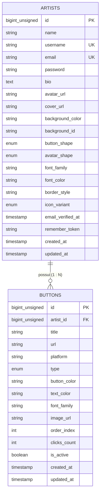

# Dicionário de Dados — Assin.art v1 (Backend Laravel 11)

> **Documento:** Especificação Técnica de Banco de Dados  
> **Versão:** 1.0 (Consolidada)  
> **SGBD de Desenvolvimento:** SQLite (`database/database.sqlite`)  
> **SGBD de Produção:** MySQL 8+ / PostgreSQL (Agnóstico via Eloquent ORM)  
> **Arquitetura:** 2 Tabelas integradas (`artists` e `buttons`) com Herança Visual Neo-Brutalista.

---

## 1. Visão Geral Relacional



---

## 2. Tabela `artists`

Armazena as credenciais de acesso, os dados de perfil público e todas as preferências visuais globais da página neo-brutalista do artista.

- **Nome no Banco:** `artists`
- **Model Eloquent:** `App\Models\Artist`
- **Chave Primária:** `id` (`BIGINT UNSIGNED AUTO_INCREMENT`)
- **Rota Pública Associada:** `GET assin.art/{username}`

| Coluna | Tipo SQL | Nulo? | Padrão (Default) | Restrições / Índices | Descrição Funcional | Exemplo Real |
|---|---|:---:|---|---|---|---|
| `id` | `BIGINT UNSIGNED` | Não | *Auto Increment* | `PRIMARY KEY` | Identificador único e imutável do artista no sistema. | `1` |
| `name` | `VARCHAR(100)` | Não | — | — | Nome real ou artístico exibido em destaque no topo do perfil. | `"Gabriel Pinho"` |
| `username` | `VARCHAR(50)` | Não | — | `UNIQUE`, `INDEX` | Identificador público na URL (`assin.art/{username}`). Permite alteração no painel. | `"pinhogo"` |
| `email` | `VARCHAR(255)` | Não | — | `UNIQUE` | E-mail corporativo/pessoal para login e recuperação de senha. | `"gabriel@assin.art"` |
| `password` | `VARCHAR(255)` | Não | — | — | Hash da senha de acesso (Bcrypt / Argon2id). | `"$2y$12$..."` |
| `bio` | `VARCHAR(500)` | Sim | `NULL` | — | Pequena biografia ou descrição artística abaixo do avatar. | `"Designer e ilustrador neo-brutalista em SP."` |
| `avatar_url` | `VARCHAR(2048)` | Sim | `NULL` | — | URL da imagem de perfil (armazenada em disco/S3). | `"/storage/avatars/pinho.webp"` |
| `cover_url` | `VARCHAR(2048)` | Sim | `NULL` | — | URL da imagem de capa/banner no topo da página. Se `NULL`, o fundo sólido prevalece. | `"/storage/covers/banner-art.webp"` |
| `background_color` | `VARCHAR(20)` | Não | `'#FFFFFF'` | — | Cor hexadecimal do plano de fundo da página pública. Suporta color picker e paleta. | `'#FFE600'` |
| `background_id` | `VARCHAR(50)` | Sim | `NULL` | — | Identificador do padrão geométrico/textura neo-brutalista ou gradiente pré-definido. | `'dots-grid'` |
| `button_shape` | `ENUM` | Não | `'square'` | `'square', 'rounded', 'pill'` | Formato global de todos os botões e cards da página do artista. | `'rounded'` |
| `avatar_shape` | `ENUM` | Não | `'circle'` | `'circle', 'square', 'rounded'` | Formato de corte da moldura do avatar do artista. | `'square'` |
| `font_family` | `VARCHAR(50)` | Não | `'Space Grotesk'` | — | Tipografia global dos títulos e textos da página pública. | `'Space Grotesk'` |
| `font_color` | `VARCHAR(20)` | Não | `'#000000'` | — | Cor padrão das fontes textuais da página em hexadecimal. | `'#121212'` |
| `border_style` | `VARCHAR(30)` | Não | `'solid-3px'` | — | Espessura e estilo das bordas neo-brutalistas (`solid-3px`, `solid-4px`, `none`). | `'solid-3px'` |
| `icon_variant` | `ENUM` | Não | `'default'` | `'default', 'black_outline', 'white_outline', 'none'` | Estilo visual dos ícones de redes sociais dos botões. | `'black_outline'` |
| `email_verified_at` | `TIMESTAMP` | Sim | `NULL` | — | Data e hora em que o artista confirmou a titularidade do e-mail. | `2026-10-20 22:30:00` |
| `remember_token` | `VARCHAR(100)` | Sim | `NULL` | — | Token para persistência da sessão "Lembrar de mim" no Laravel Auth. | `"tXk9...8zQ"` |
| `created_at` | `TIMESTAMP` | Sim | `CURRENT_TIMESTAMP` | — | Data e hora de criação do cadastro no sistema. | `2026-10-20 20:00:00` |
| `updated_at` | `TIMESTAMP` | Sim | `CURRENT_TIMESTAMP` | — | Data e hora da última alteração de dados cadastrais ou visuais. | `2026-10-20 22:15:00` |

---

## 3. Tabela `buttons`

Armazena os links, redes sociais, contadores de métricas e estilizações individuais de cada botão pertencente ao artista.

- **Nome no Banco:** `buttons`
- **Model Eloquent:** `App\Models\Button`
- **Chave Primária:** `id` (`BIGINT UNSIGNED AUTO_INCREMENT`)
- **Chave Estrangeira:** `artist_id` apontando para `artists.id` com `ON DELETE CASCADE`
- **Rota de Redirecionamento/Clique:** `GET assin.art/r/{id}`

| Coluna | Tipo SQL | Nulo? | Padrão (Default) | Restrições / Índices | Descrição Funcional | Exemplo Real |
|---|---|:---:|---|---|---|---|
| `id` | `BIGINT UNSIGNED` | Não | *Auto Increment* | `PRIMARY KEY` | Identificador único do botão/link. | `1` |
| `artist_id` | `BIGINT UNSIGNED` | Não | — | `FK (artists.id)`, `INDEX` | ID do artista proprietário deste botão. | `1` |
| `title` | `VARCHAR(100)` | Não | — | — | Texto/rótulo principal exibido no botão. | `"Ouvir no Spotify"` |
| `url` | `VARCHAR(2048)` | Não | — | — | Link de destino final (para onde o visitante será redirecionado). | `"https://open.spotify.com/artist/..."` |
| `platform` | `VARCHAR(50)` | Sim | `'custom'` | — | Identificador da plataforma social para carregar o ícone SVG correspondente. | `'spotify'` |
| `type` | `ENUM` | Não | `'standard'` | `'standard', 'icon_pill', 'card_featured'` | Tipo estrutural: botão comum em largura total, pílula compacta de ícone ou card com thumbnail. | `'card_featured'` |
| `button_color` | `VARCHAR(20)` | Sim | `NULL` | — | Cor de fundo específica deste botão. **Se `NULL`, herda a cor padrão da página**. | `'#1DB954'` |
| `text_color` | `VARCHAR(20)` | Sim | `NULL` | — | Cor do texto do botão. **Se `NULL`, herda `artists.font_color`**. | `'#FFFFFF'` |
| `font_family` | `VARCHAR(50)` | Sim | `NULL` | — | Fonte tipográfica individual deste botão. **Se `NULL`, herda `artists.font_family`**. | `'Syne'` |
| `image_url` | `VARCHAR(2048)` | Sim | `NULL` | — | Imagem de capa / thumbnail para botões do tipo `card_featured`. | `"/storage/cards/single-cover.webp"` |
| `order_index` | `INT UNSIGNED` | Não | `0` | `INDEX (artist_id, order_index)` | Posição ordinal na lista para ordenação por Drag & Drop no painel. | `1` |
| `clicks_count` | `INT UNSIGNED` | Não | `0` | — | Quantidade total de cliques computados pela rota de redirect `/r/{id}`. | `342` |
| `is_active` | `BOOLEAN` | Não | `TRUE` | `INDEX` | Define se o botão está visível no perfil público ou temporariamente ocultado. | `true` |
| `created_at` | `TIMESTAMP` | Sim | `CURRENT_TIMESTAMP` | — | Data e hora de inclusão do botão. | `2026-10-20 21:00:00` |
| `updated_at` | `TIMESTAMP` | Sim | `CURRENT_TIMESTAMP` | — | Data e hora da última alteração de conteúdo ou ordem. | `2026-10-20 22:10:00` |

---

## 4. Matriz de Herança Visual (Fallback Cascade)

O sistema adota o padrão de **Herança Inteligente com Fallback**. O frontend e o backend resolvem os estilos da seguinte forma:

```text
Botão Renderizado:
├── Fonte:       buttons.font_family ?? artists.font_family ?? 'Space Grotesk'
├── Cor Texto:   buttons.text_color  ?? artists.font_color  ?? '#000000'
├── Cor Fundo:   buttons.button_color ?? (tema da página / '#FFE600')
├── Formato:     artists.button_shape (uniforme em toda a página: square | rounded | pill)
├── Borda:       artists.border_style (uniforme em toda a página: solid-3px)
└── Ícone:       SVG da plataforma (renderizado segundo artists.icon_variant)
```

---

## 5. Regras de Integridade e Índices do Banco

1. **Exclusão em Cascata (`ON DELETE CASCADE`):**
   Ao remover um registro em `artists`, todos os seus `buttons` relacionados são excluídos automaticamente pelo SGBD.
2. **Índice Composto de Ordenação:**
   `CREATE INDEX idx_buttons_artist_order ON buttons (artist_id, order_index ASC);`
   Garante busca instantânea dos botões de um perfil já ordenados na consulta pública.
3. **Imutabilidade e Segurança:**
   - O `username` pode ser alterado livremente pelo artista sem risco de corrupção de dados, pois todas as relações usam a chave técnica numérica `artists.id`.
