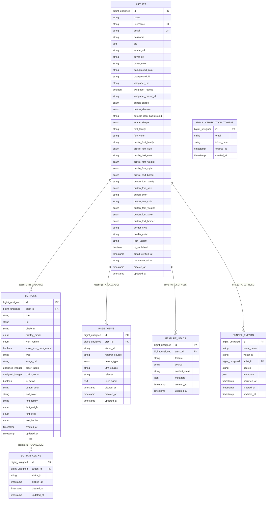

# Dicionário de Dados — Assin.art v1 (Backend Laravel 11)

> **Documento:** Especificação Técnica de Banco de Dados  
> **Versão:** 2.0 (Consolidada com Contratos de API)  
> **SGBD de Desenvolvimento:** SQLite (`database/database.sqlite`)  
> **SGBD de Produção:** MySQL 8+ / PostgreSQL (Agnóstico via Eloquent ORM)  
> **Arquitetura:** 4 Tabelas Relacionais (`artists`, `buttons`, `page_views`, `button_clicks`) com Herança Visual Neo-Brutalista.

---

## 1. Visão Geral Relacional (4 Tabelas)

---

## 2. Tabela `artists`

Armazena as credenciais de acesso, dados de perfil e configurações visuais globais da página neo-brutalista.

- **Nome no Banco:** `artists`
- **Model Eloquent:** `App\Models\Artist`
- **Chave Primária:** `id` (`BIGINT UNSIGNED AUTO_INCREMENT`)
- **Rota Pública Associada:** `GET /{username}`

| Coluna | Tipo SQL | Nulo? | Padrão | Descrição Funcional |
|---|---|:---:|---|---|
| `id` | `BIGINT UNSIGNED` | Não | *Auto Increment* | Identificador único do artista. |
| `name` | `VARCHAR(100)` | Não | — | Nome real ou artístico exibido no perfil. |
| `username` | `VARCHAR(50)` | Não | — | Identificador público único na URL. |
| `email` | `VARCHAR(255)` | Não | — | E-mail para login e recuperação de senha. |
| `password` | `VARCHAR(255)` | Não | — | Hash da senha de acesso (Bcrypt / Argon2id). |
| `bio` | `VARCHAR(500)` | Sim | `NULL` | Biografia do artista abaixo do avatar. |
| `avatar_url` | `VARCHAR(2048)` | Sim | `NULL` | URL do arquivo de avatar no storage. |
| `cover_url` | `VARCHAR(2048)` | Sim | `NULL` | URL do banner de capa no topo. |
| `cover_color` | `VARCHAR(20)` | Sim | `NULL` | Cor sólida de destaque para capa sem imagem. |
| `background_color` | `VARCHAR(20)` | Não | `'#FFFFFF'` | Cor hexadecimal de fundo da página. |
| `background_id` | `VARCHAR(50)` | Sim | `NULL` | ID do preset de textura ou padrão geométrico. |
| `wallpaper_url` | `VARCHAR(2048)` | Sim | `NULL` | URL de imagem de papel de parede em mosaico. |
| `wallpaper_repeat` | `BOOLEAN` | Não | `false` | Se verdadeiro, repete em mosaico (tiling). |
| `wallpaper_preset_id` | `VARCHAR(50)` | Sim | `NULL` | ID de preset de wallpaper selecionado. |
| `button_shape` | `ENUM` | Não | `'square'` | Formato dos botões (`square`, `rounded`, `pill`). |
| `button_shadow` | `ENUM` | Não | `'hard_small'` | Estilo de sombra neo-brutalista. |
| `circular_icon_background` | `VARCHAR(20)` | Não | `'auto'` | Fundo de ícones circulares (`auto` ou `#hex`). |
| `avatar_shape` | `ENUM` | Não | `'circle'` | Formato da moldura do avatar. |
| `font_family` | `VARCHAR(50)` | Não | `'Space Grotesk'` | Fonte global herdada. |
| `font_color` | `VARCHAR(20)` | Não | `'#000000'` | Cor textual padrão. |
| `profile_font_family` | `VARCHAR(50)` | Não | `'Space Grotesk'` | Família tipográfica do perfil. |
| `profile_font_size` | `ENUM` | Não | `'md'` | Tamanho da fonte do perfil (`sm`, `md`, `lg`). |
| `profile_text_color` | `VARCHAR(20)` | Não | `'#000000'` | Cor do texto do perfil em hexadecimal. |
| `profile_font_weight` | `ENUM` | Não | `'normal'` | Peso da fonte do perfil (`normal`, `bold`). |
| `profile_font_style` | `ENUM` | Não | `'normal'` | Estilo da fonte do perfil (`normal`, `italic`). |
| `profile_text_border` | `ENUM` | Não | `'none'` | Contorno do texto do perfil (`none`, `black`, `white`, `yellow`). |
| `button_font_family` | `VARCHAR(50)` | Não | `'Space Grotesk'` | Família tipográfica global dos botões. |
| `button_font_size` | `ENUM` | Não | `'md'` | Tamanho global dos botões (`sm`, `md`, `lg`). |
| `button_color` | `VARCHAR(20)` | Não | `'#FFE600'` | Cor de fundo padrão dos botões. |
| `button_text_color` | `VARCHAR(20)` | Não | `'#000000'` | Cor de texto padrão dos botões. |
| `button_font_weight` | `ENUM` | Não | `'normal'` | Peso padrão dos botões (`normal`, `bold`). |
| `button_font_style` | `ENUM` | Não | `'normal'` | Estilo padrão dos botões (`normal`, `italic`). |
| `button_text_border` | `ENUM` | Não | `'none'` | Contorno de texto padrão dos botões. |
| `border_style` | `VARCHAR(30)` | Não | `'solid-3px'` | Espessura de borda neo-brutalista. |
| `border_color` | `VARCHAR(20)` | Não | `'#000000'` | Cor das bordas neo-brutalistas. |
| `icon_variant` | `VARCHAR(30)` | Não | `'default'` | Variante de ícones sociais. |
| `is_published` | `BOOLEAN` | Não | `true` | Define visibilidade pública em `GET /{username}` (`true` para contas existentes; `false` no cadastro inicial). |
| `email_verified_at` | `TIMESTAMP` | Sim | `NULL` | Carimbo de verificação de e-mail. |
| `remember_token` | `VARCHAR(100)` | Sim | `NULL` | Token de persistência de sessão. |
| `created_at` / `updated_at` | `TIMESTAMP` | Sim | `CURRENT_TIMESTAMP` | Carimbos de criação e atualização. |

---

## 3. Tabela `buttons`

Armazena os links, redes sociais, contadores de cliques e personalizações individuais de cada botão.

- **Nome no Banco:** `buttons`
- **Model Eloquent:** `App\Models\Button`
- **Chave Primária:** `id` (`BIGINT UNSIGNED AUTO_INCREMENT`)
- **Chave Estrangeira:** `artist_id` references `artists(id)` ON DELETE CASCADE

| Coluna | Tipo SQL | Nulo? | Padrão | Descrição Funcional |
|---|---|:---:|---|---|
| `id` | `BIGINT UNSIGNED` | Não | *Auto Increment* | Identificador único do botão (cast para inteiro). |
| `artist_id` | `BIGINT UNSIGNED` | Não | — | Chave estrangeira do artista proprietário. |
| `title` | `VARCHAR(100)` | Não | — | Rótulo do botão ou nome da rede. |
| `url` | `VARCHAR(2048)` | Não | — | URL de destino do link. |
| `platform` | `VARCHAR(50)` | Não | `'custom'` | Identificador da plataforma ou `'custom'`. |
| `display_mode` | `ENUM` | Não | `'button'` | Modo de exibição: `'button'` (card) ou `'circular'` (ícone). |
| `icon_variant` | `ENUM` | Não | `'default'` | Variante do ícone (`default`, `black`, `white`, `none`). |
| `show_icon_background` | `BOOLEAN` | Não | `true` | Exibição de fundo do ícone em modo circular. |
| `type` | `VARCHAR(50)` | Não | `'standard'` | Tipo: `'standard'`, `'featured'`, `'icon_pill'`, `'card_featured'`. |
| `image_url` | `VARCHAR(2048)` | Sim | `NULL` | Thumbnail para cards featured. |
| `order_index` | `UNSIGNED INT` | Não | `0` | Posição ordinal para reordenação drag & drop. |
| `clicks_count` | `UNSIGNED INT` | Não | `0` | Total acumulado de cliques no redirecionador. |
| `is_active` | `BOOLEAN` | Não | `true` | Visibilidade do link na página pública. |
| `button_color` | `VARCHAR(20)` | Sim | `NULL` | Sobrescrita individual da cor do botão. |
| `text_color` | `VARCHAR(20)` | Sim | `NULL` | Sobrescrita individual da cor do texto. |
| `font_family` | `VARCHAR(50)` | Sim | `NULL` | Sobrescrita individual da fonte. |
| `font_weight` | `ENUM` | Sim | `NULL` | Sobrescrita de peso (`normal`, `bold`). |
| `font_style` | `ENUM` | Sim | `NULL` | Sobrescrita de estilo (`normal`, `italic`). |
| `text_border` | `ENUM` | Sim | `NULL` | Sobrescrita de contorno de texto. |
| `created_at` / `updated_at` | `TIMESTAMP` | Sim | `CURRENT_TIMESTAMP` | Carimbos de auditoria. |

---

## 4. Tabela `page_views`

Registra acessos e pageviews do perfil público com dados para agregação de telemetria analítica.

- **Nome no Banco:** `page_views`
- **Model Eloquent:** `App\Models\PageView`
- **Chave Primária:** `id` (`BIGINT UNSIGNED AUTO_INCREMENT`)
- **Chave Estrangeira:** `artist_id` references `artists(id)` ON DELETE CASCADE

| Coluna | Tipo SQL | Nulo? | Padrão | Descrição Funcional |
|---|---|:---:|---|---|
| `id` | `BIGINT UNSIGNED` | Não | *Auto Increment* | Identificador único do evento. |
| `artist_id` | `BIGINT UNSIGNED` | Não | — | Chave estrangeira do perfil visitado. |
| `visitor_id` | `VARCHAR(64)` | Não | — | UUID anônimo do visitante gerado no client. |
| `referrer_source` | `VARCHAR(50)` | Não | `'direct'` | Origem do tráfego (`instagram`, `tiktok`, `google`, etc.). |
| `device_type` | `VARCHAR(20)` | Não | `'desktop'` | Tipo de dispositivo (`mobile`, `desktop`, `tablet`). |
| `utm_source` | `VARCHAR(100)` | Sim | `NULL` | Parâmetro UTM de campanha quando informado. |
| `referrer` | `VARCHAR(2048)` | Sim | `NULL` | URL completa do cabeçalho referer. |
| `user_agent` | `TEXT` | Sim | `NULL` | User Agent do navegador do visitante. |
| `viewed_at` | `TIMESTAMP` | Não | `CURRENT_TIMESTAMP` | Carimbo de data/hora da visualização. |
| `created_at` / `updated_at` | `TIMESTAMP` | Sim | `CURRENT_TIMESTAMP` | Carimbos de auditoria. |

---

## 5. Tabela `button_clicks`

Registra cliques pontuais de cada link para detalhamento e séries temporais.

- **Nome no Banco:** `button_clicks`
- **Model Eloquent:** `App\Models\ButtonClick`
- **Chave Primária:** `id` (`BIGINT UNSIGNED AUTO_INCREMENT`)
- **Chave Estrangeira:** `button_id` references `buttons(id)` ON DELETE CASCADE

| Coluna | Tipo SQL | Nulo? | Padrão | Descrição Funcional |
|---|---|:---:|---|---|
| `id` | `BIGINT UNSIGNED` | Não | *Auto Increment* | Identificador único do clique. |
| `button_id` | `BIGINT UNSIGNED` | Não | — | Chave estrangeira do botão clicado. |
| `visitor_id` | `VARCHAR(64)` | Sim | `NULL` | UUID anônimo do visitante quando disponível. |
| `clicked_at` | `TIMESTAMP` | Não | `CURRENT_TIMESTAMP` | Carimbo de data/hora do clique. |
| `created_at` / `updated_at` | `TIMESTAMP` | Sim | `CURRENT_TIMESTAMP` | Carimbos de auditoria. |

---

## 6. Configuração do Banco de Dados por Ambiente

Esta seção descreve como a aplicação usa o banco de dados em cada ambiente.

### 6.1 Isolamento do SQLite

- O SQLite é o banco padrão (`DB_CONNECTION=sqlite`) somente para desenvolvimento local e testes.
- Os testes automatizados usam `DB_DATABASE=:memory:` (definido em `phpunit.xml`).
- NÃO use o SQLite em produção.
- Em produção, defina `DB_CONNECTION=pgsql` ou `DB_CONNECTION=mysql`.

### 6.2 TLS para Azure Database for PostgreSQL e MySQL

A conexão com o banco de produção DEVE usar TLS.

| Variável | Conexão | Descrição |
|---|---|---|
| `DB_SSLMODE` | `pgsql` | Modo TLS. Use `require`. Padrão: `prefer`. |
| `DB_SSLROOTCERT` | `pgsql` | Caminho do certificado raiz (CA). Use com `verify-full`. |
| `MYSQL_ATTR_SSL_CA` | `mysql`, `mariadb` | Caminho do certificado CA. |
| `MYSQL_ATTR_SSL_VERIFY_SERVER_CERT` | `mysql`, `mariadb` | Verifica o certificado do servidor. Padrão: `true`. |

- O valor `false` em `MYSQL_ATTR_SSL_VERIFY_SERVER_CERT` é mantido. A configuração remove somente valores `null` e vazios.
- O endpoint `GET /up` abre uma conexão com o banco. Se a conexão falhar, o endpoint não retorna `200`.
- O proxy do Azure é confiável (`trustProxies(at: '*')`).

### 6.3 Tabelas de infraestrutura de fila

A migration `0001_01_01_000004_create_jobs_table.php` cria três tabelas. Use `QUEUE_CONNECTION=database` somente após executar esta migration.

| Tabela | Função |
|---|---|
| `jobs` | Guarda os jobs pendentes da fila (`queue`, `payload`, `attempts`, `reserved_at`, `available_at`, `created_at`). |
| `job_batches` | Guarda o estado dos lotes de jobs (`total_jobs`, `pending_jobs`, `failed_jobs`, `cancelled_at`, `finished_at`). |
| `failed_jobs` | Guarda os jobs que falharam (`uuid` único, `connection`, `queue`, `payload`, `exception`, `failed_at`). |

---

## 7. Tabela `email_verification_tokens`

Armazena hashes SHA-256 de tokens de uso único e expiração temporária para confirmação de e-mail dos artistas.

- **Nome no Banco:** `email_verification_tokens`
- **Migration:** `database/migrations/2026_11_16_000001_create_email_verification_tokens_table.php`
- **Chave Primária:** `id` (`BIGINT UNSIGNED AUTO_INCREMENT`)

| Coluna | Tipo SQL | Nulo? | Padrão | Descrição Funcional |
|---|---|:---:|---|---|
| `id` | `BIGINT UNSIGNED` | Não | *Auto Increment* | Identificador único do registro de verificação. |
| `email` | `VARCHAR(255)` | Não | — | E-mail normalizado do artista (indexado). |
| `token_hash` | `VARCHAR(64)` | Não | — | Hash SHA-256 em hexadecimal do token enviado por e-mail. |
| `expires_at` | `TIMESTAMP` | Não | — | Data e hora limite para uso do token (`+24h`). |
| `created_at` | `TIMESTAMP` | Sim | `NULL` | Carimbo de criação do token. |

---

## 8. Tabela `feature_leads`

Armazena leads de interesse em novas funcionalidades enviados por visitantes anônimos ou artistas autenticados.

- **Nome no Banco:** `feature_leads`
- **Model Eloquent:** `App\Models\FeatureLead`
- **Migration:** `database/migrations/2026_11_20_000001_create_feature_leads_table.php`
- **Chave Primária:** `id` (`BIGINT UNSIGNED AUTO_INCREMENT`)
- **Chave Estrangeira:** `artist_id` referencia `artists(id)` com `ON DELETE SET NULL`
- **Índices:** `(feature, source)`, `(artist_id, feature)` e `(created_at)`

| Coluna | Tipo SQL | Nulo? | Padrão | Descrição Funcional |
|---|---|:---:|---|---|
| `id` | `BIGINT UNSIGNED` | Não | *Auto Increment* | Identificador único do lead. |
| `artist_id` | `BIGINT UNSIGNED` | Sim | `NULL` | Identificador do artista autenticado quando disponível. |
| `feature` | `VARCHAR(50)` | Não | `'vitrine'` | Funcionalidade solicitada (`vitrine` ou `assistente`). |
| `source` | `VARCHAR(50)` | Não | — | Ponto de captura (`home_hero`, `home_footer`, `home_waitlist` ou `editor_banner`). |
| `contact_value` | `VARCHAR(255)` | Sim | `NULL` | E-mail ou `@handle` normalizado em minúsculas. |
| `metadata` | `JSON` | Sim | `NULL` | Metadados de interesse (como `selling_type` e `selling_types`). |
| `created_at` / `updated_at` | `TIMESTAMP` | Sim | `CURRENT_TIMESTAMP` | Carimbos de criação e atualização. |

---

## 9. Tabela `funnel_events`

Armazena eventos de funil da landing page e do editor para o relatório de KPIs de validação.

- **Nome no Banco:** `funnel_events`
- **Model Eloquent:** `App\Models\FunnelEvent`
- **Migration:** `database/migrations/2026_11_20_000002_create_funnel_events_table.php`
- **Chave Primária:** `id` (`BIGINT UNSIGNED AUTO_INCREMENT`)
- **Chave Estrangeira:** `artist_id` referencia `artists(id)` com `ON DELETE SET NULL`
- **Índices:** `(event_name, occurred_at)` e `(event_name, visitor_id)`

| Coluna | Tipo SQL | Nulo? | Padrão | Descrição Funcional |
|---|---|:---:|---|---|
| `id` | `BIGINT UNSIGNED` | Não | *Auto Increment* | Identificador único do evento de funil. |
| `event_name` | `VARCHAR(80)` | Não | — | Nome do evento (`home_pageview`, `home_waitlist_vitrine_submitted`, `editor_session` ou `editor_vitrine_cta_clicked`). |
| `visitor_id` | `VARCHAR(64)` | Não | — | Identificador do visitante anônimo ou IP truncado. |
| `artist_id` | `BIGINT UNSIGNED` | Sim | `NULL` | Identificador do artista autenticado quando disponível. |
| `source` | `VARCHAR(50)` | Sim | `NULL` | Origem opcional informada no evento. |
| `metadata` | `JSON` | Sim | `NULL` | Dados adicionais opcionais do evento. |
| `occurred_at` | `TIMESTAMP` | Não | `CURRENT_TIMESTAMP` | Data e hora da ocorrência do evento. |
| `created_at` / `updated_at` | `TIMESTAMP` | Sim | `CURRENT_TIMESTAMP` | Carimbos de criação e atualização. |
