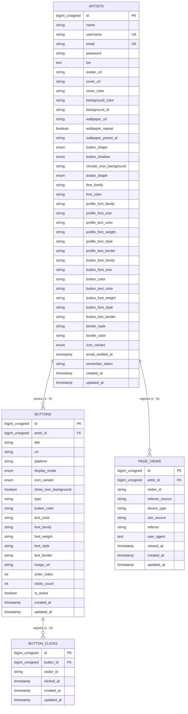

# Dicionário de Dados — Assin.art v1 (Backend Laravel 11)

> **Documento:** Especificação Técnica de Banco de Dados  
> **Versão:** 1.1 (Atualizada com Tipografia Avançada, Estilos Visuais e Telemetria de Métricas)  
> **SGBD de Desenvolvimento:** SQLite (`database/database.sqlite`)  
> **SGBD de Produção:** MySQL 8+ / PostgreSQL (Agnóstico via Eloquent ORM)  
> **Arquitetura:** 4 Entidades principais (`artists`, `buttons`, `page_views`, `button_clicks`) com Herança Visual Neo-Brutalista e Telemetria em Tempo Real.

---

## 1. Visão Geral Relacional



---

## 2. Tabela `artists`

Armazena as credenciais de acesso, dados do perfil público, parâmetros de identidade visual (avatar, capa, wallpapers/texturas) e as configurações de herança tipográfica e estilística da página neo-brutalista.

- **Nome no Banco:** `artists`
- **Model Eloquent:** `App\Models\Artist`
- **Chave Primária:** `id` (`BIGINT UNSIGNED AUTO_INCREMENT`)
- **Rota Pública Associada:** `GET assin.art/{username}`

| Coluna | Tipo SQL | Nulo? | Padrão (Default) | Restrições / Índices | Descrição Funcional | Exemplo Real |
|---|---|:---:|---|---|---|---|
| `id` | `BIGINT UNSIGNED` | Não | *Auto Increment* | `PRIMARY KEY` | Identificador único e imutável do artista no sistema. | `1` |
| `name` | `VARCHAR(100)` | Não | — | — | Nome real ou artístico exibido em destaque no topo do perfil. | `"Gabriel Pinho"` |
| `username` | `VARCHAR(50)` | Não | — | `UNIQUE`, `INDEX` | Identificador público na URL (`assin.art/{username}`). Permite alteração no painel. | `"pinhogo"` |
| `email` | `VARCHAR(255)` | Não | — | `UNIQUE`, `INDEX` | E-mail corporativo/pessoal para login e recuperação de senha. | `"gabriel@assin.art"` |
| `password` | `VARCHAR(255)` | Não | — | — | Hash da senha de acesso (Bcrypt / Argon2id). | `"$2y$12$..."` |
| `bio` | `VARCHAR(500)` | Sim | `NULL` | — | Pequena biografia ou descrição artística abaixo do avatar. | `"Designer e ilustrador neo-brutalista em SP."` |
| `avatar_url` | `VARCHAR(2048)` | Sim | `NULL` | — | URL da imagem de perfil (armazenada em disco/S3). | `"/storage/avatars/pinho.webp"` |
| `cover_url` | `VARCHAR(2048)` | Sim | `NULL` | — | URL da imagem de capa/banner no topo da página. Se `NULL`, avalia `cover_color`. | `"/storage/covers/banner-art.webp"` |
| `cover_color` | `VARCHAR(20)` | Sim | `NULL` | — | Cor hexadecimal sólida de fundo da capa quando não houver imagem uploaded. | `'#121212'` |
| `background_color` | `VARCHAR(20)` | Não | `'#FFFFFF'` | — | Cor hexadecimal do plano de fundo da página pública. | `'#FFE600'` |
| `background_id` | `VARCHAR(50)` | Sim | `NULL` | — | Identificador do padrão geométrico/textura neo-brutalista pré-definido. | `'dots-grid'` |
| `wallpaper_url` | `VARCHAR(2048)` | Sim | `NULL` | — | Imagem de fundo/wallpaper customizada enviada pelo artista. | `"/storage/wallpapers/pattern.webp"` |
| `wallpaper_repeat` | `BOOLEAN` | Não | `FALSE` | — | Se o wallpaper de fundo deve se repetir como padrão em ladrilho (`tiling pattern`). | `false` |
| `wallpaper_preset_id` | `VARCHAR(50)` | Sim | `NULL` | — | Identificador de preset de wallpaper temático selecionado. | `'checkered-flag'` |
| `button_shape` | `ENUM` | Não | `'square'` | `'square', 'rounded', 'pill'` | Formato global de corte dos botões e cards da página. | `'rounded'` |
| `button_shadow` | `ENUM` | Não | `'hard_small'` | `'none', 'hard_small', 'hard_large', 'soft', 'diffuse', 'elevated', 'colored'` | Efeito de sombra e elevação neo-brutalista global aplicada aos botões. | `'hard_small'` |
| `circular_icon_background` | `VARCHAR(20)` | Não | `'auto'` | — | Cor de fundo específica para botões em modo circular (`#hex` ou `'auto'`). | `'auto'` |
| `avatar_shape` | `ENUM` | Não | `'circle'` | `'circle', 'square', 'rounded'` | Formato de corte da moldura do avatar do artista. | `'square'` |
| `font_family` | `VARCHAR(50)` | Não | `'Space Grotesk'` | — | Família tipográfica global base / fallback da página pública. | `'Space Grotesk'` |
| `font_color` | `VARCHAR(20)` | Não | `'#000000'` | — | Cor hexadecimal padrão base das fontes textuais da página. | `'#000000'` |
| `profile_font_family` | `VARCHAR(50)` | Não | `'Space Grotesk'` | — | Família tipográfica aplicada especificamente aos textos do perfil (nome e bio). | `'Space Grotesk'` |
| `profile_font_size` | `VARCHAR(10)` | Não | `'md'` | `'sm', 'md', 'lg', 'xl'` | Escala de tamanho da tipografia do perfil. | `'md'` |
| `profile_text_color` | `VARCHAR(20)` | Não | `'#000000'` | — | Cor hexadecimal dos textos do perfil. | `'#000000'` |
| `profile_font_weight` | `VARCHAR(10)` | Não | `'normal'` | `'normal', 'bold', '500', '700'` | Peso da fonte aplicado aos textos do cabeçalho do perfil. | `'bold'` |
| `profile_font_style` | `VARCHAR(10)` | Não | `'normal'` | `'normal', 'italic'` | Estilo tipográfico dos textos do perfil. | `'normal'` |
| `profile_text_border` | `VARCHAR(10)` | Não | `'none'` | `'none', 'thin', 'thick'` | Efeito de contorno / stroke neo-brutalista no texto do perfil. | `'none'` |
| `button_font_family` | `VARCHAR(50)` | Sim | `NULL` | — | Família tipográfica padrão de todos os botões. Se `NULL`, herda `font_family`. | `'Syne'` |
| `button_font_size` | `VARCHAR(10)` | Não | `'md'` | `'sm', 'md', 'lg'` | Escala de tamanho padrão do texto dos botões. | `'md'` |
| `button_color` | `VARCHAR(20)` | Não | `'#FFE600'` | — | Cor hexadecimal padrão de preenchimento dos botões da página. | `'#FFE600'` |
| `button_text_color` | `VARCHAR(20)` | Não | `'#000000'` | — | Cor hexadecimal padrão do texto dos botões da página. | `'#000000'` |
| `button_font_weight` | `VARCHAR(10)` | Não | `'normal'` | `'normal', 'bold', '500', '700'` | Peso da fonte padrão global dos botões. | `'normal'` |
| `button_font_style` | `VARCHAR(10)` | Não | `'normal'` | `'normal', 'italic'` | Estilo tipográfico padrão global dos botões. | `'normal'` |
| `button_text_border` | `VARCHAR(10)` | Não | `'none'` | `'none', 'thin', 'thick'` | Efeito de contorno / stroke padrão global no texto dos botões. | `'none'` |
| `border_style` | `VARCHAR(30)` | Não | `'solid-3px'` | — | Espessura e traçado das bordas neo-brutalistas (`solid-3px`, `solid-4px`, `none`). | `'solid-3px'` |
| `border_color` | `VARCHAR(20)` | Não | `'#000000'` | — | Cor hexadecimal das bordas neo-brutalistas dos elementos da página. | `'#000000'` |
| `icon_variant` | `VARCHAR(30)` | Não | `'default'` | `'default', 'black', 'white', 'none'` | Variante visual padrão dos ícones nos botões. | `'default'` |
| `email_verified_at` | `TIMESTAMP` | Sim | `NULL` | — | Data e hora de confirmação de titularidade do e-mail. | `2026-10-20 22:30:00` |
| `remember_token` | `VARCHAR(100)` | Sim | `NULL` | — | Token para persistência de sessão autenticada "Lembrar de mim". | `"tXk9...8zQ"` |
| `created_at` | `TIMESTAMP` | Sim | `CURRENT_TIMESTAMP` | — | Data e hora de criação do cadastro no sistema. | `2026-10-20 20:00:00` |
| `updated_at` | `TIMESTAMP` | Sim | `CURRENT_TIMESTAMP` | — | Data e hora da última modificação do registro. | `2026-11-02 14:40:00` |

---

## 3. Tabela `buttons`

Armazena os links, redes sociais, modo de exibição, métricas consolidadas e customizações individuais de estilo de cada botão pertencente ao artista.

- **Nome no Banco:** `buttons`
- **Model Eloquent:** `App\Models\Button`
- **Chave Primária:** `id` (`BIGINT UNSIGNED AUTO_INCREMENT`)
- **Chave Estrangeira:** `artist_id` apontando para `artists.id` com `ON DELETE CASCADE`
- **Rota de Redirecionamento/Clique:** `GET assin.art/r/{id}` ou via telemetria `POST /api/v1/track`

| Coluna | Tipo SQL | Nulo? | Padrão (Default) | Restrições / Índices | Descrição Funcional | Exemplo Real |
|---|---|:---:|---|---|---|---|
| `id` | `BIGINT UNSIGNED` | Não | *Auto Increment* | `PRIMARY KEY` | Identificador único do botão/link. | `1` |
| `artist_id` | `BIGINT UNSIGNED` | Não | — | `FK (artists.id)`, `INDEX` | ID do artista proprietário deste botão. | `1` |
| `title` | `VARCHAR(100)` | Não | — | — | Texto/rótulo principal exibido no botão. | `"Ouvir no Spotify"` |
| `url` | `VARCHAR(2048)` | Não | — | — | Link de destino final (para onde o visitante será direcionado). | `"https://open.spotify.com/artist/..."` |
| `platform` | `VARCHAR(50)` | Não | `'custom'` | — | Identificador da plataforma social para carregar o ícone SVG correspondente. | `'spotify'` |
| `display_mode` | `ENUM` | Não | `'button'` | `'button', 'circular'`, `INDEX` | Modo de renderização: botão bloco em pilha (`button`) ou botão de ícone circular (`circular`). | `'button'` |
| `icon_variant` | `ENUM` | Não | `'default'` | `'default', 'black', 'white', 'none'` | Variante visual específica do ícone neste botão. | `'default'` |
| `show_icon_background` | `BOOLEAN` | Não | `TRUE` | — | Define se o ícone do botão deve ter fundo contrastante ou ser transparente. | `true` |
| `type` | `VARCHAR(50)` | Não | `'standard'` | `'standard', 'icon_pill', 'card_featured'` | Tipo estrutural: botão comum, pílula de ícone ou card com thumbnail. | `'card_featured'` |
| `button_color` | `VARCHAR(20)` | Sim | `NULL` | — | Cor de fundo específica deste botão. Se `NULL`, herda `artists.button_color`. | `'#1DB954'` |
| `text_color` | `VARCHAR(20)` | Sim | `NULL` | — | Cor do texto do botão. Se `NULL`, herda `artists.button_text_color`. | `'#FFFFFF'` |
| `font_family` | `VARCHAR(50)` | Sim | `NULL` | — | Família tipográfica deste botão. Se `NULL`, herda `artists.button_font_family`. | `'Syne'` |
| `font_weight` | `VARCHAR(10)` | Sim | `NULL` | — | Peso da fonte específico deste botão. Se `NULL`, herda `artists.button_font_weight`. | `'bold'` |
| `font_style` | `VARCHAR(10)` | Sim | `NULL` | — | Estilo tipográfico deste botão (`'normal'`, `'italic'`). Se `NULL`, herda `artists.button_font_style`. | `'italic'` |
| `text_border` | `VARCHAR(10)` | Sim | `NULL` | — | Contorno / stroke no texto do botão (`'none'`, `'thin'`, `'thick'`). Se `NULL`, herda `artists.button_text_border`. | `'thin'` |
| `image_url` | `VARCHAR(2048)` | Sim | `NULL` | — | Imagem de capa / thumbnail para botões do tipo `card_featured`. | `"/storage/cards/single-cover.webp"` |
| `order_index` | `INT UNSIGNED` | Não | `0` | `INDEX (artist_id, order_index)` | Posição ordinal na lista para ordenação por Drag & Drop no painel. | `1` |
| `clicks_count` | `INT UNSIGNED` | Não | `0` | — | Contador consolidado total de cliques (atualizado em tempo real para leitura rápida). | `342` |
| `is_active` | `BOOLEAN` | Não | `TRUE` | `INDEX (artist_id, is_active)` | Define se o botão está visível no perfil público ou temporariamente desativado. | `true` |
| `created_at` | `TIMESTAMP` | Sim | `CURRENT_TIMESTAMP` | — | Data e hora de inclusão do botão. | `2026-10-20 21:00:00` |
| `updated_at` | `TIMESTAMP` | Sim | `CURRENT_TIMESTAMP` | — | Data e hora da última alteração de conteúdo, estilo ou ordem. | `2026-11-02 14:40:00` |

---

## 4. Tabela `page_views`

Armazena os eventos granulares de visualização de página na URL pública do artista, viabilizando telemetria em tempo real, contagem de visitantes únicos, identificação de dispositivos e fontes de tráfego / campanhas UTM.

- **Nome no Banco:** `page_views`
- **Model Eloquent:** `App\Models\PageView`
- **Chave Primária:** `id` (`BIGINT UNSIGNED AUTO_INCREMENT`)
- **Chave Estrangeira:** `artist_id` apontando para `artists.id` com `ON DELETE CASCADE`
- **Rotas Associadas:**
  - Ingestão pública: `POST /api/v1/track` (com payload `{ type: "pageview", artist_id, ... }`)
  - Painel de métricas: `GET /api/v1/metrics/summary` (consolidado temporal por 7d, 30d, 90d ou período customizado)

| Coluna | Tipo SQL | Nulo? | Padrão (Default) | Restrições / Índices | Descrição Funcional | Exemplo Real |
|---|---|:---:|---|---|---|---|
| `id` | `BIGINT UNSIGNED` | Não | *Auto Increment* | `PRIMARY KEY` | Identificador único do registro de visualização. | `1024` |
| `artist_id` | `BIGINT UNSIGNED` | Não | — | `FK (artists.id)`, `INDEX (artist_id, viewed_at)`, `INDEX (artist_id, visitor_id)` | ID do artista cuja página pública foi acessada. | `1` |
| `visitor_id` | `VARCHAR(64)` | Não | — | `INDEX (artist_id, visitor_id)` | Identificador pseudo-anônimo do visitante gerado no client-side (UUID v4 / browser fingerprint). Permite deduplicação de visitantes únicos sem armazenar dados pessoais (LGPD/GDPR friendly). | `"e8f49b6b-4b2a-4f51-b8f2-892182b8c312"` |
| `referrer_source` | `VARCHAR(50)` | Não | `'direct'` | — | Canal de origem classificado da visita (`'direct'`, `'instagram'`, `'tiktok'`, `'twitter'`, `'youtube'`, `'facebook'`, `'search'`, `'other'`). | `'instagram'` |
| `device_type` | `VARCHAR(20)` | Não | `'desktop'` | — | Classificação do dispositivo obtida via User-Agent (`'mobile'`, `'desktop'`, `'tablet'`). | `'mobile'` |
| `utm_source` | `VARCHAR(100)` | Sim | `NULL` | — | Parâmetro de rastreamento de campanha `utm_source` capturado da query string. | `'bio_instagram'` |
| `referrer` | `VARCHAR(2048)` | Sim | `NULL` | — | URL de origem completa capturada do cabeçalho `Referer` ou `document.referrer`. | `"https://l.instagram.com/"` |
| `user_agent` | `TEXT` | Sim | `NULL` | — | Cabeçalho `User-Agent` HTTP original completo para auditoria e diagnósticos. | `"Mozilla/5.0 (iPhone; CPU iPhone OS 17_4)..."` |
| `viewed_at` | `TIMESTAMP` | Não | `CURRENT_TIMESTAMP` | `INDEX (artist_id, viewed_at)` | Carimbo de data/hora exato do acesso, indexado para consultas agregadas por período temporal. | `2026-11-02 14:15:30` |
| `created_at` | `TIMESTAMP` | Sim | `CURRENT_TIMESTAMP` | — | Timestamp de criação do registro no banco de dados. | `2026-11-02 14:15:30` |
| `updated_at` | `TIMESTAMP` | Sim | `CURRENT_TIMESTAMP` | — | Timestamp da última atualização do registro. | `2026-11-02 14:15:30` |

---

## 5. Tabela `button_clicks`

Armazena o registro de cada clique individual disparado em um botão/link, permitindo calcular séries temporais, CTR (Click-Through Rate), correlação com visitantes e distribuição de engajamento por link ao longo do tempo.

- **Nome no Banco:** `button_clicks`
- **Model Eloquent:** `App\Models\ButtonClick`
- **Chave Primária:** `id` (`BIGINT UNSIGNED AUTO_INCREMENT`)
- **Chave Estrangeira:** `button_id` apontando para `buttons.id` com `ON DELETE CASCADE`
- **Rotas Associadas:**
  - Telemetria no frontend: `POST /api/v1/track` (com payload `{ type: "click", button_id, ... }`)
  - Redirecionamento legado/direto: `GET assin.art/r/{id}` (dispara inserção assíncrona do clique e redireciona 302)

| Coluna | Tipo SQL | Nulo? | Padrão (Default) | Restrições / Índices | Descrição Funcional | Exemplo Real |
|---|---|:---:|---|---|---|---|
| `id` | `BIGINT UNSIGNED` | Não | *Auto Increment* | `PRIMARY KEY` | Identificador único do evento de clique. | `2048` |
| `button_id` | `BIGINT UNSIGNED` | Não | — | `FK (buttons.id)`, `INDEX (button_id, clicked_at)` | ID do botão que recebeu o clique. | `15` |
| `visitor_id` | `VARCHAR(64)` | Sim | `NULL` | — | Identificador anônimo do visitante que realizou o clique (permite cruzamento analítico com `page_views.visitor_id`). | `"e8f49b6b-4b2a-4f51-b8f2-892182b8c312"` |
| `clicked_at` | `TIMESTAMP` | Não | `CURRENT_TIMESTAMP` | `INDEX (button_id, clicked_at)` | Carimbo de data/hora do clique, indexado para geração rápida de gráficos cronológicos e CTR. | `2026-11-02 14:16:05` |
| `created_at` | `TIMESTAMP` | Sim | `CURRENT_TIMESTAMP` | — | Timestamp de criação do registro no banco de dados. | `2026-11-02 14:16:05` |
| `updated_at` | `TIMESTAMP` | Sim | `CURRENT_TIMESTAMP` | — | Timestamp de atualização do registro. | `2026-11-02 14:16:05` |

---

## 6. Matriz de Herança Visual e Resolução de Estilos (Fallback Cascade)

O ecossistema adota um pipeline de **Herança Inteligente Multinível com Fallback Gracioso**. O backend (via atributos virtuais acessores do Eloquent) e o frontend resolvem os estilos estéticos exatamente na seguinte precedência:

```text
Resolução Visual Neo-Brutalista:

1. Plano de Fundo da Página (Page Background):
   └── Imagem/Preset/Cor: artists.wallpaper_url (upload) ?? artists.background_id (preset) ?? artists.background_color ?? '#FFFFFF'
       └── Repetição:    artists.wallpaper_repeat (boolean: false = stretch/cover, true = repeat/pattern)

2. Capa / Banner do Topo (Header Cover):
   └── Imagem ou Cor:   artists.cover_url (upload) ?? artists.cover_color (hex) ?? null (fundo padrão transparente/página)

3. Tipografia do Perfil (Header / Nome & Bio):
   ├── Família:         artists.profile_font_family ?? artists.font_family ?? 'Space Grotesk'
   ├── Escala/Tamanho:  artists.profile_font_size ?? 'md' ('sm', 'md', 'lg', 'xl')
   ├── Cor do Texto:    artists.profile_text_color ?? artists.font_color ?? '#000000'
   ├── Peso:            artists.profile_font_weight ?? 'normal' ('normal', 'bold')
   ├── Estilo:          artists.profile_font_style ?? 'normal' ('normal', 'italic')
   └── Contorno:        artists.profile_text_border ?? 'none' ('none', 'thin', 'thick')

4. Botões e Links (Cascata com Fallback Triplo: Individual ➔ Global de Botões ➔ Tema da Página):
   ├── Família:         buttons.font_family ?? artists.button_font_family ?? artists.font_family ?? 'Space Grotesk'
   ├── Peso Tipográfico:buttons.font_weight ?? artists.button_font_weight ?? 'normal'
   ├── Estilo:          buttons.font_style ?? artists.button_font_style ?? 'normal'
   ├── Contorno Texto:  buttons.text_border ?? artists.button_text_border ?? 'none'
   ├── Escala/Tamanho:  artists.button_font_size ?? 'md'
   ├── Cor do Texto:    buttons.text_color ?? artists.button_text_color ?? artists.font_color ?? '#000000'
   ├── Cor de Fundo:    buttons.button_color ?? artists.button_color ?? '#FFE600'
   ├── Sombra:          artists.button_shadow ?? 'hard_small'
   ├── Formato:         artists.button_shape ('square' | 'rounded' | 'pill')
   ├── Borda:           artists.border_style ('solid-3px' | 'solid-4px' | 'none') & artists.border_color ('#hex')
   ├── Modo Exibição:   buttons.display_mode ('button' | 'circular')
   ├── Fundo do Ícone:  buttons.show_icon_background (boolean) & artists.circular_icon_background ('auto' | '#hex')
   └── Ícone:           buttons.icon_variant ?? artists.icon_variant ?? 'default'
```

---

## 7. Regras de Integridade, Índices e Performance

1. **Exclusão em Cascata Total (`ON DELETE CASCADE`):**
   - Ao deletar um registro em `artists`, todos os seus `buttons` e todos os seus `page_views` associados são excluídos imediatamente pelo SGBD.
   - Ao deletar um `button`, todos os seus registros históricos em `button_clicks` são automaticamente purgados.

2. **Estratégia de Índices Compostos para Alta Frequência:**
   - `buttons`:
     - `INDEX idx_buttons_artist_order (artist_id, order_index ASC)`: Garante ordenação instantânea na renderização pública do perfil.
     - `INDEX idx_buttons_artist_active (artist_id, is_active)`: Acelera filtros de botões públicos ativos.
     - `INDEX idx_buttons_artist_mode (artist_id, display_mode)`: Otimiza separação entre botões empilhados e botões circulares.
   - `page_views`:
     - `INDEX idx_page_views_artist_viewed (artist_id, viewed_at)`: Otimiza agregação temporal por períodos (7d, 30d, 90d).
     - `INDEX idx_page_views_artist_visitor (artist_id, visitor_id)`: Acelera o cálculo de visitantes únicos com `COUNT(DISTINCT visitor_id)`.
   - `button_clicks`:
     - `INDEX idx_button_clicks_button_clicked (button_id, clicked_at)`: Garante leitura ultra rápida de engajamento temporal por botão e cálculo de CTR.

3. **Arquitetura Híbrida de Métricas (Consolidado + Granular):**
   - O campo `buttons.clicks_count` mantém o somatório cumulativo total direto no registro do botão, permitindo leitura `O(1)` sem operações custosas de `COUNT(*)`.
   - A tabela `button_clicks` preserva os eventos individuais carimbados no tempo para gráficos de tendência, análises comparativas e auditoria de conversão.
